# Massive-STEPS 分析报告

**来源：** [Massive-STEPS](https://github.com/cruiseresearchgroup/Massive-STEPS) · [arXiv:2505.11239](https://arxiv.org/abs/2505.11239) · [HF collection](https://huggingface.co/collections/CRUISEResearchGroup/massive-steps-point-of-interest-check-in-dataset-682716f625d74c2569bc7a73)  
**评测城（研究/基线/地图）：** Tokyo · Melbourne · Beijing · Shanghai  
**证据：** **[cited]** 论文/README · **[measured]** 本机对 HF check-in CSV 计算

本目录为 Massive_POI 侧的精简交付：一份总报告 + 必要图与 CSV。

---

## 1. 数据集概览

### 1.1 定位与覆盖 [cited]

Massive-STEPS = 城市级、可复现的 **next-POI / semantic trajectory** 基准，主任务含监督推荐、零样本 LLM 推荐、以及轨迹末 check-in 是否落在周末的时空分类。

- **15 城 / 10 国**；STD 两段约 **24 个月**（2012–2013、2017–2018，非连续）
- 轨迹：同用户相邻 check-in 间隔 ≤ **δτ = 8h** 归入同一 trail
- 全库约：**80,299 users** · **950,809 trails** · **386,007 POIs**（城内独立编号）· **2,629,541 check-ins**
- 切分：**trail 级 7:1:2**，并对 `user_id` stratify（同用户可跨 train/test）

规模表：[`massive-steps-cited-city-table.csv`](massive-steps-cited-city-table.csv)

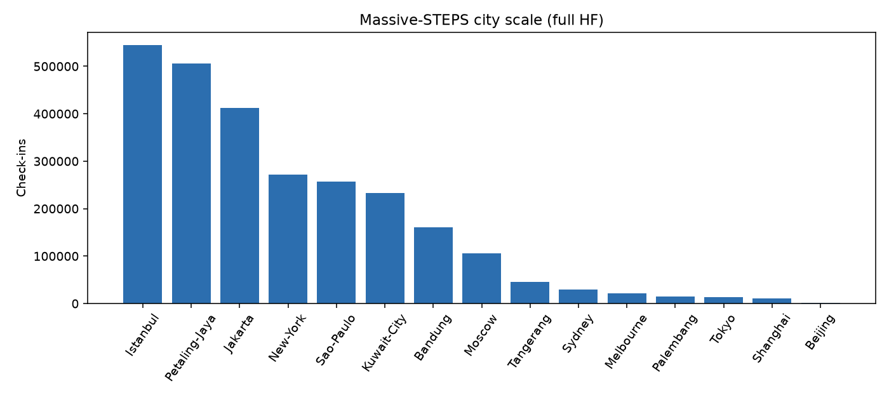

规模差异极大：Istanbul / Petaling Jaya / Jakarta 为百万级 check-in；Beijing / Shanghai / Tokyo 子集显著更小。

### 1.2 字段 [cited]

结构化主表（HF `{city}_checkins*.csv`）核心字段：

| 字段 | 含义 |
|------|------|
| `trail_id` / `user_id` / `venue_id` | 轨迹、用户、**城内** ordinal POI |
| `latitude` / `longitude` | venue 坐标；隐私缺失时为空 |
| `name` / `address` / `venue_category` | 语义元数据 |
| `venue_city_*` | 行政地名与中心坐标（**无 venue 坐标时的空间 fallback**） |
| `timestamp` | check-in 时间 |

论文将监督特征归纳为：**social · spatial · temporal · categorical**。`venue_id` **不可跨城**直接联合。

### 1.3 分布画像 [measured + cited]

**实测 10 城**（含上表四城 + Palembang / Sydney / Tangerang / Bandung / Moscow / New York）：[`massive-steps-measured-summary.csv`](massive-steps-measured-summary.csv)

| 现象 | 要点 |
|------|------|
| 极短轨迹 | μ_len ≈ 2.5–3.1；length≤3 约占 **77–89%** |
| 用户长尾 | users≤5 trails：Tokyo ~0.60，Beijing ~0.52 |
| POI 长尾 | once-only ~44–59%；top10% POI 可占半数以上 check-ins |
| 坐标缺失 | 论文约 **13.25%**；实测 Tokyo ~3% → Palembang/Tangerang ~28–30% |
| 年代偏斜 | Tokyo 几乎全是 2018；Bandung/Moscow/Beijing 几乎全是 2013 |

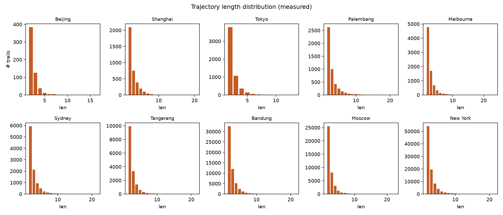

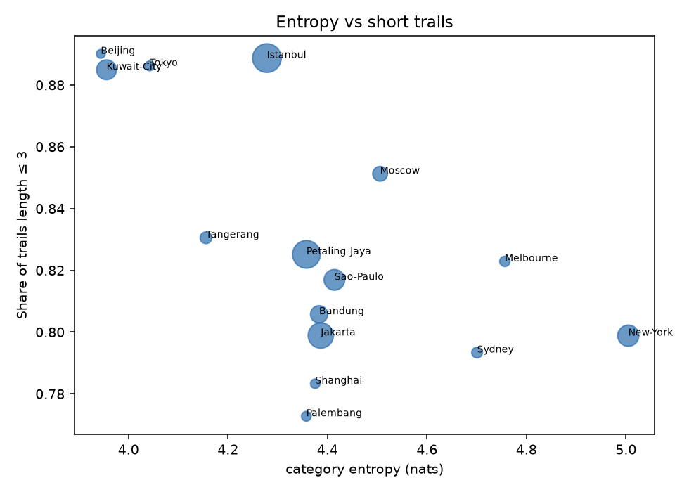

**复用注意：** 短上下文、大稀疏候选、缺失坐标 fallback、非全局 POI ID、非 user-disjoint 官方切分、动态 POI 过期风险。完整训练数据在 HF，不在 GitHub `data/`。

---

## 2. 研究角度（四城证据）

完整数值：[`data/research-evidence.csv`](data/research-evidence.csv)

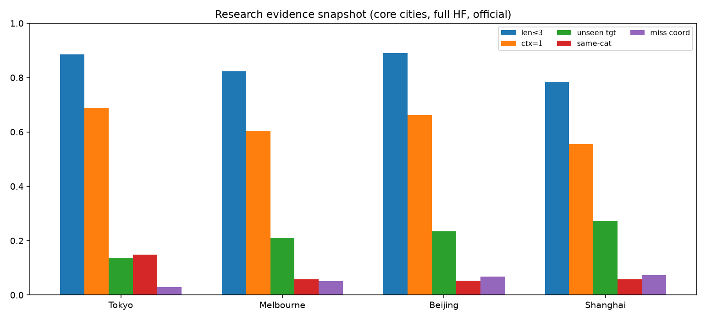

| 角度 | 实测要点 | 开放问题 |
|------|----------|----------|
| 短上下文 | test 中 ctx_len=1 约占 **55–69%** | 单步专用先验 vs 深序列模型；分层报长轨迹 |
| Cold-start | Markov Acc@1：cold≪warm（Beijing 0.11→0.31） | user-disjoint 下 SOTA 掉多少？跨城 meta |
| 未见目标 | test unseen target **13–27%** | 开放词表 / name·category·坐标生成式推荐 |
| 坐标缺失 | OD 边至少一端缺精确坐标 **5–14%**（本四城） | mask/分层；避免 admin centroid 伪邻近 |
| 2013↔2018 | Tokyo 无 2013；Mel/SH 类别 L1 漂移大 | period-conditioned 指标；开闭店 |
| 跨城 | 类别 Jaccard 0.30–0.65；ID 无重叠 | category+text+相对空间 zero-shot |
| 语义 vs 空间 | Nearest Acc@1≈0；Markov1 明显更强；同类别转移仅 ~5–15% | 先区域后语义两阶段 |
| Weekend 分类 | 偏斜城上 majority 已 ~0.68–0.70 | 必报相对 majority 的 **lift** |
| 个性化泄漏 | **UserMostPop** 官方 split 上四城 Acc@1 全胜简单基线 | 并行报 official / user-disjoint / time-based |

---

## 3. 廉价基线定义与结果

任务：给定上下文 \(c_1,\ldots,c_{L-1}\)，预测末站 `venue_id`；候选=全城 POI；报 Acc@1/5/10。缺失坐标用 `venue_city_*`。

### 3.1 定义摘要

| 模型 | 核心 |
|------|------|
| **MostPop** | 全局 venue 频次排序 |
| **UserMostPop** | 用户历史频次；不足回退 MostPop（user-disjoint 下 ≡ MostPop） |
| **Markov1** | 一阶 POI→POI 转移（看当前站）；不足回退 MostPop |
| **Nearest** | 相对当前站 Haversine 最近其他 POI |
| **CatMarkov** | 类别一阶转移 → 类内 MostPop 消歧 |
| **SameWeekdayMostPop** | 按 **target（末站）** weekday 桶频次；空桶回退 MostPop |
| **DayNightMostPop** | 按 **target hour** 的 Day/Night 二桶；空桶回退 MostPop |
| **SameHourBinMostPop** | `hour_bin = hour // 4`（6 个 4h 箱；对照） |
| **SameWeekdayHourMostPop** | `(weekday, hour_bin)` 联合桶 |

**预测时刻（强制）：** 一律用 **target POI 的 check-in timestamp**（轨迹末事件时间），**不用** trail 首 timestamp。official 上约 **32–37%** trails 的 target 与 first 落在不同 Day/Night 桶；weekday 不一致约 **3–19%**（见 [`data/event_time_meta.csv`](data/event_time_meta.csv)）——用 trail start 会系统性错桶。

**Day/Night 切分：** **Day = hour ∈ [7, 19)，Night = 其余**。取 7–19 以对齐典型日间活动 / 通勤窗，跨城季节稳定（不依赖日出日落）；敏感度上 6–18 与 7–19 Acc@1 接近，8–20 仅 Tokyo 抬升、Melbourne 更差。

### 3.2 官方 split 基线 [measured]

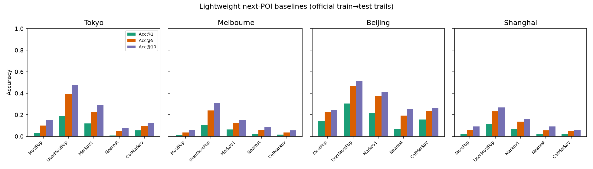

表：[`data/research-baselines.csv`](data/research-baselines.csv) · 对照论文：[`data/research-baselines-vs-paper.csv`](data/research-baselines-vs-paper.csv) · 分层：[`data/research-baseline-strata.csv`](data/research-baseline-strata.csv)

| city | UserMostPop | Markov1 | MostPop | Nearest | STHGCN [cited] |
|------|------------:|--------:|--------:|--------:|---------------:|
| Tokyo | **0.186** | 0.119 | 0.034 | ~0.01 | 0.250 |
| Melbourne | **0.106** | 0.065 | 0.011 | ~0.02 | 0.168 |
| Beijing | **0.304** | 0.217 | 0.139 | ~0.07 | 0.453 |
| Shanghai | **0.114** | 0.067 | 0.022 | ~0.02 | 0.193 |

读数：全局 MostPop 很弱；UserMostPop ≫ MostPop；Markov1 稳居第二；Nearest 接近失败；新方法务必带上 UserMostPop/Markov，而非只超 MostPop。

### 3.3 时间条件 MostPop [measured]

完整表：[`data/temporal_baselines.csv`](data/temporal_baselines.csv) · weekday/day-night：[`data/weekday_daynight_baselines.csv`](data/weekday_daynight_baselines.csv) · 图：[`figures/temporal_baselines_acc1.png`](figures/temporal_baselines_acc1.png)

**Official Acc@1（含 DayNight；对照 MostPop / SameHourBin）**

| city | MostPop | SameWeekday | DayNight | SameHourBin | SameWeekdayHour |
|------|--------:|------------:|---------:|------------:|----------------:|
| Tokyo | 0.034 | 0.040 | 0.034 | **0.048** | **0.051** |
| Melbourne | 0.011 | **0.013** | 0.010 | 0.011 | 0.010 |
| Beijing | 0.139 | 0.087 | 0.139 | **0.148** | 0.148 |
| Shanghai | 0.022 | 0.023 | 0.025 | **0.037** | 0.036 |

**Official Acc@5 / Acc@10（SameWeekday · DayNight）**

| city | SameWeekday @5/@10 | DayNight @5/@10 |
|------|-------------------:|----------------:|
| Tokyo | 0.103 / 0.149 | 0.106 / 0.157 |
| Melbourne | 0.039 / 0.063 | 0.041 / 0.067 |
| Beijing | 0.174 / 0.191 | 0.217 / 0.261 |
| Shanghai | 0.055 / 0.074 | 0.065 / 0.088 |

**User-disjoint Acc@1（摘要）**

| city | MostPop | SameWeekday | DayNight | SameHourBin | n_test |
|------|--------:|------------:|---------:|------------:|-------:|
| Tokyo | 0.038 | 0.038 | 0.038 | **0.064** | 1018 |
| Melbourne | 0.006 | 0.006 | 0.006 | **0.010** | 1414 |
| Beijing | 0.210 | 0.150 | 0.210 | **0.260** | 100 |
| Shanghai | 0.014 | **0.017** | 0.014 | 0.008 | 783 |

**结论：**  
1. **DayNight ≈ MostPop（Acc@1）**：二桶过粗，几乎不改 Top-1；@5/@10 有时略好于 MostPop（Tokyo/Beijing/Mel）。  
2. **SameWeekday** 相对 MostPop 仅小幅增益（Tokyo +0.6pp；Beijing 反而更差）。  
3. **SameHourBin（4h）仍是时间条件里最强的廉价桶**，显著优于 DayNight / weekday。  
4. 时间是弱全局先验；user-disjoint 下 SameHourBin 在 Tokyo/Beijing 抬升最明显。

### 3.4 Weekend 三项指标

论文任务：末次 check-in 是否周末（`dow ≥ 5`）。

| 术语 | 定义 |
|------|------|
| 周末 base rate | \(P(\text{末站在周末})\)，全城 trails |
| Majority Acc | 永远猜多数类（四城周末率&lt;0.5 → Acc = 1 − base rate） |
| 末POI类别规则 Acc | train 上学「末站类别 → 周末/工作日」，test 查表 |

重算：[`data/weekend_baselines.csv`](data/weekend_baselines.csv)

| city | base rate | Majority | 类别规则 |
|------|----------:|---------:|---------:|
| Tokyo | 0.444 | 0.556 | 0.565 |
| Melbourne | 0.324 | 0.676 | 0.657 |
| Beijing | 0.297 | 0.703 | 0.669 |
| Shanghai | 0.323 | 0.677 | 0.654 |

偏斜城上类别规则**打不赢** majority；应报 **lift**。

---

## 4. 切分稳定性 [measured]

三协议：**(a) official** HF 切分 · **(b) user-disjoint** 用户 80/20 · **(c) time-based** 按 trail 末时间最早 80% / 最晚 20%。

元数据：[`data/split_meta.csv`](data/split_meta.csv) · 全表：[`data/baselines_by_split.csv`](data/baselines_by_split.csv) · 翻榜：[`data/ranking_flips.csv`](data/ranking_flips.csv)

| city | official Top-1 | user-disjoint Top-1 | time-based Top-1 |
|------|----------------|---------------------|------------------|
| Tokyo | UserMostPop | **Markov1** | UserMostPop |
| Melbourne | UserMostPop | **Nearest** | **Nearest** |
| Beijing | UserMostPop | **Markov1** | UserMostPop |
| Shanghai | UserMostPop | **Nearest** | UserMostPop |

**强硬结论：** 官方协议下 UserMostPop 四城全胜；user-disjoint 下 UserMostPop≡MostPop 且 **Top-1 一律翻转**；time-based 更近部署、部分翻榜。不报 (b)(c) 的 SOTA 在泛化语义上不可信。

---

## 5. 轨迹时间跨度 [measured]

定义：`duration = last_ts − first_ts`（小时）。δτ=8h 约束的是**相邻间隔**，不是总跨度。

汇总：[`data/trail_duration_stats.csv`](data/trail_duration_stats.csv)

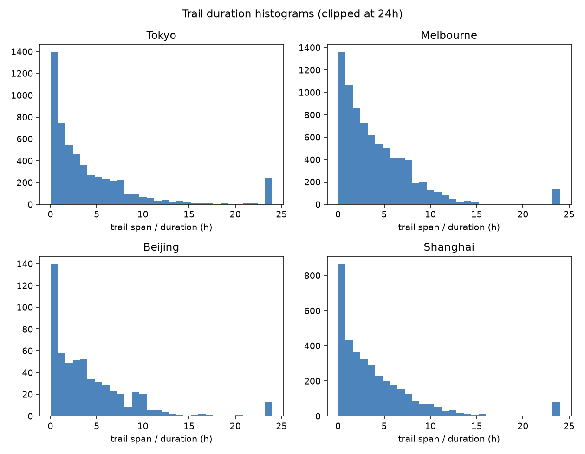

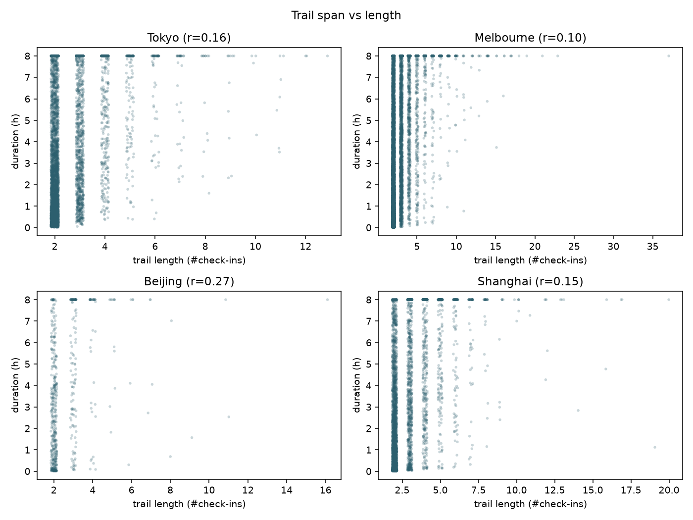

| city | n | median (h) | p90 (h) | ≤4h | ≤8h | corr(span,len) |
|------|--:|-----------:|--------:|----:|----:|---------------:|
| Tokyo | 5482 | 2.50 | 10.07 | 0.64 | 0.86 | 0.16 |
| Melbourne | 7864 | 3.12 | 8.80 | 0.59 | 0.88 | 0.10 |
| Beijing | 573 | 2.97 | 9.55 | 0.61 | 0.85 | 0.27 |
| Shanghai | 3636 | 2.75 | 9.25 | 0.63 | 0.87 | 0.15 |

中位约 **2.5–3.1h**；约 85–88% trails ≤8h；span–length 相关弱。多数预测落在数小时窗口；粗 weekday 节律收益有限，与时间 MostPop 弱增益一致。

---

## 6. 地图：极简灰底气泡 / 流向

对 Tokyo / Melbourne / Beijing / Shanghai：浅灰底图（`Esri.WorldGrayCanvas` 系；**当代**瓦片，**不声称** 2012–18 历史路网）+ 分位数网格质心；同 `trail_id` 相邻 check-in 为 OD。

| 文件 | 含义 |
|------|------|
| `{city}_minimal_bubbles.png` | 红色半透明比例圆（∝ 格子 check-in） |
| `{city}_minimal_flows.png` | Top OD desire lines（色/宽 ∝ Relative flow %） |

目录：[`maps/`](maps/)（含 `*_grid_region_stats.csv` / `*_top_od_flows.csv`）

### Tokyo

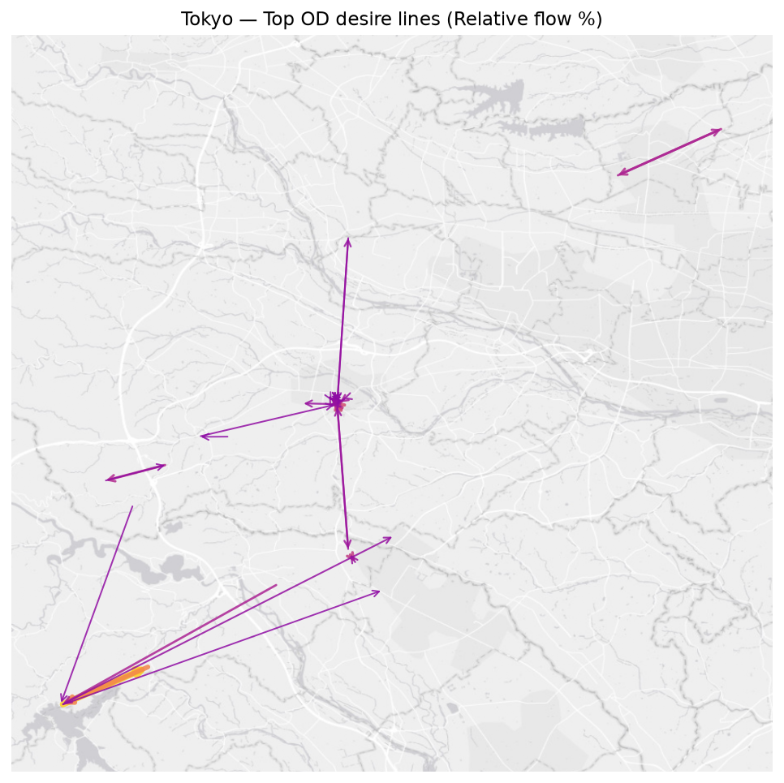

### Melbourne

### Beijing

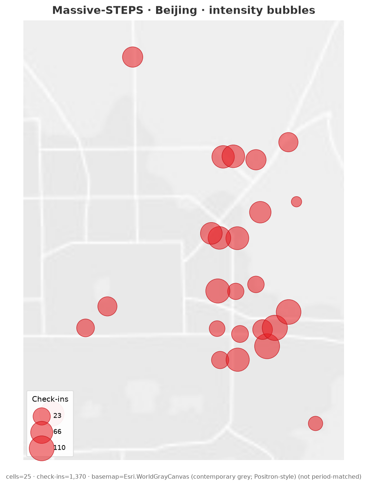

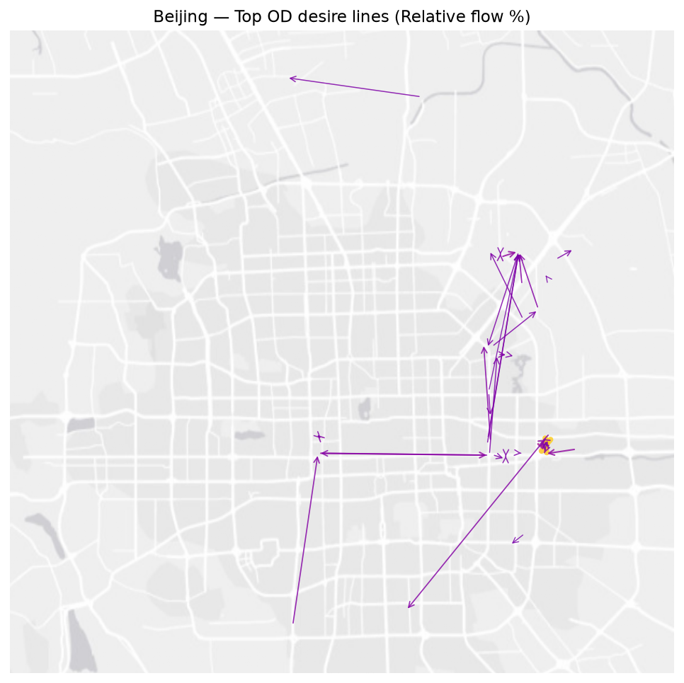

### Shanghai

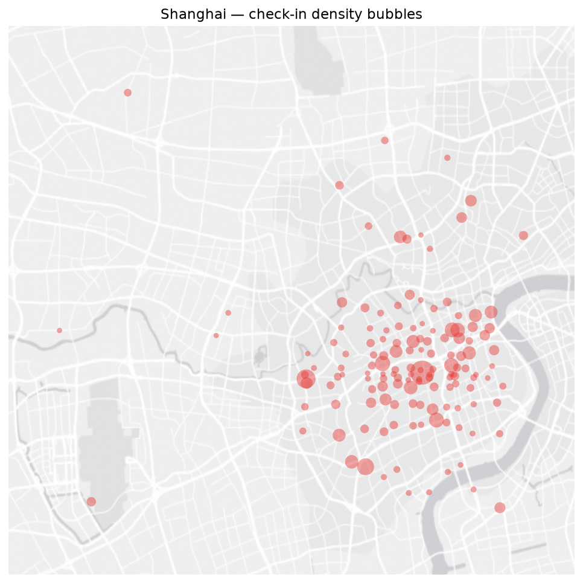

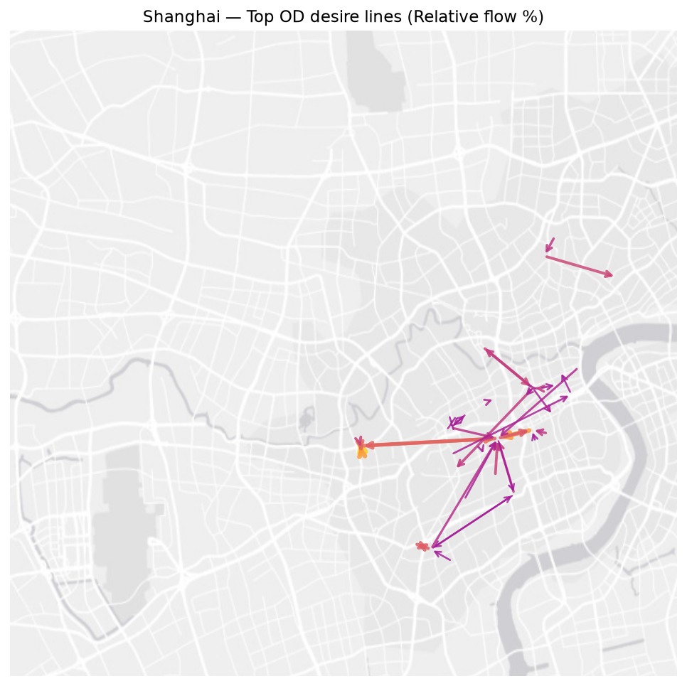

可视化启发：网格/H3 先预测再消歧；枢纽边（车站/商场）作图先验；Tokyo 区内枢纽换乘 vs Melbourne CBD 放射；解释地图时声明 admin 回退可能堆叠伪热点。

---

## 7. 优先课题（精简）

1. **切分协议一等公民**：三协议联合排行榜；量化官方 Acc 中同用户泄漏（UserMostPop 必报）。  
2. **单步上下文专用模型**：针对 ctx_len=1 的多数 test。  
3. **Unseen-POI / 开放词表**：name·address·category·坐标；单独报 unseen 子集。  
4. **空间–语义两阶段**：网格/OD 召回 + 语义重排。  
5. **坐标缺失鲁棒**：精确坐标 / fallback / missing token 三设置。  
6. **2013↔2018 漂移与开闭店**：period-conditioned；勿对 Tokyo 一刀切纵向。  
7. **跨城 category/text 迁移**：leave-one-city-out。  
8. **Weekend lift 协议**：相对 majority；难例子=末类别规则错。  
9. **Hub-aware 图先验**：用 OD/转移强度正则化。  
10. **廉价基线决策卡**：由数据特征预测该用哪条基线、深度模型最小有意义增益。

---

## 附录：本目录文件

| 路径 | 说明 |
|------|------|
| [`massive-steps-analysis.md`](massive-steps-analysis.md) | 本报告 |
| [`README.md`](README.md) | 目录索引 |
| [`massive-steps-cited-city-table.csv`](massive-steps-cited-city-table.csv) | 15 城规模表 |
| [`massive-steps-measured-summary.csv`](massive-steps-measured-summary.csv) | 10 城实测分布摘要 |
| [`figures/`](figures/) | 规模/分布、证据快照、基线、切分、时长图 |
| [`data/`](data/) | 研究/基线/切分/时间条件 CSV（含 `weekday_daynight_baselines.csv` · `event_time_meta.csv` · `bin_definition.json`） |
| [`maps/`](maps/) | 极简灰底气泡与流向图 + OD/格子 CSV |
