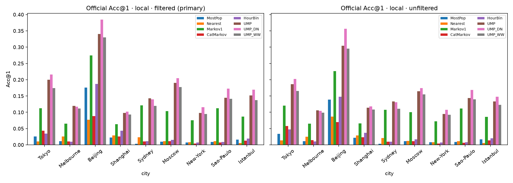

# Massive-STEPS 分析报告（全量 HF · 15 城）

**来源：** [Massive-STEPS](https://github.com/cruiseresearchgroup/Massive-STEPS) · [arXiv:2505.11239](https://arxiv.org/abs/2505.11239) · [HF collection](https://huggingface.co/collections/CRUISEResearchGroup/massive-steps-point-of-interest-check-in-dataset-682716f625d74c2569bc7a73)  
**评测城（全量）：** Tokyo · Melbourne · Beijing · Shanghai · Sydney · Palembang · Moscow · New-York · Sao-Paulo · Bandung · Istanbul · Jakarta · Kuwait-City · Petaling-Jaya · Tangerang  
**证据：** **[cited]** 论文/README · **[measured]** 本机对 **完整** HF check-in CSV 计算（无 row/city subsample；个性化时段表另有文档化长尾用户过滤）  
**协议：** **official split only**；prediction time = **被预测 check-in 的 IANA 本地时**；主表不含 user-disjoint。

本目录为 Massive_POI 侧的精简交付：一份总报告 + 必要图与 CSV。

**全量 HF 校验：** `covers_full_csv=True` 对全部 15 城成立（`train+val+test` 行数 = `*_checkins.csv`）。Provenance：[`data/hf_download_provenance.csv`](data/hf_download_provenance.csv)。合计实测 check-ins ≈ **2,629,541**。

---

## 图轴 / 标签术语表（中文）

| 图中标签 | 中文释义 |
|----------|----------|
| **category entropy (nats)** | 类别分布的香农熵（Shannon entropy），单位 **nat**（自然对数 \(\ln\)，非 bit） |
| **Gini** / **poi_gini** | POI 流行度的基尼系数：越接近 1 表示 check-in 越集中在少数热门 POI |
| **Share of check-ins** | 该小时（或该档）check-in 占总 check-in 的比例 |
| **Hour of day** | 一天中的小时 \(0\ldots23\)；本报告时间桶默认 **城市本地时**（IANA） |
| **Acc@k** | 真实目标 POI 落在模型 Top-\(k\) 预测中的比例（全城候选） |
| **trail span / duration (h)** | 轨迹时间跨度 \(=\text{末 timestamp}-\text{首 timestamp}\)（小时）；≠ STD 的相邻间隔 δτ=8h |
| **Relative flow %** | 某条 OD 边流量占该城全部相邻转移次数的百分比（流向图线宽/颜色） |
| **same-cat transition** | 相邻两次 check-in **共享同一 `venue_category`**；rate = 同类内转移占比 |
| **ctx_len** | 预测时可用的上下文长度（末站之前的 check-in 数）；官方 test 上 ctx_len=1 常占多数 |
| **Desire line / OD** | 起讫期望线：同 `trail_id` 相邻 check-in 连成的流量边 |

---

## 1. 数据集概览

### 1.1 定位与覆盖 [cited + measured]

Massive-STEPS = 城市级、可复现的 **next-POI / semantic trajectory** 基准。

- **15 城 / 10 国**；STD 两段约 **24 个月**（2012–2013、2017–2018，非连续）
- 轨迹：同用户相邻 check-in 间隔 ≤ **δτ = 8h** 归入同一 trail
- 切分：**trail 级 7:1:2**，并对 `user_id` stratify（同用户可跨 train/test）
- 本报告实测：**完整 HF 15 城 CSV**（见 provenance）

规模表：[`massive-steps-cited-city-table.csv`](massive-steps-cited-city-table.csv) · 分布摘要：[`massive-steps-measured-summary.csv`](massive-steps-measured-summary.csv)


**图注：** 十五城 check-in 规模对照（完整 HF）。Istanbul / Petaling Jaya / Jakarta 等为数十万级，而 Beijing / Shanghai / Tokyo 子集显著更小——跨城对比必须归一化或分层，不能直接比绝对 Acc。

### 1.2 字段 [cited]

| 字段 | 含义 |
|------|------|
| `trail_id` / `user_id` / `venue_id` | 轨迹、用户、**城内** ordinal POI |
| `latitude` / `longitude` | venue 坐标；隐私缺失时为空 |
| `name` / `address` / `venue_category` | 语义元数据 |
| `venue_city_*` | 行政地名与中心坐标（**无 venue 坐标时的空间 fallback**） |
| `timestamp` | check-in 时间（**去 timezone offset 的 naive datetime**；本地时 = 当作 UTC 再 `tz_convert(IANA)`） |

IANA 映射见 [`data/bin_definition.json`](data/bin_definition.json)。

### 1.3 分布画像 [measured · full HF]

| city | users | trails | POIs | check-ins | μ_len | ≤3 frac | POI once | Gini | miss-coord |
|------|------:|-------:|-----:|----------:|------:|--------:|---------:|-----:|-----------:|
| Tokyo | 764 | 5482 | 2982 | 13839 | 2.52 | 0.89 | 0.50 | 0.67 | 0.03 |
| Melbourne | 646 | 7864 | 6901 | 22050 | 2.80 | 0.82 | 0.54 | 0.56 | 0.05 |
| Beijing | 56 | 573 | 598 | 1470 | 2.57 | 0.89 | 0.59 | 0.48 | 0.07 |
| Shanghai | 296 | 3636 | 3610 | 10491 | 2.89 | 0.78 | 0.58 | 0.55 | 0.07 |
| Sydney | 740 | 10148 | 8189 | 29900 | 2.95 | 0.79 | 0.55 | 0.61 | 0.08 |
| Palembang | 267 | 4699 | 4117 | 14467 | 3.08 | 0.77 | 0.55 | 0.60 | 0.29 |
| Moscow | 3993 | 39485 | 13994 | 105620 | 2.67 | 0.85 | 0.44 | 0.74 | 0.15 |
| New-York | 6929 | 92041 | 45804 | 272368 | 2.96 | 0.80 | 0.44 | 0.68 | 0.07 |
| Sao-Paulo | 5822 | 89689 | 34881 | 256824 | 2.86 | 0.82 | 0.43 | 0.73 | 0.07 |
| Bandung | 3377 | 55333 | 26559 | 161284 | 2.91 | 0.81 | 0.50 | 0.73 | 0.24 |
| Istanbul | 23700 | 216411 | 42795 | 544471 | 2.52 | 0.89 | 0.44 | 0.83 | 0.12 |
| Jakarta | 8336 | 137396 | 71150 | 412100 | 3.00 | 0.80 | 0.51 | 0.72 | 0.19 |
| Kuwait-City | 9628 | 91658 | 13455 | 232706 | 2.54 | 0.88 | 0.42 | 0.87 | 0.13 |
| Petaling-Jaya | 14308 | 180410 | 53650 | 506430 | 2.81 | 0.83 | 0.44 | 0.79 | 0.12 |
| Tangerang | 1437 | 15984 | 9975 | 45521 | 2.85 | 0.83 | 0.51 | 0.66 | 0.28 |


**图注：** 各城 length≤3 轨迹占比。绝大多数 trails 只有 2–3 次 check-in；next-POI「上下文」常常只是单步。


**图注：** POI once-only 比例与 Gini。大词表 + 稀疏标签使全局 MostPop 很弱，并驱动 unseen-target 问题。


**图注：** 核心四城按 **城市本地时** 的 hour-of-day 份额。行为节律解释一律用 local。


**图注：** 横轴 category entropy (nats)，纵轴 length≤3 占比，气泡∝规模。连接「城市难度」与「短上下文」。

---

## 2. 研究角度（全城证据）

完整数值：[`data/research-evidence.csv`](data/research-evidence.csv)


**图注：** 核心四城关键证据条一屏对照（短轨迹、ctx=1、未见目标、same-cat、缺坐标）。

| city | ctx=1 | unseen tgt | same-cat | cold≤3 | 2013 frac | 2018 frac |
|------|------:|-----------:|---------:|-------:|----------:|----------:|
| Tokyo | 0.69 | 0.13 | 0.15 | 0.29 | 0.00 | 1.00 |
| Melbourne | 0.60 | 0.21 | 0.06 | 0.12 | 0.84 | 0.16 |
| Beijing | 0.66 | 0.23 | 0.05 | 0.17 | 0.98 | 0.02 |
| Shanghai | 0.55 | 0.27 | 0.06 | 0.13 | 0.87 | 0.13 |
| Sydney | 0.59 | 0.18 | 0.06 | 0.12 | 0.83 | 0.17 |
| Palembang | 0.56 | 0.18 | 0.06 | 0.04 | 0.99 | 0.01 |
| Moscow | 0.65 | 0.08 | 0.07 | 0.19 | 0.98 | 0.02 |
| New-York | 0.59 | 0.09 | 0.06 | 0.11 | 0.86 | 0.14 |
| Sao-Paulo | 0.61 | 0.08 | 0.06 | 0.07 | 0.93 | 0.07 |
| Bandung | 0.59 | 0.10 | 0.06 | 0.05 | 0.99 | 0.01 |
| Istanbul | 0.69 | 0.05 | 0.07 | 0.18 | 0.74 | 0.26 |
| Jakarta | 0.58 | 0.11 | 0.07 | 0.05 | 0.99 | 0.01 |
| Kuwait-City | 0.69 | 0.03 | 0.08 | 0.17 | 0.18 | 0.82 |
| Petaling-Jaya | 0.61 | 0.06 | 0.06 | 0.14 | 0.81 | 0.19 |
| Tangerang | 0.64 | 0.13 | 0.09 | 0.13 | 1.00 | 0.00 |

| 角度 | 实测要点 | 开放问题 |
|------|----------|----------|
| 短上下文 | 多数城 test ctx_len=1 过半 | 单步先验 vs 深序列；分层报长轨迹 |
| Cold-start | cold 用户占比高；个性化历史量是主难度轴 | 跨城 meta；user-disjoint 仅作诊断勿作主表 |
| 未见目标 | unseen target 常见两位数 % | 开放词表 / name·category·坐标 |
| 坐标缺失 | 城间差异大（Tokyo ~3% → Palembang ~29%） | mask/分层；避免 admin centroid 伪邻近 |
| same-cat 转移 | 多数城仅个位数–低两位数 % | 纯 CatMarkov 上限有限 |
| 2013↔2018 | Tokyo 几乎全 2018；多城偏 2013 | period-conditioned；开闭店 |
| 个性化泄漏 | **UserMostPop / UMP_DN** 在 official 上全面领先廉价全局先验 | 新方法必须超 UMP 族，而不只超 MostPop |

---

## 3. 廉价基线（official · local）

任务：给定上下文 \(c_1,\ldots,c_{L-1}\) 与 **已知 target 时刻**，预测末站 `venue_id`；候选=全城 POI；报 Acc@1/5/10。

### 3.1 定义摘要

| 模型 | 核心 |
|------|------|
| **MostPop** | 全局 venue 频次 |
| **Nearest** | 相对当前站 Haversine/近似最近其他 POI（缺坐标 → `venue_city_*`） |
| **Markov1** | 一阶 POI→POI；不足回退 MostPop |
| **CatMarkov** | 类别一阶转移 → 类内 MostPop |
| **DayNight / SameWD / HourBin / WorkWeekend** | 按 **target local** 时刻分桶的全局 MostPop |
| **UserMostPop** | 用户历史频次；不足回退 MostPop |
| **UMP_DayNight / UMP_Weekday / UMP_WorkWeekend** | 用户×时段桶；回退用户全局 → MostPop |

**预测时刻（强制）：** 被预测那次 check-in **自己的** timestamp（trail 上 = 末站同一时刻），**从不**用 trail 首站时间。  
**Day/Night：** Day = hour ∈ **[7, 19)**。  
**长尾过滤（UMP 主表）：** train 上 ≥5 check-ins 且 day/night/work/weekend 各 ≥2（local）。元数据：[`data/longtail_filter_meta.csv`](data/longtail_filter_meta.csv)。

#### 伪代码

```
# local_* from target check-in timestamp (IANA); split = official only
fit global / user / user×bin on train check-ins
predict(trail):
  t = trail.last_checkin          # NEVER trail.first
  return merge(user_bin[u][bin(t)], user_global[u], MostPop)  # or global bin / Markov / Nearest
```

### 3.2 Official Acc@1（local · **unfiltered** · 全局/转移/空间主表）

CSV：[`data/acc1_comparison_unfiltered_official_local.csv`](data/acc1_comparison_unfiltered_official_local.csv) · 长表：[`data/research-baselines.csv`](data/research-baselines.csv)

| city | MostPop | Nearest | Markov1 | CatMarkov | HourBin | UserMostPop | UMP_DN | UMP_WW | n_test |
|------|--------:|--------:|--------:|--------:|--------:|--------:|--------:|--------:|-------:|
| Tokyo | 0.034 | 0.014 | 0.120 | 0.057 | 0.047 | 0.186 | **0.202** | 0.165 | 1097 |
| Melbourne | 0.011 | 0.025 | 0.065 | 0.015 | 0.010 | **0.106** | 0.104 | 0.099 | 1573 |
| Beijing | 0.139 | 0.087 | 0.226 | 0.070 | 0.148 | 0.304 | **0.357** | 0.296 | 115 |
| Shanghai | 0.022 | 0.029 | 0.066 | 0.023 | 0.037 | 0.114 | **0.118** | 0.109 | 728 |
| Sydney | 0.003 | 0.021 | 0.108 | 0.009 | 0.010 | **0.133** | 0.131 | 0.111 | 2030 |
| Palembang | 0.017 | 0.010 | 0.073 | 0.003 | 0.017 | 0.169 | **0.179** | 0.162 | 940 |
| Moscow | 0.011 | 0.012 | 0.101 | 0.011 | 0.017 | 0.165 | **0.174** | 0.155 | 7897 |
| New-York | 0.008 | 0.008 | 0.073 | 0.004 | 0.007 | 0.095 | **0.108** | 0.092 | 18409 |
| Sao-Paulo | 0.009 | 0.011 | 0.112 | 0.006 | 0.008 | 0.143 | **0.169** | 0.140 | 17938 |
| Bandung | 0.012 | 0.006 | 0.087 | 0.009 | 0.014 | 0.144 | **0.153** | 0.130 | 11067 |
| Istanbul | 0.017 | 0.006 | 0.086 | 0.013 | 0.020 | 0.134 | **0.147** | 0.123 | 43283 |
| Jakarta | 0.009 | 0.007 | 0.076 | 0.005 | 0.009 | 0.143 | **0.148** | 0.129 | 27480 |
| Kuwait-City | 0.012 | 0.003 | 0.090 | 0.023 | 0.031 | 0.160 | **0.163** | 0.143 | 18332 |
| Petaling-Jaya | 0.010 | 0.005 | 0.073 | 0.011 | 0.011 | 0.106 | **0.116** | 0.099 | 36082 |
| Tangerang | 0.022 | 0.008 | 0.140 | 0.012 | 0.022 | **0.221** | **0.221** | 0.200 | 3197 |

**读数：** 全 15 城 **UserMostPop 或 UMP_DN** 主导 Acc@1；**Markov1** 稳居非个性化最强；**Nearest / CatMarkov / 全局时间桶** 通常弱得多。新方法应报相对 UMP_DN 与 Markov1 的 lift。

### 3.3 Official Acc@1（local · **filtered** · 个性化时段主表）



**图注：** 官方·本地时多模型 Acc@1；左 filtered、右 unfiltered（图为代表性城子集）。UMP_DN 仍是最强个性化廉价基线；UMP_WW 通常优于稀疏的 UMP_WD。

CSV：[`data/acc1_full_comparison_official_local.csv`](data/acc1_full_comparison_official_local.csv) · Acc@5/10：[`data/acc5_full_comparison_official_local.csv`](data/acc5_full_comparison_official_local.csv) · [`data/acc10_full_comparison_official_local.csv`](data/acc10_full_comparison_official_local.csv)

| city | MostPop | DayNight | SameWD | HourBin | UserMostPop | UMP_DN | UMP_WD | UMP_WW | n_test | n_users |
|------|--------:|--------:|--------:|--------:|--------:|--------:|--------:|--------:|-------:|--------:|
| Tokyo | 0.026 | 0.026 | 0.026 | 0.035 | 0.200 | **0.216** | 0.165 | 0.174 | 666 | 276 |
| Melbourne | 0.011 | 0.008 | 0.011 | 0.009 | **0.120** | 0.117 | 0.081 | 0.111 | 1286 | 362 |
| Beijing | 0.176 | 0.187 | 0.143 | 0.187 | 0.341 | **0.385** | 0.220 | 0.330 | 91 | 30 |
| Shanghai | 0.022 | 0.033 | 0.024 | 0.043 | 0.098 | **0.102** | 0.095 | 0.093 | 581 | 148 |
| Sydney | 0.004 | 0.001 | 0.005 | 0.011 | **0.143** | 0.140 | 0.107 | 0.120 | 1678 | 414 |
| Palembang | 0.019 | 0.019 | 0.019 | 0.019 | 0.182 | **0.190** | 0.107 | 0.172 | 858 | 199 |
| Moscow | 0.009 | 0.013 | 0.009 | 0.015 | 0.190 | **0.204** | 0.139 | 0.178 | 5273 | 1945 |
| New-York | 0.007 | 0.006 | 0.006 | 0.007 | 0.098 | **0.115** | 0.077 | 0.095 | 15616 | 4045 |
| Sao-Paulo | 0.009 | 0.009 | 0.009 | 0.008 | 0.145 | **0.173** | 0.114 | 0.141 | 14491 | 3438 |
| Bandung | 0.012 | 0.012 | 0.011 | 0.013 | 0.155 | **0.163** | 0.102 | 0.140 | 9578 | 2228 |
| Istanbul | 0.016 | 0.016 | 0.016 | 0.020 | 0.152 | **0.169** | 0.108 | 0.137 | 29821 | 10957 |
| Jakarta | 0.009 | 0.009 | 0.009 | 0.009 | 0.156 | **0.161** | 0.107 | 0.140 | 23867 | 5498 |
| Kuwait-City | 0.013 | 0.026 | 0.024 | 0.028 | 0.186 | **0.190** | 0.137 | 0.167 | 12995 | 4439 |
| Petaling-Jaya | 0.009 | 0.009 | 0.008 | 0.010 | 0.119 | **0.131** | 0.086 | 0.111 | 29418 | 8610 |
| Tangerang | 0.022 | 0.022 | 0.022 | 0.022 | 0.238 | **0.243** | 0.175 | 0.218 | 2556 | 796 |


**图注：** filtered 上 UMP / UMP_DN / UMP_WD / UMP_WW 的 Acc@1。UMP_DN 多数城领先；UMP_WW 是对 7 路 weekday 稀疏的稳健替代。

#### Acc@5（filtered · 摘要）

| city | UserMostPop | UMP_DN | UMP_WW | Markov1 |
|------|--------:|--------:|--------:|--------:|
| Tokyo | 0.399 | **0.417** | 0.377 | 0.212 |
| Melbourne | 0.257 | **0.259** | 0.240 | 0.123 |
| Beijing | **0.505** | 0.495 | 0.451 | 0.451 |
| Shanghai | 0.210 | **0.212** | 0.203 | 0.133 |
| Sydney | 0.299 | **0.300** | 0.283 | 0.191 |
| Palembang | **0.337** | 0.336 | 0.321 | 0.153 |
| Moscow | 0.391 | **0.391** | 0.379 | 0.205 |
| New-York | 0.244 | **0.255** | 0.235 | 0.140 |
| Sao-Paulo | 0.372 | **0.382** | 0.371 | 0.216 |
| Bandung | **0.320** | 0.316 | 0.307 | 0.170 |
| Istanbul | 0.358 | **0.361** | 0.340 | 0.191 |
| Jakarta | **0.306** | 0.302 | 0.294 | 0.160 |
| Kuwait-City | 0.390 | **0.393** | 0.375 | 0.217 |
| Petaling-Jaya | 0.256 | **0.261** | 0.243 | 0.161 |
| Tangerang | **0.466** | 0.461 | 0.452 | 0.248 |

#### Acc@10（filtered · 摘要）

| city | UserMostPop | UMP_DN | UMP_WW | Markov1 |
|------|--------:|--------:|--------:|--------:|
| Tokyo | 0.488 | **0.489** | 0.470 | 0.261 |
| Melbourne | **0.329** | 0.320 | 0.309 | 0.156 |
| Beijing | 0.538 | 0.516 | **0.549** | 0.462 |
| Shanghai | 0.250 | **0.263** | 0.255 | 0.157 |
| Sydney | 0.361 | **0.365** | 0.353 | 0.211 |
| Palembang | **0.429** | 0.408 | 0.392 | 0.190 |
| Moscow | 0.463 | **0.468** | 0.457 | 0.255 |
| New-York | 0.306 | **0.313** | 0.299 | 0.163 |
| Sao-Paulo | 0.455 | **0.462** | 0.455 | 0.262 |
| Bandung | **0.386** | 0.382 | 0.374 | 0.213 |
| Istanbul | 0.440 | **0.441** | 0.428 | 0.248 |
| Jakarta | **0.364** | 0.360 | 0.355 | 0.200 |
| Kuwait-City | **0.487** | 0.486 | 0.473 | 0.295 |
| Petaling-Jaya | 0.319 | **0.323** | 0.310 | 0.206 |
| Tangerang | **0.543** | 0.540 | 0.543 | 0.285 |

### 3.4 Weekend 三项指标（local）

末次 check-in 是否周末（`dow ≥ 5`，**local**）。重算：[`data/weekend_baselines.csv`](data/weekend_baselines.csv)

| city | base rate | Majority | 类别规则 |
|------|----------:|---------:|---------:|
| Tokyo | 0.445 | 0.555 | 0.547 |
| Melbourne | 0.333 | 0.667 | 0.656 |
| Beijing | 0.307 | 0.693 | 0.600 |
| Shanghai | 0.335 | 0.665 | 0.626 |
| Sydney | 0.320 | 0.680 | 0.651 |
| Palembang | 0.326 | 0.674 | 0.682 |
| Moscow | 0.261 | 0.739 | 0.736 |
| New-York | 0.336 | 0.664 | 0.665 |
| Sao-Paulo | 0.251 | 0.749 | 0.759 |
| Bandung | 0.319 | 0.681 | 0.676 |
| Istanbul | 0.298 | 0.702 | 0.706 |
| Jakarta | 0.337 | 0.663 | 0.660 |
| Kuwait-City | 0.247 | 0.753 | 0.754 |
| Petaling-Jaya | 0.335 | 0.665 | 0.662 |
| Tangerang | 0.354 | 0.646 | 0.650 |

偏斜城上类别规则常打不赢 / 仅略胜 majority；应报 **lift**。

---

## 4. 轨迹时间跨度 [measured · full HF]

定义：`duration = last_ts − first_ts`（小时）。δτ=8h 约束相邻间隔，不是总跨度。

汇总：[`data/trail_duration_stats.csv`](data/trail_duration_stats.csv)


**图注：** 核心四城 trail 总跨度分布。中位约 2.5–3.1h，约 85–89% ≤8h。


**图注：** 跨度 vs 长度；相关弱——「序列深度」≠「时间跨度」。

| city | n | median (h) | p90 (h) | ≤4h | ≤8h | corr(span,len) |
|------|--:|-----------:|--------:|----:|----:|---------------:|
| Tokyo | 5482 | 2.50 | 10.07 | 0.64 | 0.86 | 0.16 |
| Melbourne | 7864 | 3.12 | 8.79 | 0.59 | 0.88 | 0.10 |
| Beijing | 573 | 2.97 | 9.55 | 0.61 | 0.85 | 0.27 |
| Shanghai | 3636 | 2.75 | 9.25 | 0.63 | 0.87 | 0.15 |
| Sydney | 10148 | 3.12 | 9.21 | 0.59 | 0.86 | 0.07 |
| Palembang | 4699 | 3.27 | 9.52 | 0.57 | 0.85 | 0.07 |
| Moscow | 39485 | 2.68 | 8.42 | 0.64 | 0.89 | 0.13 |
| New-York | 92041 | 3.38 | 9.47 | 0.56 | 0.86 | 0.10 |
| Sao-Paulo | 89689 | 3.23 | 10.00 | 0.57 | 0.85 | 0.10 |
| Bandung | 55333 | 3.22 | 9.58 | 0.58 | 0.86 | 0.20 |
| Istanbul | 216411 | 2.77 | 8.45 | 0.64 | 0.89 | 0.08 |
| Jakarta | 137396 | 3.15 | 9.15 | 0.59 | 0.87 | 0.22 |
| Kuwait-City | 91658 | 2.23 | 8.68 | 0.69 | 0.89 | 0.07 |
| Petaling-Jaya | 180410 | 2.93 | 8.82 | 0.61 | 0.88 | 0.16 |
| Tangerang | 15984 | 2.73 | 9.83 | 0.62 | 0.86 | 0.22 |

---

## 5. 地图（子集：Tokyo / Melbourne / Beijing / Shanghai）

浅灰底图（`Esri.WorldGrayCanvas`；**当代**瓦片，**不声称** 2012–18 历史路网）+ 分位数网格质心；同 `trail_id` 相邻 check-in 为 OD。目录：[`maps/`](maps/)。

### Tokyo


**图注：** Tokyo 网格气泡——签到集中在少数枢纽格。


**图注：** Tokyo Top OD（Relative flow %）；主流量偏短距枢纽换乘。

### Melbourne


**图注：** Melbourne 更偏 CBD 核心堆积。


**图注：** Melbourne CBD 核心 + 放射状长边。

### Beijing


**图注：** Beijing 样本小、热点更碎；注意方差与坐标 fallback。


**图注：** Beijing Top OD；宜作定性结构。

### Shanghai


**图注：** Shanghai 沿核心城区聚集。


**图注：** Shanghai 短距核心往返为主。

---

## 6. 优先课题（精简）

1. **Official + UMP 必报**：新方法至少超过 UserMostPop / UMP_DN 与 Markov1。  
2. **单步上下文专用模型**：针对 ctx_len=1 的多数 test。  
3. **Unseen-POI / 开放词表**：单独报 unseen 子集。  
4. **空间–语义两阶段**：网格/OD 召回 + 语义重排（Nearest/CatMarkov 单打上限低）。  
5. **坐标缺失鲁棒**：精确 / fallback / missing token 三设置。  
6. **2013↔2018 漂移**：period-conditioned；勿对 Tokyo 一刀切纵向。  
7. **跨城 category/text 迁移**：leave-one-city-out。  
8. **Weekend lift**：相对 majority。  
9. **Hub-aware 图先验**：用 OD/转移强度正则化。  
10. **时间戳本地时**：行为与时间桶以 IANA local 为准。  
11. **廉价基线决策卡**：由数据特征预测该用哪条基线。

---

## 附录：本目录文件

| 路径 | 说明 |
|------|------|
| [`massive-steps-analysis.md`](massive-steps-analysis.md) | 本报告 |
| [`README.md`](README.md) | 目录索引 |
| [`massive-steps-cited-city-table.csv`](massive-steps-cited-city-table.csv) | 15 城规模表（full HF） |
| [`massive-steps-measured-summary.csv`](massive-steps-measured-summary.csv) | 15 城实测分布摘要 |
| [`figures/`](figures/) | 规模/分布、证据、基线、UMP、时长图 |
| [`data/`](data/) | 研究/基线/时长/过滤/provenance CSV + `bin_definition.json` |
| [`maps/`](maps/) | 四城极简灰底气泡与流向图 |

**Provenance 确认：** 15/15 城 `covers_full_csv=True`；下载自 `CRUISEResearchGroup/Massive-STEPS-{City}`；无 nrows subsample。
