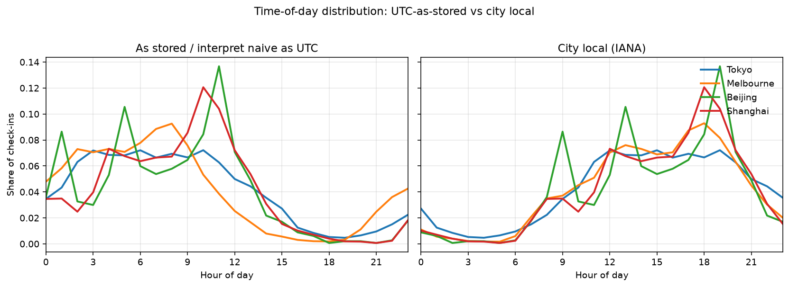
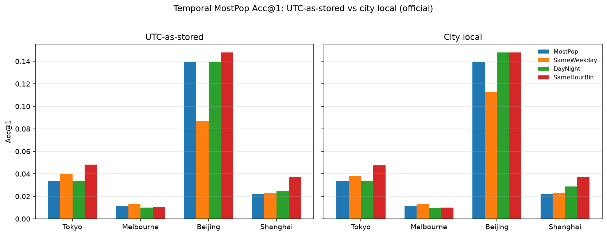
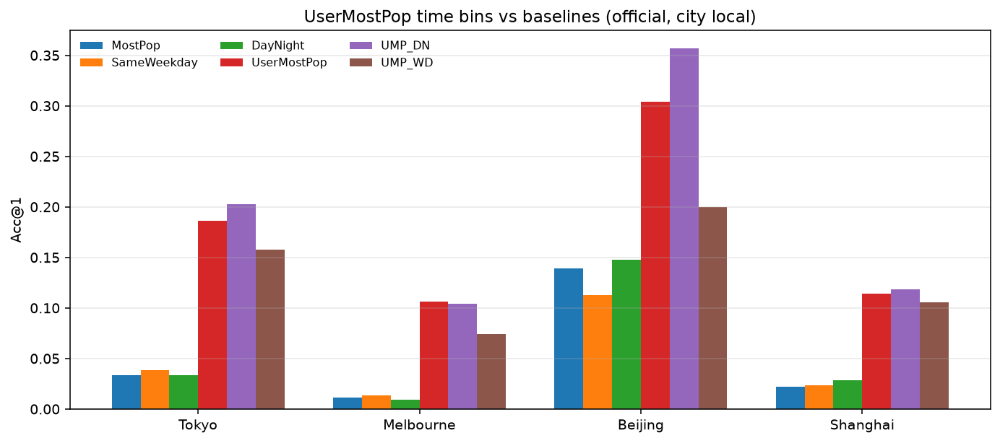

# Massive-STEPS 分析报告

**来源：** [Massive-STEPS](https://github.com/cruiseresearchgroup/Massive-STEPS) · [arXiv:2505.11239](https://arxiv.org/abs/2505.11239) · [HF collection](https://huggingface.co/collections/CRUISEResearchGroup/massive-steps-point-of-interest-check-in-dataset-682716f625d74c2569bc7a73)  
**评测城（研究/基线/地图）：** Tokyo · Melbourne · Beijing · Shanghai  
**证据：** **[cited]** 论文/README · **[measured]** 本机对 HF check-in CSV 计算

本目录为 Massive_POI 侧的精简交付：一份总报告 + 必要图与 CSV。

---

## 图轴 / 标签术语表（中文）

读图前先对一下轴含义（保留图中英文轴标签，释义如下）：

| 图中标签 | 中文释义 |
|----------|----------|
| **category entropy (nats)** | 类别分布的香农熵（Shannon entropy），单位 **nat**（自然对数 \(\ln\)，非 bit） |
| **Gini** / **poi_gini** | POI 流行度的基尼系数：越接近 1 表示 check-in 越集中在少数热门 POI |
| **Share of check-ins** | 该小时（或该档）check-in 占总 check-in 的比例 |
| **Hour of day** | 一天中的小时 \(0\ldots23\)；须注明是 **UTC-as-stored** 还是 **城市本地时** |
| **Acc@k** | 真实目标 POI 落在模型 Top-\(k\) 预测中的比例（全城候选） |
| **trail span / duration (h)** | 轨迹时间跨度 \(=\text{末 timestamp}-\text{首 timestamp}\)（小时）；≠ STD 的相邻间隔 δτ=8h |
| **Relative flow %** | 某条 OD 边流量占该城全部相邻转移次数的百分比（流向图线宽/颜色） |
| **same-cat transition** | 相邻两次 check-in **共享同一 `venue_category`**；报告的 rate = 同类内转移（OD 边 / transition）占比 |
| **ctx_len** | 预测时可用的上下文长度（末站之前的 check-in 数）；官方 test 上 ctx_len=1 常占多数 |
| **Desire line / OD** | 起讫期望线：同 `trail_id` 相邻 check-in 连成的流量边（不考虑真实路网） |

---

## 1. 数据集概览

### 1.1 定位与覆盖 [cited]

Massive-STEPS = 城市级、可复现的 **next-POI / semantic trajectory** 基准，主任务含监督推荐、零样本 LLM 推荐、以及轨迹末 check-in 是否落在周末的时空分类。

- **15 城 / 10 国**；STD 两段约 **24 个月**（2012–2013、2017–2018，非连续）
- 轨迹：同用户相邻 check-in 间隔 ≤ **δτ = 8h** 归入同一 trail
- 全库约：**80,299 users** · **950,809 trails** · **386,007 POIs**（城内独立编号）· **2,629,541 check-ins**
- 切分：**trail 级 7:1:2**，并对 `user_id` stratify（同用户可跨 train/test）

规模表：[`massive-steps-cited-city-table.csv`](massive-steps-cited-city-table.csv)


**图注：** 十五城用户 / 轨迹 / POI / check-in 规模对照。Istanbul、Petaling Jaya、Jakarta 等为百万级 check-in，而 Beijing / Shanghai / Tokyo 子集显著更小——跨城对比必须归一化或分层，不能直接比绝对 Acc。该图支撑「地理多样性 + 规模不均」是 Massive-STEPS 作为基准的核心卖点，也提示小样本城（如 Beijing）方差更大。

### 1.2 字段 [cited]

结构化主表（HF `{city}_checkins*.csv`）核心字段：

| 字段 | 含义 |
|------|------|
| `trail_id` / `user_id` / `venue_id` | 轨迹、用户、**城内** ordinal POI |
| `latitude` / `longitude` | venue 坐标；隐私缺失时为空 |
| `name` / `address` / `venue_category` | 语义元数据 |
| `venue_city_*` | 行政地名与中心坐标（**无 venue 坐标时的空间 fallback**） |
| `timestamp` | check-in 时间（**去 timezone offset 的 naive datetime**） |

论文将监督特征归纳为：**social · spatial · temporal · categorical**。`venue_id` **不可跨城**直接联合。

**Timestamp 约定（实测确认）：** HF / Massive-STEPS 写出的 `timestamp` **无 `+00:00` / `Z` 后缀**（offset 被剥掉）。字段值与按 **UTC** 解读再转到城市本地时后的钟点一致地对不齐——四城 **100%** check-in 的 hour 在「naive 直读」与「IANA 本地」之间不同。本报告时间桶基线因此 **并列报告两种模式**（§3.3）。

### 1.3 分布画像 [measured + cited]

**实测 10 城**（含上表四城 + Palembang / Sydney / Tangerang / Bandung / Moscow / New York）：[`massive-steps-measured-summary.csv`](massive-steps-measured-summary.csv)

| 现象 | 要点 |
|------|------|
| 极短轨迹 | μ_len ≈ 2.5–3.1；length≤3 约占 **77–89%** |
| 用户长尾 | users≤5 trails：Tokyo ~0.60，Beijing ~0.52 |
| POI 长尾 | once-only ~44–59%；top10% POI 可占半数以上 check-ins |
| 坐标缺失 | 论文约 **13.25%**；实测 Tokyo ~3% → Palembang/Tangerang ~28–30% |
| 年代偏斜 | Tokyo 几乎全是 2018；Bandung/Moscow/Beijing 几乎全是 2013 |
| same-cat 转移 | test 上同类转移仅约 **5–15%**（Tokyo ~0.15；Mel/BJ/SH ~0.05–0.06） |


**图注：** 各城轨迹长度直方图（或密度）。绝大多数 trails 只有 2–3 次 check-in，长序列稀有。说明 next-POI 评测的「上下文」常常只是 **单步**，序列模型的优势需要与非序列先验（用户习惯、一跳转移、流行度）严格对照。


**图注：** POI 流行度长尾——大量 POI 仅出现一次，头部 POI 占走大部分 check-in（高 Gini）。大词表 + 稀疏标签使全局 MostPop 很弱，也驱动 unseen-target / 开放词表推荐问题。



**图注：** 左：把 naive `timestamp` **当作 UTC / 原样取 hour**；右：经 IANA 转到城市本地时（Tokyo→`Asia/Tokyo`，Melbourne→`Australia/Melbourne`，Beijing/Shanghai→`Asia/Shanghai`）。UTC 视图下各城峰相位错开；本地时后四城对齐出共同的日节律（凌晨低谷、日间/晚间峰）。旧版单图轴上的 “local timestamp as stored” 易误解——存储值更接近 **剥掉 offset 的 UTC**。时间特征与 SameHourBin 等基线必须以本地时为准做行为解释，同时保留 UTC-as-stored 对照以免与历史数字对不上。


**图注：** 横轴 **category entropy (nats)** = 类别分布香农熵；纵轴为 length≤3 的轨迹占比；气泡大小反映规模。类别更均匀（高熵）的城往往短轨迹略少；Beijing/Tokyo 低熵 + 极短轨迹扎堆。该图连接「城市难度」与「短上下文」两条主线，呼应论文熵–Acc 负相关。

**复用注意：** 短上下文、大稀疏候选、缺失坐标 fallback、非全局 POI ID、非 user-disjoint 官方切分、动态 POI 过期风险、**时间戳 timezone 语义**。完整训练数据在 HF，不在 GitHub `data/`。

---

## 2. 研究角度（四城证据）

完整数值：[`data/research-evidence.csv`](data/research-evidence.csv)


**图注：** 四城关键证据条（短轨迹占比、cold/warm、未见目标、坐标缺失、same-cat 转移等）一屏对照。用来快速判断「该城更该打个性化、空间还是语义牌」，避免只看单一 Acc@1。

| 角度 | 实测要点 | 开放问题 |
|------|----------|----------|
| 短上下文 | test 中 ctx_len=1 约占 **55–69%** | 单步专用先验 vs 深序列模型；分层报长轨迹 |
| Cold-start | Markov Acc@1：cold≪warm（Beijing 0.11→0.31） | user-disjoint 下 SOTA 掉多少？跨城 meta |
| 未见目标 | test unseen target **13–27%** | 开放词表 / name·category·坐标生成式推荐 |
| 坐标缺失 | OD 边至少一端缺精确坐标 **5–14%**（本四城） | mask/分层；避免 admin centroid 伪邻近 |
| same-cat 转移 | 仅 **~5–15%** 相邻转移同类 | 纯类别马尔可夫上限有限；需空间/个性化 |
| 2013↔2018 | Tokyo 无 2013；Mel/SH 类别 L1 漂移大 | period-conditioned 指标；开闭店 |
| 跨城 | 类别 Jaccard 0.30–0.65；ID 无重叠 | category+text+相对空间 zero-shot |
| 语义 vs 空间 | Nearest Acc@1≈0；Markov1 明显更强 | 先区域后语义两阶段 |
| Weekend 分类 | 偏斜城上 majority 已 ~0.68–0.70 | 必报相对 majority 的 **lift** |
| 个性化泄漏 | **UserMostPop** 官方 split 上四城 Acc@1 全胜简单基线 | 并行报 official / user-disjoint / time-based |

---

## 3. 廉价基线定义与结果

任务：给定上下文 \(c_1,\ldots,c_{L-1}\)，预测末站 `venue_id`；候选=全城 POI；报 Acc@1/5/10。缺失坐标用 `venue_city_*`。

### 3.1 定义摘要

| 模型 | 核心 |
|------|------|
| **MostPop** | 全局 venue 频次排序 |
| **UserMostPop** | 用户历史频次；不足回退 MostPop（user-disjoint 下 ≡ MostPop） |
| **Markov1** | 一阶 POI→POI 转移（看当前站）；不足回退 MostPop |
| **Nearest** | 相对当前站 Haversine 最近其他 POI |
| **CatMarkov** | 类别一阶转移 → 类内 MostPop 消歧 |
| **SameWeekdayMostPop** | 按 **target（末站）** weekday 桶频次；空桶回退 MostPop |
| **DayNightMostPop** | 按 **target hour** 的 Day/Night 二桶；空桶回退 MostPop |
| **SameHourBinMostPop** | `hour_bin = hour // 4`（6 个 4h 箱；对照） |
| **SameWeekdayHourMostPop** | `(weekday, hour_bin)` 联合桶 |
| **UserMostPop_Day / _Night** | 该用户 train 中对应 Day/Night 桶内 MostPop；test 用 target **本地**时选桶；回退 UserMostPop → MostPop |
| **UserMostPop_Weekday** | 同上，按 target weekday 选用户桶 |

**预测时刻（强制）：** 一律用 **target POI 的 check-in timestamp**（轨迹末事件时间），**不用** trail 首 timestamp。official 上约 **32–37%** trails 的 target 与 first 落在不同 Day/Night 桶（UTC-as-stored）；本地时下该不一致约 **25–38%**（见 [`data/utc_local_time_meta.csv`](data/utc_local_time_meta.csv) / [`data/event_time_meta.csv`](data/event_time_meta.csv)）。

**Day/Night 切分：** **Day = hour ∈ [7, 19)，Night = 其余**（定义见 [`data/bin_definition.json`](data/bin_definition.json)）。  
**时区偏好（现行）：** 新基线与行为读数默认 **城市本地 IANA**（Tokyo `Asia/Tokyo` · Melbourne `Australia/Melbourne` · Beijing/Shanghai `Asia/Shanghai`）；UTC-as-stored 仅作历史对照。

#### 时间桶实现（伪代码；prediction time = target）

```
# timestamp: HF naive → treat as UTC, then tz_convert(city_IANA) for local_*
# Day = hour ∈ [7,19); hour_bin = hour // 4; weekday = Mon=0..Sun=6

fit SameWeekday / SameHourBin / SameWeekdayHour / DayNight:
  for each train check-in c:
    key = weekday(c) | hour_bin(c) | (weekday, hour_bin) | daynight(c)
    bucket[key][c.venue] += 1
  global = MostPop(train)

predict(trail):
  t = trail.last_checkin          # NEVER trail.first
  key = f(t.local_*)              # prefer local going forward
  return merge(bucket[key], global)   # empty bucket → global
```

### 3.2 官方 split 非时间基线 [measured]


**图注：** 四城 MostPop / UserMostPop / Markov1 / Nearest 等 Acc@k 总览。UserMostPop 在官方切分上全面领先，说明同用户跨 split 把回头客习惯算进可预测性；新方法必须超越 UserMostPop/Markov，而不是只超 MostPop。

表：[`data/research-baselines.csv`](data/research-baselines.csv) · 对照论文：[`data/research-baselines-vs-paper.csv`](data/research-baselines-vs-paper.csv) · 分层：[`data/research-baseline-strata.csv`](data/research-baseline-strata.csv)

| city | UserMostPop | Markov1 | MostPop | Nearest | STHGCN [cited] |
|------|------------:|--------:|--------:|--------:|---------------:|
| Tokyo | **0.186** | 0.119 | 0.034 | ~0.01 | 0.250 |
| Melbourne | **0.106** | 0.065 | 0.011 | ~0.02 | 0.168 |
| Beijing | **0.304** | 0.217 | 0.139 | ~0.07 | 0.453 |
| Shanghai | **0.114** | 0.067 | 0.022 | ~0.02 | 0.193 |

### 3.3 时间条件 MostPop：UTC-as-stored vs 城市本地时 [measured]

**两种时间模式（必须并列）：**

| 模式 | 做法 |
|------|------|
| **UTC-as-stored** | 对 naive `timestamp` **直接**取 `hour` / `weekday`（= 把剥掉 offset 的值当作 UTC 钟点；与历史 temporal 数字一致） |
| **City local** | `tz_localize("UTC")` → `tz_convert(IANA)`：Tokyo `Asia/Tokyo` · Melbourne `Australia/Melbourne` · Beijing/Shanghai `Asia/Shanghai` |

IANA 与桶定义：[`data/bin_definition.json`](data/bin_definition.json) · 完整长表：[`data/utc_local_temporal_baselines.csv`](data/utc_local_temporal_baselines.csv) · 桶错位元数据：[`data/utc_local_time_meta.csv`](data/utc_local_time_meta.csv) · Acc 差分：[`data/utc_local_acc_deltas.csv`](data/utc_local_acc_deltas.csv)



**图注：** 官方切分下 MostPop / SameWeekday / DayNight / SameHourBin 的 Acc@1，左 UTC-as-stored、右城市本地时并排。用来检查「换成本地时后廉价时间桶还值不值得报」——多数城 Top-1 变化很小，但 DayNight @5/@10 与个别城（Beijing SameWeekday）有可见错位。

#### Official Acc@1（并排）

| city | MostPop | SW utc | SW local | DN utc | DN local | HB utc | HB local |
|------|--------:|-------:|---------:|-------:|---------:|-------:|---------:|
| Tokyo | 0.034 | 0.040 | 0.038 | 0.034 | 0.034 | **0.048** | 0.047 |
| Melbourne | 0.011 | **0.013** | **0.013** | 0.010 | 0.010 | 0.011 | 0.010 |
| Beijing | 0.139 | 0.087 | 0.113 | 0.139 | **0.148** | **0.148** | **0.148** |
| Shanghai | 0.022 | 0.023 | 0.023 | 0.025 | 0.029 | **0.037** | **0.037** |

（SW=SameWeekday，DN=DayNight，HB=SameHourBin；四舍五入。n_test：Tokyo 1097 · Mel 1573 · BJ 115 · SH 728。）

#### Official Acc@5（并排）

| city | MostPop | SW utc | SW local | DN utc | DN local | HB utc | HB local |
|------|--------:|-------:|---------:|-------:|---------:|-------:|---------:|
| Tokyo | 0.100 | 0.103 | 0.099 | 0.106 | **0.125** | 0.131 | **0.139** |
| Melbourne | 0.035 | 0.039 | 0.038 | 0.041 | 0.043 | 0.041 | **0.048** |
| Beijing | 0.226 | 0.174 | 0.174 | 0.217 | **0.226** | 0.200 | 0.200 |
| Shanghai | 0.060 | 0.055 | 0.062 | 0.065 | **0.070** | 0.065 | 0.065 |

#### Official Acc@10（并排）

| city | MostPop | SW utc | SW local | DN utc | DN local | HB utc | HB local |
|------|--------:|-------:|---------:|-------:|---------:|-------:|---------:|
| Tokyo | 0.151 | 0.149 | 0.151 | 0.157 | **0.181** | 0.183 | **0.199** |
| Melbourne | 0.062 | 0.063 | 0.065 | 0.067 | 0.067 | 0.076 | **0.077** |
| Beijing | 0.243 | 0.191 | 0.200 | 0.261 | **0.278** | **0.270** | **0.270** |
| Shanghai | 0.091 | 0.074 | 0.091 | 0.088 | **0.099** | 0.092 | 0.092 |

透视 CSV：[`data/acc1_utc_vs_local_official.csv`](data/acc1_utc_vs_local_official.csv) · [`data/acc5_utc_vs_local_official.csv`](data/acc5_utc_vs_local_official.csv) · [`data/acc10_utc_vs_local_official.csv`](data/acc10_utc_vs_local_official.csv)

#### 桶错位与读数

官方 test 目标时刻上，**UTC vs local**：

| city | hour 不一致 | weekday 不一致 | DayNight 不一致 | hour_bin 不一致 |
|------|------------:|---------------:|----------------:|----------------:|
| Tokyo | 1.00 | 0.13 | 0.74 | 1.00 |
| Melbourne | 1.00 | 0.09 | 0.83 | 1.00 |
| Beijing | 1.00 | 0.03 | 0.77 | 1.00 |
| Shanghai | 1.00 | 0.06 | 0.68 | 1.00 |

1. **Hour / hour_bin 几乎总是错位**（偏移 8–11h），但 **SameHourBin Acc@1 多数城几乎不变**——桶内流行度排序对整体平移有一定鲁棒性；Tokyo/Mel @5/@10 本地时略升。  
2. **DayNight 二桶在 UTC 下常 ≈ MostPop**；改成本地时后 Tokyo/Shanghai @5/@10、Beijing Acc@1 有小幅改善（日间窗对准真实通勤/活动）。  
3. **SameWeekday**：Beijing Acc@1 从 0.087→0.113（+2.6pp）——跨日界造成的 weekday 错桶最伤小样本城。  
4. **结论不变：** 时间仍是弱全局先验，**SameHourBin 仍是最强廉价时间桶**；解释行为节律请用 **local**，复现旧表请用 **UTC-as-stored**。

**User-disjoint Acc@1（摘要，UTC / local）**

| city | MostPop | SW u/l | DN u/l | HB u/l | n_test |
|------|--------:|-------:|-------:|-------:|-------:|
| Tokyo | 0.038 | 0.038 / 0.038 | 0.038 / 0.038 | **0.064 / 0.058** | 1018 |
| Melbourne | 0.006 | 0.006 / 0.005 | 0.006 / 0.009 | **0.010 / 0.009** | 1414 |
| Beijing | 0.210 | 0.150 / 0.150 | 0.210 / 0.210 | **0.260 / 0.260** | 100 |
| Shanghai | 0.014 | **0.017 / 0.017** | 0.014 / 0.004 | 0.008 / 0.008 | 783 |

### 3.4 UserMostPop 日/夜 / 星期桶 [measured · local]

**定义（伪代码）：**

```
fit:
  for each train check-in c of user u:
    user_global[u][c.venue] += 1
    user_bin[u][daynight(c.local_hour)][c.venue] += 1   # Day/Night
    # UserMostPop_Weekday: user_bin[u][weekday(c.local)][c.venue] += 1

predict(trail):
  t = trail.last_checkin                    # target event time
  b = daynight(t.local_hour)                # or weekday(t.local)
  return merge(user_bin[u][b], user_global[u], MostPop)
  # empty user-bin → that user's UserMostPop → global MostPop
```

`UserMostPop_DayNight` = 上述路由在**全量** test 上的 Acc；`UserMostPop_Day` / `_Night` = 仅在 target 落在该桶的 test 子集上的同一路由 Acc（n 见 CSV）。

长表：[`data/usermostpop_time_bins.csv`](data/usermostpop_time_bins.csv) · Acc@1/5/10 透视：[`data/acc1_usermostpop_timebins_official_local.csv`](data/acc1_usermostpop_timebins_official_local.csv) 等 · 图：[`figures/usermostpop_timebins_acc1_local.png`](figures/usermostpop_timebins_acc1_local.png)



**图注：** 官方切分、城市本地时下 UserMostPop 家族与全局 DayNight/SameWeekday 的 Acc@1。日/夜用户桶在 Tokyo/Beijing/Shanghai 抬升 UserMostPop；Weekday 用户桶过碎，全面弱于全局 UserMostPop。

#### Official Acc@1（local）

| city | MostPop | UserMostPop | DayNight | SameWeekday | **UMP_DayNight** | UMP_Weekday | UMP_Day† | UMP_Night† | n |
|------|--------:|------------:|---------:|------------:|-----------------:|------------:|---------:|-----------:|--:|
| Tokyo | 0.034 | 0.186 | 0.034 | 0.038 | **0.202** | 0.158 | 0.166 | 0.244 | 1097 |
| Melbourne | 0.011 | **0.106** | 0.010 | 0.013 | 0.104 | 0.074 | 0.089 | 0.123 | 1573 |
| Beijing | 0.139 | 0.304 | 0.148 | 0.113 | **0.357** | 0.200 | 0.196 | 0.508 | 115 |
| Shanghai | 0.022 | 0.114 | 0.029 | 0.023 | **0.118** | 0.106 | 0.092 | 0.146 | 728 |

†子集 Acc（Tokyo day/night n=589/508；Mel 873/700；BJ 56/59；SH 379/349）。

#### Official Acc@5 / Acc@10（local，摘要）

| city | UMP @5 | UMP_DN @5 | UMP @10 | UMP_DN @10 |
|------|-------:|----------:|--------:|-----------:|
| Tokyo | 0.396 | **0.409** | 0.479 | 0.479 |
| Melbourne | 0.241 | **0.243** | **0.310** | 0.303 |
| Beijing | 0.470 | **0.478** | **0.513** | 0.504 |
| Shanghai | 0.232 | **0.236** | 0.269 | **0.282** |

#### User-disjoint Acc@1（local）

| city | MostPop≡UMP | DayNight | SameWeekday | UMP_DayNight | n |
|------|------------:|---------:|------------:|-------------:|--:|
| Tokyo | 0.038 | 0.038 | 0.038 | 0.038 | 1018 |
| Melbourne | 0.006 | 0.009 | 0.005 | 0.006 | 1414 |
| Beijing | 0.210 | 0.210 | 0.150 | 0.210 | 100 |
| Shanghai | 0.014 | 0.004 | 0.017 | 0.014 | 783 |

**读数：** (1) **UMP_DayNight 在 Tokyo +1.6pp、Beijing +5.2pp** 相对 UserMostPop；Melbourne 基本持平略降；Shanghai 微升。(2) **Night 子集 Acc 明显高于 Day**（北京 Night Acc@1 0.51）。(3) **UserMostPop_Weekday 全面弱于 UserMostPop**——用户×星期桶过碎，噪声排序压过回退。(4) user-disjoint 下个性化消失，UMP_DayNight ≡ MostPop。

### 3.5 Weekend 三项指标

论文任务：末次 check-in 是否周末（`dow ≥ 5`）。**历史数字按 UTC-as-stored weekday**；本地时会改变贴近日界的标签，完整重算留待后续（本 lean 更新聚焦时间条件 MostPop）。

| 术语 | 定义 |
|------|------|
| 周末 base rate | \(P(\text{末站在周末})\)，全城 trails |
| Majority Acc | 永远猜多数类（四城周末率&lt;0.5 → Acc = 1 − base rate） |
| 末POI类别规则 Acc | train 上学「末站类别 → 周末/工作日」，test 查表 |

重算：[`data/weekend_baselines.csv`](data/weekend_baselines.csv)

| city | base rate | Majority | 类别规则 |
|------|----------:|---------:|---------:|
| Tokyo | 0.444 | 0.556 | 0.565 |
| Melbourne | 0.324 | 0.676 | 0.657 |
| Beijing | 0.297 | 0.703 | 0.669 |
| Shanghai | 0.323 | 0.677 | 0.654 |

偏斜城上类别规则**打不赢** majority；应报 **lift**。

---

## 4. 切分稳定性 [measured]

三协议：**(a) official** HF 切分 · **(b) user-disjoint** 用户 80/20 · **(c) time-based** 按 trail 末时间最早 80% / 最晚 20%。

元数据：[`data/split_meta.csv`](data/split_meta.csv) · 全表：[`data/baselines_by_split.csv`](data/baselines_by_split.csv) · 翻榜：[`data/ranking_flips.csv`](data/ranking_flips.csv)


**图注：** 同一套廉价基线在 official / user-disjoint / time-based 三种切分下的 Acc@1。官方协议下 UserMostPop 四城全胜；user-disjoint 后 Top-1 **一律翻转**——不报多协议的 SOTA 在泛化语义上不可信。

| city | official Top-1 | user-disjoint Top-1 | time-based Top-1 |
|------|----------------|---------------------|------------------|
| Tokyo | UserMostPop | **Markov1** | UserMostPop |
| Melbourne | UserMostPop | **Nearest** | **Nearest** |
| Beijing | UserMostPop | **Markov1** | UserMostPop |
| Shanghai | UserMostPop | **Nearest** | UserMostPop |

---

## 5. 轨迹时间跨度 [measured]

定义：`duration = last_ts − first_ts`（小时）。δτ=8h 约束的是**相邻间隔**，不是总跨度。（跨度对 timezone 平移不敏感。）

汇总：[`data/trail_duration_stats.csv`](data/trail_duration_stats.csv)


**图注：** 各城 trail 总跨度（小时）分布。中位约 2.5–3.1h，约 85–88% ≤8h；均值被极长尾拉高。多数预测落在数小时窗口，粗 weekday 节律收益有限，与时间 MostPop 弱增益一致。


**图注：** 轨迹跨度 vs 轨迹长度散点及相关性。相关弱（r≈0.10–0.27）：更长序列略更长时段，但短序列已可铺满数小时——「序列深度」≠「时间跨度」。

| city | n | median (h) | p90 (h) | ≤4h | ≤8h | corr(span,len) |
|------|--:|-----------:|--------:|----:|----:|---------------:|
| Tokyo | 5482 | 2.50 | 10.07 | 0.64 | 0.86 | 0.16 |
| Melbourne | 7864 | 3.12 | 8.80 | 0.59 | 0.88 | 0.10 |
| Beijing | 573 | 2.97 | 9.55 | 0.61 | 0.85 | 0.27 |
| Shanghai | 3636 | 2.75 | 9.25 | 0.63 | 0.87 | 0.15 |

---

## 6. 地图：极简灰底气泡 / 流向

对 Tokyo / Melbourne / Beijing / Shanghai：浅灰底图（`Esri.WorldGrayCanvas` 系；**当代**瓦片，**不声称** 2012–18 历史路网）+ 分位数网格质心；同 `trail_id` 相邻 check-in 为 OD。

| 文件 | 含义 |
|------|------|
| `{city}_minimal_bubbles.png` | 红色半透明比例圆（∝ 格子 check-in） |
| `{city}_minimal_flows.png` | Top OD desire lines（色/宽 ∝ **Relative flow %**） |

目录：[`maps/`](maps/)（含 `*_grid_region_stats.csv` / `*_top_od_flows.csv`）

### Tokyo


**图注：** Tokyo 网格气泡——签到集中在少数枢纽格。提示「先网格/H3 召回再 POI 消歧」比全城硬排更合理。


**图注：** Tokyo Top OD 期望线（Relative flow %）。主流量偏区内短距枢纽换乘，而非长距放射；适合 hub-aware 图先验。

### Melbourne


**图注：** Melbourne 气泡更偏 CBD 核心堆积，郊区格稀疏——中心–边缘结构强于 Tokyo。


**图注：** Melbourne 流向呈 CBD 核心 + 放射状长边；与 admin 同区转移较低一致，适合「中心–郊区」OD 研究。

### Beijing


**图注：** Beijing 样本小、热点更碎；解读气泡大小时注意方差与坐标 fallback 堆叠风险。


**图注：** Beijing Top OD。小样本下头部队列不稳定，宜作定性结构而非精确流量排名。

### Shanghai


**图注：** Shanghai 气泡沿核心城区聚集；同 admin 转移极高，空间分辨率常坍缩到区级。


**图注：** Shanghai 流向以短距核心往返为主。解释地图时声明 admin 回退可能制造伪热点。

---

## 7. 优先课题（精简）

1. **切分协议一等公民**：三协议联合排行榜；量化官方 Acc 中同用户泄漏（UserMostPop 必报）。  
2. **单步上下文专用模型**：针对 ctx_len=1 的多数 test。  
3. **Unseen-POI / 开放词表**：name·address·category·坐标；单独报 unseen 子集。  
4. **空间–语义两阶段**：网格/OD 召回 + 语义重排。  
5. **坐标缺失鲁棒**：精确坐标 / fallback / missing token 三设置。  
6. **2013↔2018 漂移与开闭店**：period-conditioned；勿对 Tokyo 一刀切纵向。  
7. **跨城 category/text 迁移**：leave-one-city-out。  
8. **Weekend lift 协议**：相对 majority；难例子=末类别规则错。  
9. **Hub-aware 图先验**：用 OD/转移强度正则化。  
10. **时间戳本地时**：新基线默认 **IANA local**；UTC-as-stored 仅作历史对照。  
11. **个性化×时段**：UserMostPop_DayNight 已抬升多城 Acc@1；探索更细 hour-bin 用户桶 vs 过碎 weekday。  
12. **廉价基线决策卡**：由数据特征预测该用哪条基线、深度模型最小有意义增益。

---

## 附录：本目录文件

| 路径 | 说明 |
|------|------|
| [`massive-steps-analysis.md`](massive-steps-analysis.md) | 本报告 |
| [`README.md`](README.md) | 目录索引 |
| [`massive-steps-cited-city-table.csv`](massive-steps-cited-city-table.csv) | 15 城规模表 |
| [`massive-steps-measured-summary.csv`](massive-steps-measured-summary.csv) | 10 城实测分布摘要 |
| [`figures/`](figures/) | 规模/分布、UTC–local 时段、证据、基线、UMP 时段、切分、时长图 |
| [`data/`](data/) | 研究/基线/切分/时间条件（含 `utc_local_*`、`usermostpop_time_bins*`）CSV |
| [`maps/`](maps/) | 极简灰底气泡与流向图 + OD/格子 CSV |
