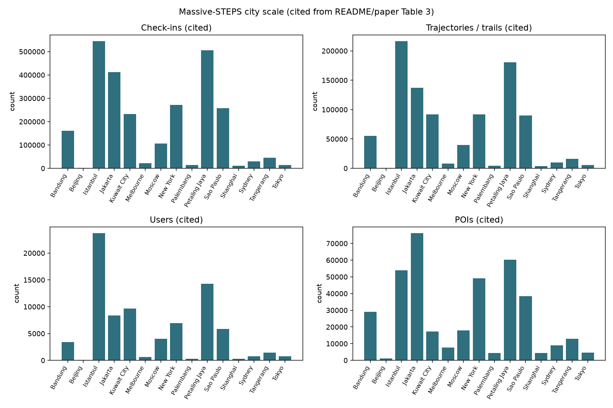
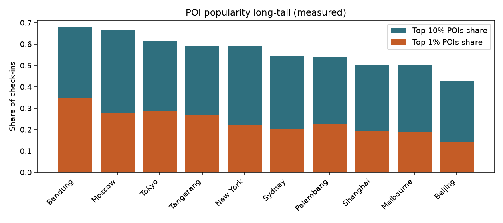
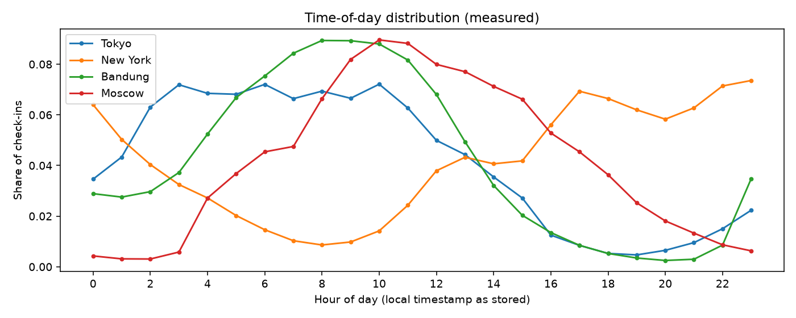
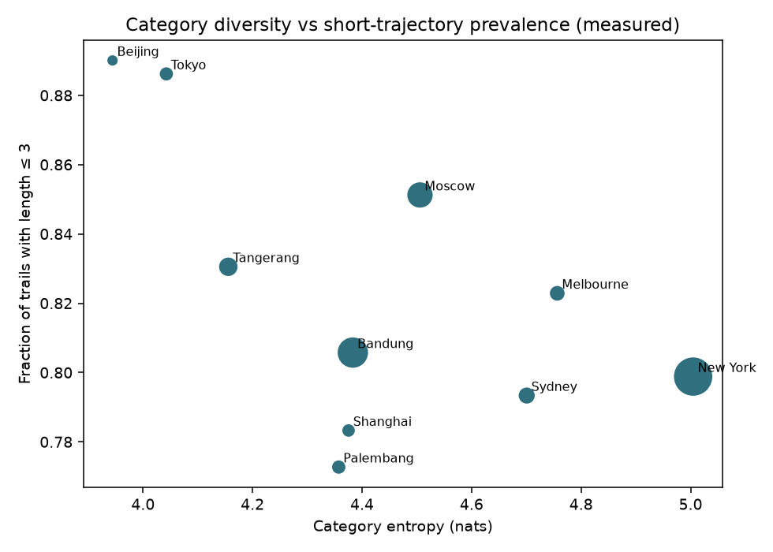

# Massive-STEPS 数据集分析报告

**来源仓库:** [cruiseresearchgroup/Massive-STEPS](https://github.com/cruiseresearchgroup/Massive-STEPS)  
**论文:** [arXiv:2505.11239](https://arxiv.org/abs/2505.11239)（SIGSPATIAL 2026）  
**Hugging Face:** [Massive-STEPS collection](https://huggingface.co/collections/CRUISEResearchGroup/massive-steps-point-of-interest-check-in-dataset-682716f625d74c2569bc7a73)  
**本环境说明:** Massive_POI workspace（`/workspace`）目前仅有空 README，未包含可复用的数据管道；分析以临时目录中只读 clone 的 Massive-STEPS + Hugging Face 下载的 check-in CSV 为准。

**证据标注约定**
- **[cited]**：来自 README / 论文 Table 3 等文档
- **[measured]**：在本机对已下载城市 check-in CSV 计算得到（共 10 城：Beijing, Shanghai, Tokyo, Palembang, Melbourne, Sydney, Tangerang, Bandung, Moscow, New York）
- 未下载的大城市（Istanbul / Jakarta / Kuwait City / Petaling Jaya / São Paulo）仅用 [cited] 规模；其分布形态与已测城市一致（短轨迹、POI 长尾）

---

## 1. 仓库与数据产物概览

### 1.1 仓库结构（只读 clone）

| 路径 | 作用 |
|------|------|
| `README.md` | 城市规模表、复现命令、benchmark Acc@1 |
| `src/preprocess_std.py` | 从 Semantic Trails + Foursquare OS Places + OSM GeoJSON 生成城市 check-in CSV |
| `src/create_next_poi_dataset.py` | 轨迹 → next-POI 文本 prompt，并按 7:1:2 切分上传 HF |
| `src/run_next_poi_llm.py` / `prompts.py` | Zero-shot LLM next-POI（LLM-ZS / LLM-Mob / LLM-Move） |
| `src/run_classify_day_*.py` | weekday/weekend 时空分类 |
| `data/<city>/` | OSM Overpass GeoJSON + `*_checkins.json` 规模统计（**不含**完整 CSV） |
| `results/` | 各城各模型评测输出 |
| 子模块目录（GETNext / STHGCN / LibCity / Flashback 等） | supervised baseline forks（浅 clone 时多为空，需 `git submodule update`） |

完整 check-in 与 prompt 数据集托管在 Hugging Face（每城一个 dataset repo），不在 GitHub 大文件中。

### 1.2 数据来源与许可

| 来源 | 用途 | 许可（文档所述） |
|------|------|------------------|
| [Semantic Trails Dataset (STD)](https://github.com/D2KLab/semantic-trails) | 2012–2013 + 2017–2018 check-in trails | CC0 1.0 |
| [Foursquare OS Places](https://huggingface.co/datasets/foursquare/fsq-os-places) | POI name / address / lat-lon 对齐 | Apache 2.0 |
| OpenStreetMap Overpass GeoJSON | 城市行政边界过滤 | OSM 许可 |
| Massive-STEPS 代码与发布物 | benchmark + 预处理脚本 | Apache-2.0（仓库 `LICENSE`） |

### 1.3 论文定位（任务）

Massive-STEPS = **Semantic Trajectories for Understanding POI Check-ins**：城市级、可复现的 **next-POI / trajectory** benchmark。主任务：

1. **Supervised POI recommendation**（next venue_id）
2. **Zero-shot POI recommendation**（LLM prompting）
3. **Spatiotemporal classification**（轨迹末 check-in 是否落在 weekend）

---

## 2. Dataset overview

### 2.1 覆盖范围 [cited]

- **15 城 / 10 国**：Bandung, Beijing, Istanbul, Jakarta, Kuwait City, Melbourne, Moscow, New York, Palembang, Petaling Jaya, São Paulo, Shanghai, Sydney, Tangerang, Tokyo  
- **时间跨度**：STD 两段共约 **24 个月**（2012–2013 与 2017–2018），非连续  
- **轨迹定义**：沿用 STD 的 trail——同一 user 的 check-in 若时间间隔 ≤ **δτ = 8 hours** 则归入同一 trajectory  
- **设计重点**：地理多样性、低资源城市、语义元数据（category / name / address）、可复现边界与公开切分

### 2.2 规模汇总 [cited]

全库合计约：**80,299 users** · **950,809 trails** · **386,007 POIs**（各城独立编号，不可跨城相加为“全球唯一 POI”） · **2,629,541 check-ins**。

| city | users | trails | pois | checkins | #train | #val | #test | μ_len | μ_int (h) |
|------|------:|-------:|-----:|---------:|-------:|-----:|------:|------:|----------:|
| Bandung | 3377 | 55333 | 29026 | 161284 | 38732 | 5534 | 11067 | 2.91 | 3.17 |
| Beijing | 56 | 573 | 1127 | 1470 | 400 | 58 | 115 | 2.57 | 3.10 |
| Istanbul | 23700 | 216411 | 53812 | 544471 | 151487 | 21641 | 43283 | 2.52 | 4.36 |
| Jakarta | 8336 | 137396 | 76116 | 412100 | 96176 | 13740 | 27480 | 3.00 | 2.81 |
| Kuwait City | 9628 | 91658 | 17180 | 232706 | 64160 | 9166 | 18332 | 2.54 | 5.31 |
| Melbourne | 646 | 7864 | 7699 | 22050 | 5504 | 787 | 1573 | 2.80 | 3.27 |
| Moscow | 3993 | 39485 | 17822 | 105620 | 27639 | 3949 | 7897 | 2.67 | 3.36 |
| New York | 6929 | 92041 | 49218 | 272368 | 64428 | 9204 | 18409 | 2.96 | 3.16 |
| Palembang | 267 | 4699 | 4343 | 14467 | 3289 | 470 | 940 | 3.08 | 3.17 |
| Petaling Jaya | 14308 | 180410 | 60158 | 506430 | 126287 | 18041 | 36082 | 2.81 | 2.96 |
| São Paulo | 5822 | 89689 | 38377 | 256824 | 62782 | 8969 | 17938 | 2.86 | 3.54 |
| Shanghai | 296 | 3636 | 4462 | 10491 | 2544 | 364 | 728 | 2.89 | 3.02 |
| Sydney | 740 | 10148 | 8986 | 29900 | 7103 | 1015 | 2030 | 2.95 | 3.33 |
| Tangerang | 1437 | 15984 | 12956 | 45521 | 11188 | 1599 | 3197 | 2.85 | 3.24 |
| Tokyo | 764 | 5482 | 4725 | 13839 | 3836 | 549 | 1097 | 2.52 | 5.16 |

CSV 副本：[`massive-steps-cited-city-table.csv`](massive-steps-cited-city-table.csv)

规模差异极大：Istanbul / Petaling Jaya / Jakarta 为百万级 check-in 候选池；Beijing / Shanghai / Tokyo 子集显著更小（论文归因于 STD 对错误 check-in 的严格过滤）。



### 2.3 Train / val / test splits [cited + code]

- 比例 **7 : 1 : 2**（`create_next_poi_dataset.py`：`test_size=0.2`，再对剩余 `test_size=0.125` → val）  
- 在 **trail 级** 切分，并对 `user_id` **stratify**，使测试用户在 train/val 中至少出现过（论文表述；代码依赖每用户 ≥3 trails）  
- 每城产出：
  - HF DatasetDict：`train` / `validation` / `test`，字段 `user_id, trail_id, inputs, targets`（文本 next-POI）
  - `{city}_checkins.csv` 全量 + `{city}_checkins_{train,validation,test}.csv`

**注意：** prompt 任务把轨迹除最后一个 check-in 外拼成 `inputs`，最后一个为 `targets`；因此输入序列长度 = trail_len − 1（常见仅为 1–2 步上下文）。

---

## 3. Features / fields

### 3.1 Check-in CSV schema（结构化主表）

示例（Tokyo）：

```text
trail_id,user_id,venue_id,latitude,longitude,name,address,
venue_category,venue_category_id,venue_category_id_code,
venue_city,venue_city_latitude,venue_city_longitude,venue_country,timestamp
```

| Field | Type | Meaning | 模型用法 |
|-------|------|---------|----------|
| `trail_id` | string | 轨迹 ID；前缀 `2013_` / `2018_` 标记 STD 子集 | 序列分组；切分主键 |
| `user_id` | int/string | 用户 ID（STD 原值） | social / personalization；LLM prompt 中的 user |
| `venue_id` | int | **城内** ordinal 匿名 POI ID（0…N−1） | next-POI 预测标签与候选空间 |
| `latitude` / `longitude` | float / NaN | FSQ venue 坐标；隐私缺失时为空 | 空间图、距离、Flashback/GETNext/STHGCN 等 |
| `name` / `address` | string / NaN | POI 名称与地址 | LLM semantic context；部分分类 prompt |
| `venue_category` | string | Foursquare 类别名 | categorical embedding；LLM 语义；day 分类 |
| `venue_category_id` | string | 原始 FSQ category id | 对齐 / 溯源 |
| `venue_category_id_code` | int | 城内类别 ordinal | 监督模型 category embedding |
| `venue_city` | string | 行政地名（GeoNames admin1） | prompt 文本；区域代理 |
| `venue_city_latitude/longitude` | float | 行政中心坐标 | **无 venue 坐标时的空间 fallback** |
| `venue_country` | string | 国家码 | prompt / 元数据 |
| `timestamp` | datetime | check-in 时间（去 timezone offset） | 时序、间隔、weekday/weekend、time embedding |

### 3.2 HF prompt 记录（LLM next-POI）

| Field | Meaning |
|-------|---------|
| `inputs` | 自然语言轨迹 + “哪个 POI id 会访问？”；给出 venue_id 范围 `0..max` |
| `targets` | 形如 `At <ts>, user U will visit POI id V.` |

Prompt 中显式使用：**timestamp, user_id, venue_id, venue_category, venue_city, venue_country**；坐标与 address 默认不进基础 prompt。

### 3.3 Pipeline 派生特征（benchmark 代码）

| Derived feature | 如何得到 | 用于 |
|-----------------|----------|------|
| Trajectory sequence | 按 `trail_id` 时间排序 | 全部 next-POI 模型 |
| Historical / context stays | LLM 评测中按用户历史截断（默认 ~15 historical stays） | LLM-Mob / LLM-ZS / LLM-Move |
| Haversine distance to candidates | `utils.haversine_distance` | LLM-Move 候选排序 |
| Negative POI samples | 随机采样 + 真值 POI（默认 100） | LLM-Move candidate set |
| Transition / POI graph | GETNext `build_graph.py` 等 | GNN baselines |
| Time-bin embeddings | 如 GETNext `time-units 48` | 时序编码 |
| Weekday/weekend label | 由末 check-in timestamp 推断 | ST day classification |
| Category entropy（论文） | 城内类别分布 Shannon entropy | 城市难度分析（非输入特征） |
| Admin-region proxy coords | venue lat/lon 缺失时用 `venue_city_*` | 空间模型兜底 |

论文将监督模型常用特征归纳为四类：**social**（user）· **spatial**（POI id + coords）· **temporal**（timestamp）· **categorical**（POI category）。

---

## 4. Distributions

### 4.1 轨迹长度：极短、长尾 [cited + measured]

- 论文 Fig.4 / Table 3：μ_len 约 **2.5–3.1**；多数轨迹仅 2–3 次 check-in  
- **[measured]** 10 城中，**length ≤ 3 的 trails 占比约 77%–89%**（Tokyo/Beijing ~0.89；Palembang ~0.77）  
- 最长轨迹存在但稀有 → next-POI 多数在 **极短 context** 下预测  


### 4.2 用户活跃度：cold-start 重 [cited + measured]

- 论文 Fig.5：多数用户仅贡献少量短轨迹  
- **[measured]** `users_with ≤5 trails`：Tokyo ~0.60，Beijing ~0.52，New York ~0.43，Bandung ~0.24  
- 过滤后每用户至少 3 trails，但分布仍高度倾斜  

### 4.3 POI 流行度：强长尾 / 稀疏 [measured]

| city | POI 仅 1 次 check-in 占比 | Top 10% POIs 占 check-ins | Gini（POI 流行度）可从 summary CSV 查阅 |
|------|---------------------------:|--------------------------:|
| Beijing | 0.589 | 0.428 | |
| Shanghai | 0.581 | 0.502 | |
| Tokyo | 0.499 | 0.614 | |
| Bandung | 0.501 | 0.677 | |
| Moscow | 0.444 | 0.665 | |
| New York | 0.436 | 0.590 | |

候选 POI 空间相对 FSQ-NYC/TKY 更大（Jakarta >76k，New York ~49k），同时大量 POI 仅出现一次 → **极端稀疏 + 大 vocab**。



### 4.4 Category / 时间 / 空间 [measured + cited]

**Category**
- Top categories 因城而异：Tokyo 以 Train Station / Convenience Store / Ramen 为主；New York 以 Metro / Bar / Coffee / Home / Office；Bandung / Palembang 以 Home / Shopping Mall 等为主  
- 论文 Fig.3：同一城市 2012–13 vs 2017–18 **Top-10 类别分布会漂移**  
- 论文提出 **category entropy** 与监督 Acc 的 Spearman **r = −0.643**：类别更均匀 → 更难预测  
- **[measured]** check-in 级 entropy（与论文 venue 级定义接近但不等同）：New York 最高 (~5.0 nats)，Beijing 较低 (~3.9)

**Time-of-day / weekend**
- Weekend check-in 占比约 **0.25–0.44**（Moscow 偏低，Tokyo 偏高）  
- 小时分布呈城市相关双峰/通勤峰（见下图）  



**Spatial / 坐标缺失**
- 论文：**约 13.25% check-ins 无精确 venue 坐标**（隐私，如 private residence）  
- **[measured]** 缺失率随城变化：Tokyo ~2.9%，New York ~7.3%，Moscow ~15%，Bandung ~23.5%，Palembang/Tangerang ~28–30%  
- 缺失时应用 `venue_city_latitude/longitude` 作代理 → 空间分辨率下降到行政区域级  

### 4.5 2013 vs 2018 子集不平衡 [measured]

| city | 2013 check-ins | 2018 check-ins |
|------|---------------:|---------------:|
| Tokyo | 0 | 13839（几乎全是 2018） |
| New York | 233398 | 38970 |
| Bandung | 159680 | 1604 |
| Moscow | 104026 | 1594 |
| Beijing | 1440 | 30 |
| Palembang | 14394 | 73 |

→ 做跨年代对比时，**样本有效性高度不均**；Tokyo 无法做 2013 对照（论文 Table 6 对该城 2012–13 标 N/A）。

### 4.6 已测城市摘要表 [measured]

完整文件：[`massive-steps-measured-summary.csv`](massive-steps-measured-summary.csv)



---

## 5. Preprocessing、filters、reuse caveats

### 5.1 官方构建流水线

1. 准备 STD：`std_2013.csv` / `std_2018.csv` + `cities.csv` + `categories.csv`  
2. 下载目标城 OSM relation → Overpass GeoJSON → `data/<city>/`  
3. `preprocess_std.py`  
   - 用城市 polygon 过滤 admin-region 点  
   - 合并两段 STD；`trail_id` 加 `2013_`/`2018_` 前缀  
   - 去 `foursquare:` / `wd:` 前缀；join FSQ OS Places（name/lat/lon/address）  
   - ordinal 编码 `venue_id` 与 `venue_category_id_code`  
   - **过滤：`min_checkins=2`（每 trail）、`min_trails=3`（每 user）**（README 示例；argparse 默认值与注释略有不一致，以论文/示例为准）  
4. `create_next_poi_dataset.py` → prompt 数据集 + 7:1:2 切分 + 上传 HF  

### 5.2 STD 上游已做清洗 [cited]

相对 GSCD，STD 已剔除：重复 venue check-in、间隔 &lt;1 分钟、超音速跳转等异常（Monti et al. 2018）。Massive-STEPS 继承该质量，但也导致部分城市（如 Tokyo）规模小于经典 FSQ-TKY。

### 5.3 复用注意点（重要）

1. **POI ID 不跨城**：每城独立 `0..N−1`；不可直接多城联合训练除非重新编码。  
2. **坐标缺失与代理**：空间模型必须处理 NaN，否则会 silently 偏向 admin centroid。  
3. **极短序列**：多数预测仅依赖 1–2 个历史 check-in；对长序列 Transformer 优势有限；cold-start 严重。  
4. **大候选空间**：Acc@1 基线整体偏低（监督 STHGCN 均约 23% Acc@1 [cited]）；评估需报告 Acc@k / NDCG@k。  
5. **时间子集偏斜**：不少城几乎全是 2013；Tokyo 几乎全是 2018——纵向结论勿一刀切。  
6. **切分泄漏风险可控但非 user-disjoint**：同一 user 的不同 trails 可跨 train/test；这是 next-POI 常见设定，但不同于严格 user-level leave-out。  
7. **Prompt 标签空间声明**：`inputs` 告知 `POI id ∈ [0, max_venue_id]`，全城词表极大，零样本若不做候选截断（LLM-Move）会极难。  
8. **动态 POI**：论文 Table 2 显示至 2025 部分城关闭率可达 ~20%+（NYC/Melbourne）；用旧 check-in 训练线上系统有过期推荐风险。  
9. **GitHub `data/` 只有边界与 json 统计**：实际训练请用 HF CSV / parquet。  
10. **子模块**：完整实验需 `git submodule update` 并 softlink `data/`。  
11. **许可组合**：STD(CC0) + FSQ Places(Apache-2.0) + OSM；再分发时保留归属与许可。  
12. **Massive_POI 本环境**：当前无现成下游代码可对照；若后续对接，建议直接消费 HF 上的 `{city}_checkins_*.csv` 与统一 schema。

---

## 6. Benchmark 要点（便于理解“模型如何用特征”）[cited]

| 任务 | 代表模型 | 主要消费特征 |
|------|----------|--------------|
| Supervised next-POI | FPMC, RNN, LSTPM, DeepMove, Flashback 族, GETNext, STHGCN, UniMove | user_id, venue_id, time, category, coords / graph |
| Zero-shot next-POI | LLM-Mob / LLM-ZS / LLM-Move + Gemini/Qwen/Llama/Gemma… | 文本化 time + category + poi id；Move 另加距离候选 |
| ST day classification | LR/RF/XGBoost BoW·TF-IDF；LLM zero-shot | 轨迹中 (time, category) 序列 |

最佳监督平均多为 **STHGCN**；零样本中带地理候选的 **LLM-Move** 往往更强。城市难度与 **category entropy** 负相关是论文核心数据洞察之一。

---

## 7. 结论（给 Massive_POI 的数据侧要点）

Massive-STEPS 是面向 **next-POI / semantic trajectory** 的多城公开基准：约 **260 万+ check-ins / 95 万 trails / 15 城**，字段同时覆盖 **social · spatial · temporal · categorical · 文本语义（name/address）**。实测确认其核心统计画像是：**极短轨迹（μ≈2.5–3.1）、用户 cold-start、POI 强长尾、类别与年代分布高度城市相关、坐标缺失率不均**。复现应走 Hugging Face 预切分文件；自建城市只需 OSM 边界 + 公开 STD/FSQ 流水线。对接新模型时，优先处理 **短上下文、大稀疏候选集、缺失坐标 fallback、以及非全局 POI ID**。

---

## 附录：本报告产物

| 文件 | 说明 |
|------|------|
| `massive-steps-dataset-analysis.md` | 本报告 |
| `massive-steps-cited-city-table.csv` | 15 城论文/README 规模表 |
| `massive-steps-measured-summary.csv` | 10 城实测分布摘要 |
| `massive-steps-figures/*.png` | 规模 / 轨迹长度 / 时段 / 长尾 / entropy 图 |

分析工作目录（非交付）：`/tmp/massive-steps-workdir/`（Massive-STEPS clone + HF CSV + 中间 JSON）。
