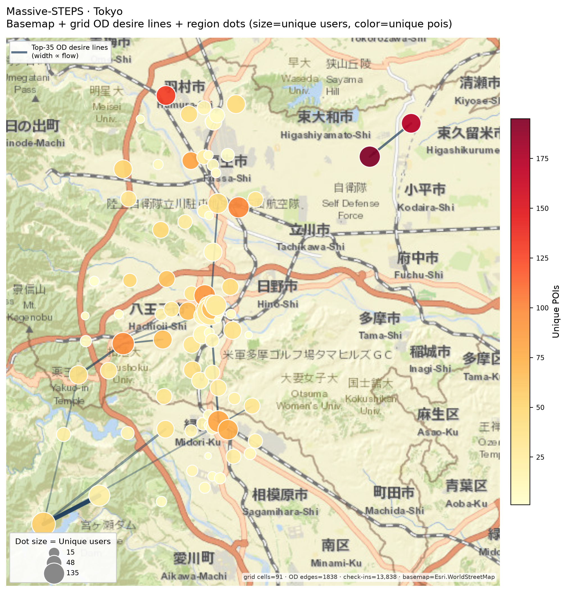
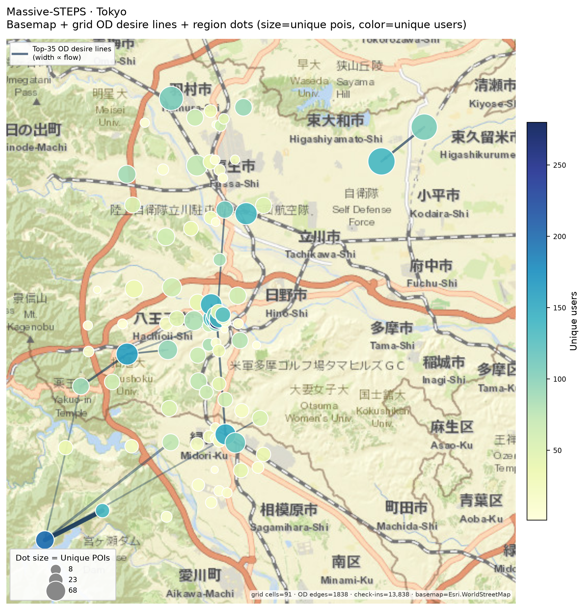
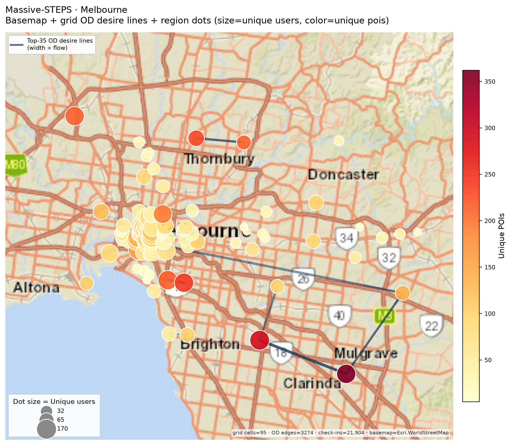
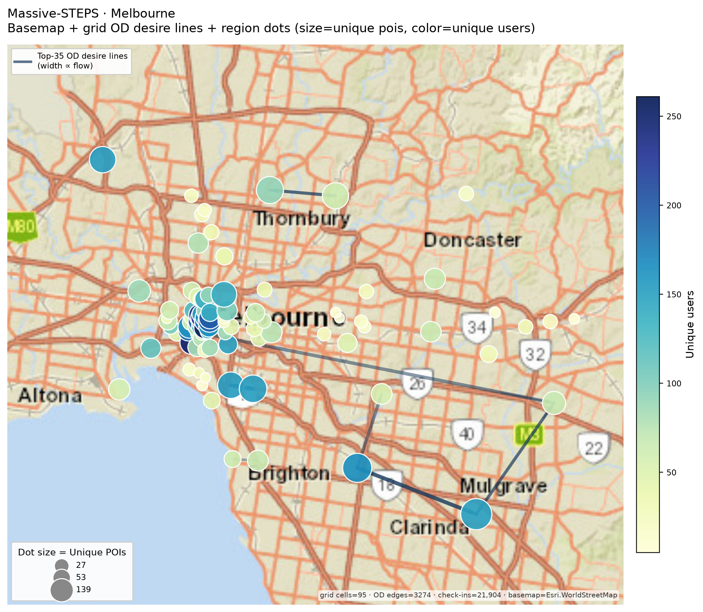
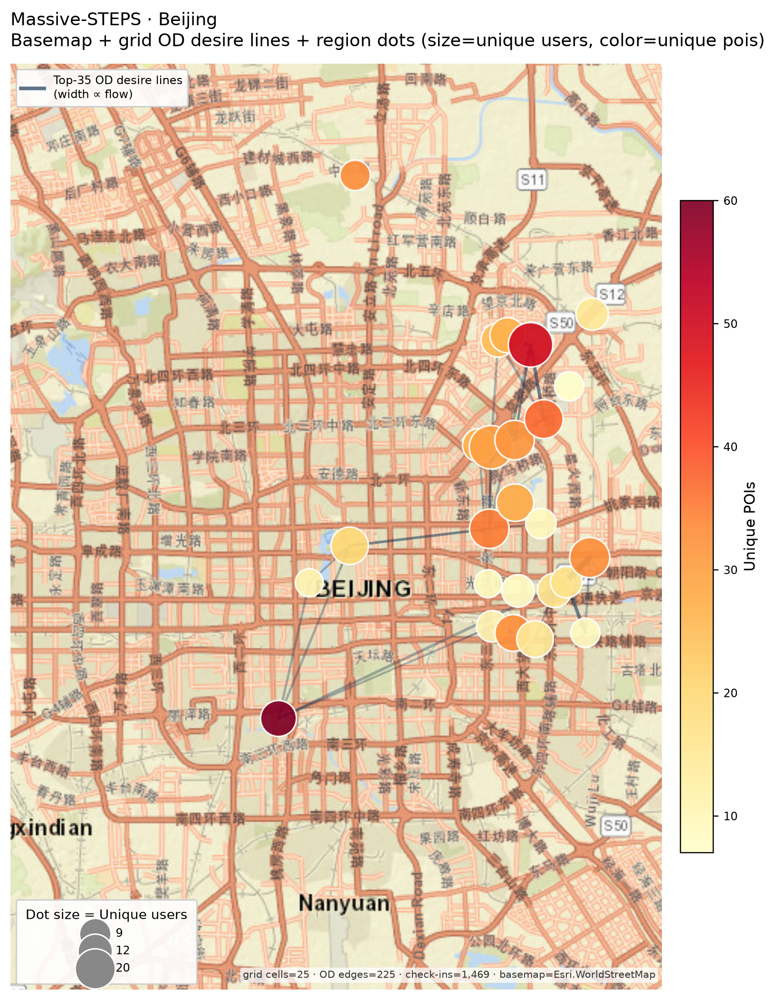
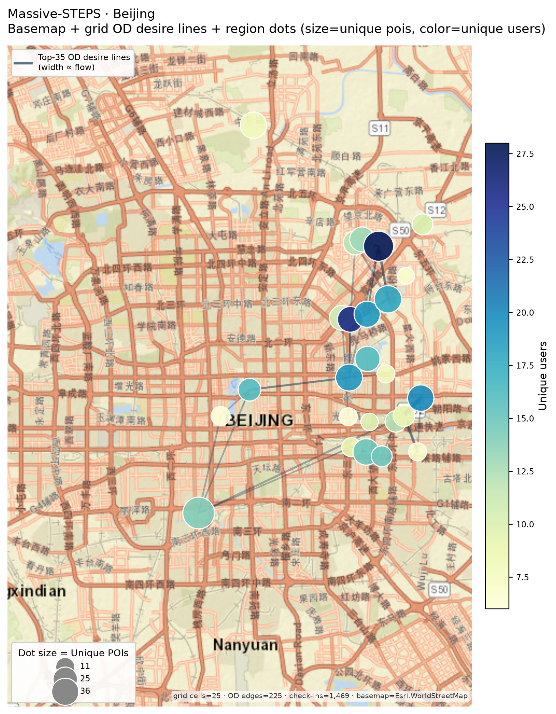
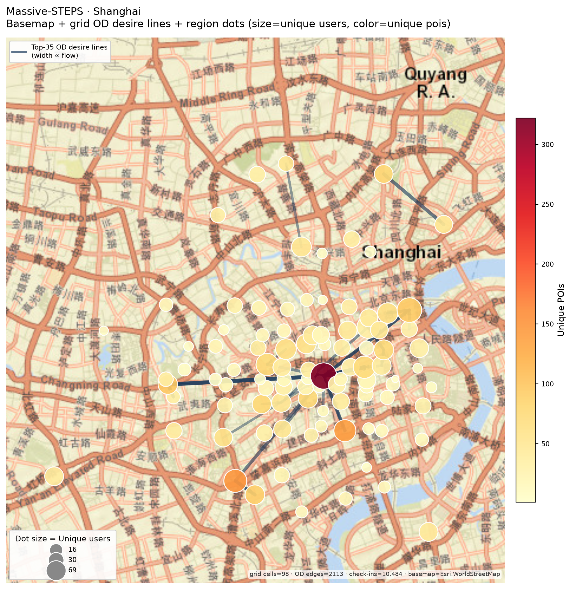
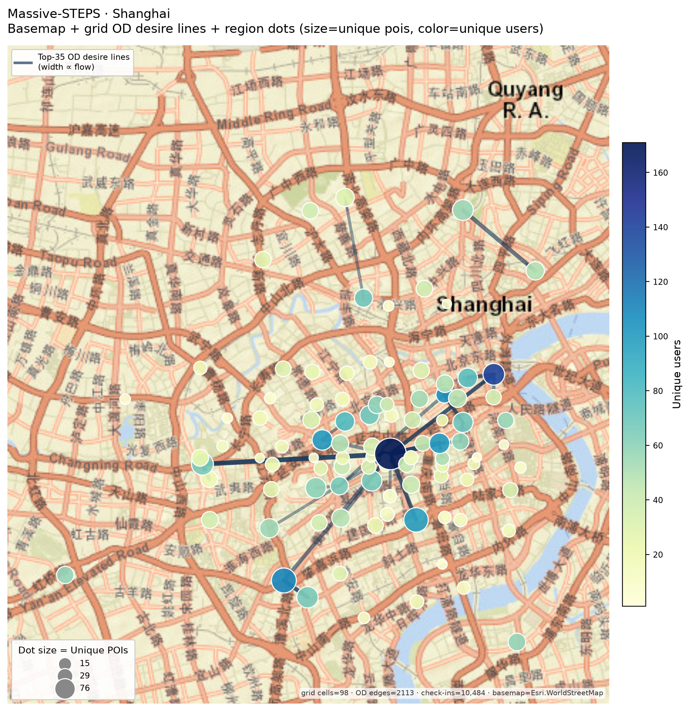

# Massive-STEPS：城市底图 + OD 流向 + 区域圆点

相对此前 [`massive-steps-research-figures/`](massive-steps-research-figures/) 里的纯散点 desire lines，本目录图在 **真实城市底图** 上叠加流向与区域统计圆点。

**城市：** Tokyo · Melbourne · Beijing · Shanghai（HF `*_checkins_{train,validation,test}.csv` 合并）  
**底图：** Esri WorldStreetMap（`contextily`；失败时回退 OSM Mapnik / Topo，再不行用浅色地理网格）  
**分区：** 经纬度分位数网格（约 5×5–10×10）；圆点落在格子质心  
**流向：** 同 `trail_id` 内相邻 check-in 构成 OD；只画 **Top-35** desire lines（线宽 ∝ 流量）

## 编码（每城两张）

| 文件后缀 | 圆点大小 | 圆点颜色 |
|----------|----------|----------|
| `*_basemap_flow_users_dots.png` | 区域 **独立用户数** | 区域 **独立 POI 数**（YlOrRd） |
| `*_basemap_flow_pois_dots.png` | 区域 **独立 POI 数** | 区域 **独立用户数**（YlGnBu） |

图内另有：流向图例、点大小图例、颜色条；脚注含格子数 / OD 边数 / check-in 数 / 底图源。

## 图册

### Tokyo

### Melbourne

### Beijing

### Shanghai

## 文件清单

目录：[`massive-steps-map-overlays/`](massive-steps-map-overlays/)

| 文件 | 说明 |
|------|------|
| `{city}_basemap_flow_users_dots.png` | 底图 + Top-35 流向 + 用户大小 / POI 颜色 |
| `{city}_basemap_flow_pois_dots.png` | 底图 + Top-35 流向 + POI 大小 / 用户颜色 |
| `{city}_grid_region_stats.csv` | 格子质心与 users/POIs/check-ins |
| `{city}_top_od_flows.csv` | Top-35 OD 边及起讫坐标 |

相关报告：[`massive-steps-research-angles.md`](massive-steps-research-angles.md)（研究角度与早期无底图 OD 图）。
