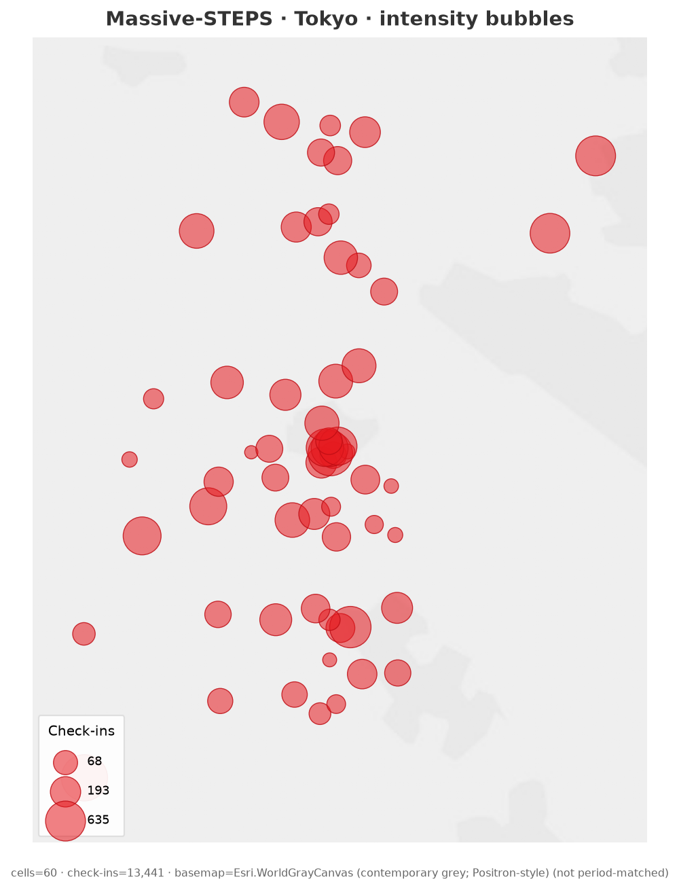
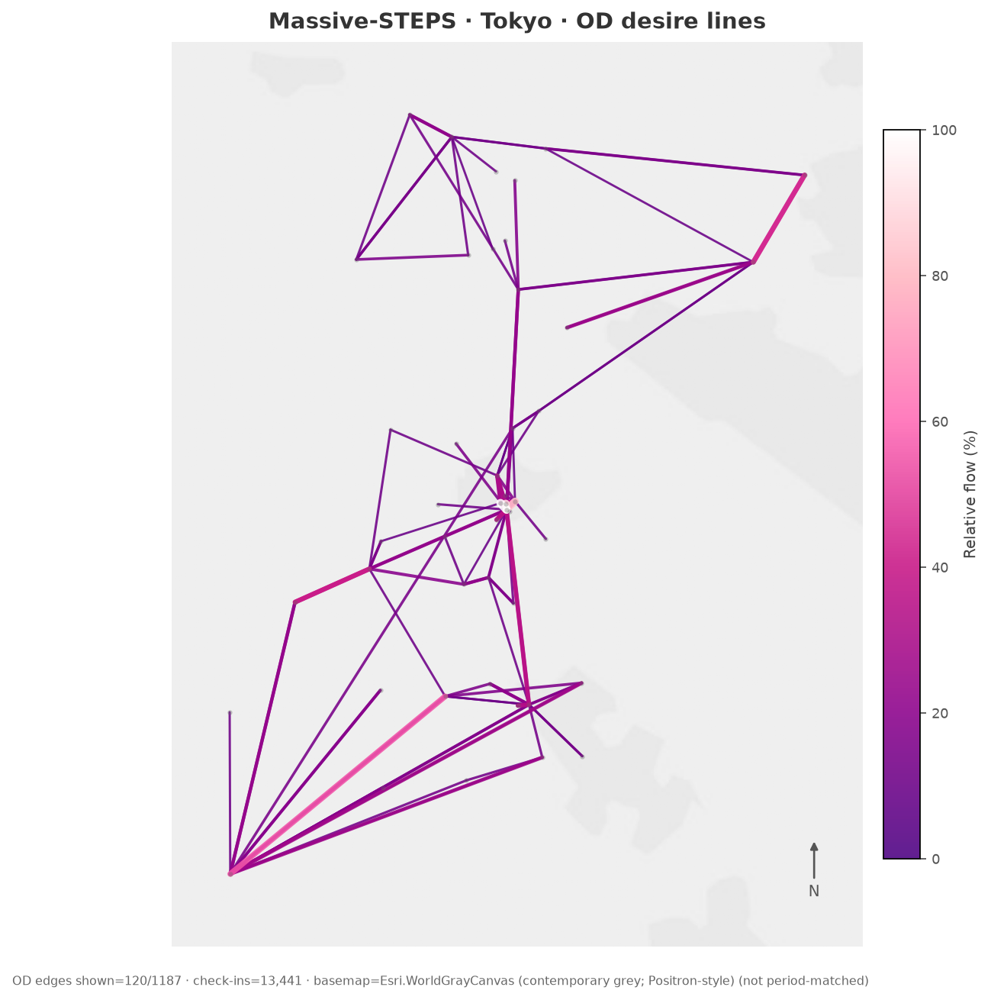
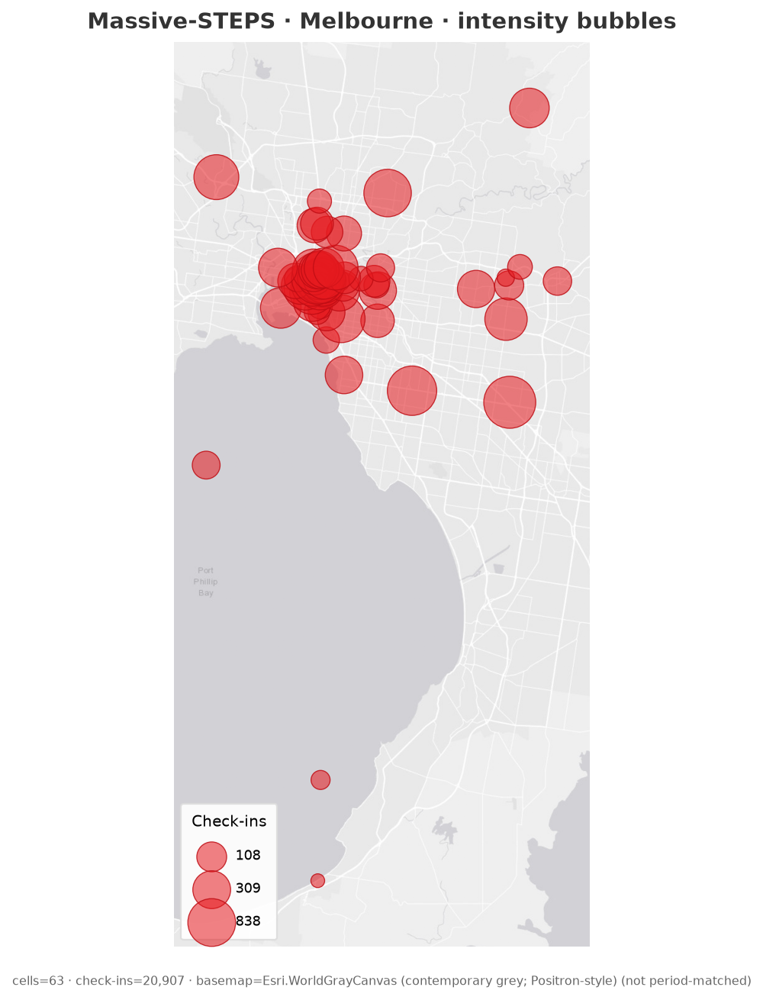
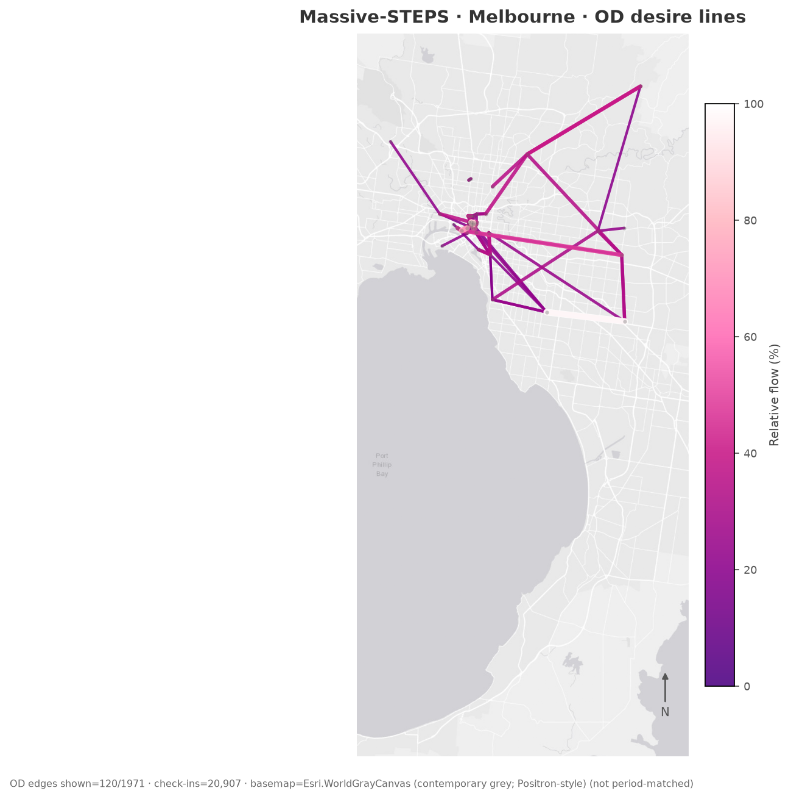
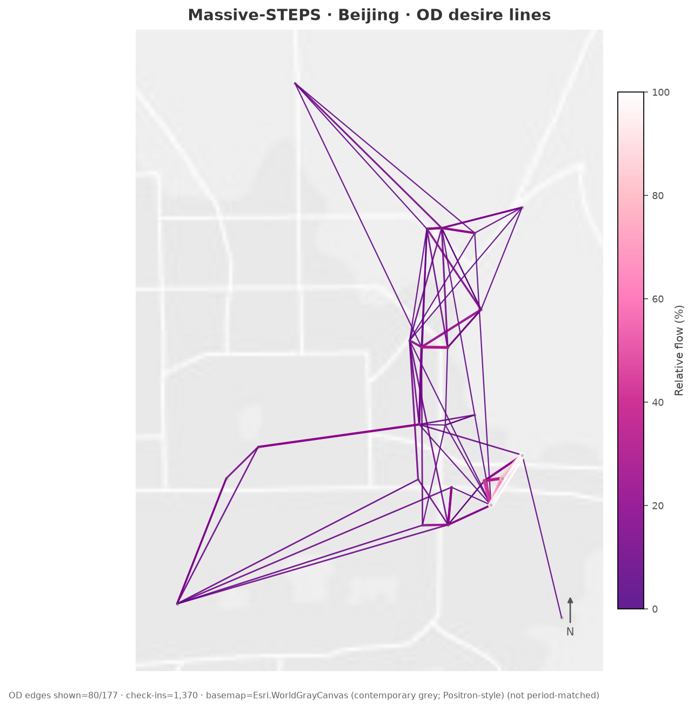
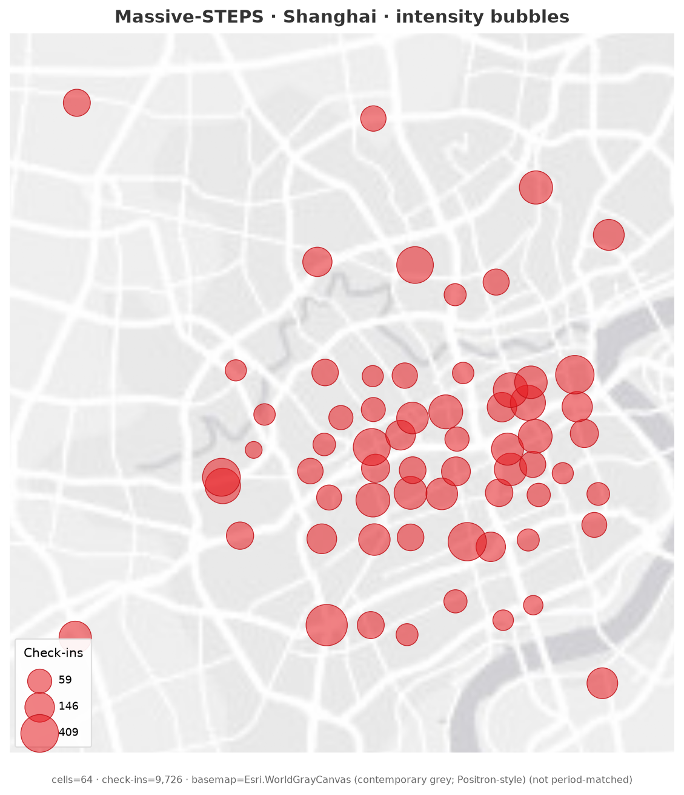
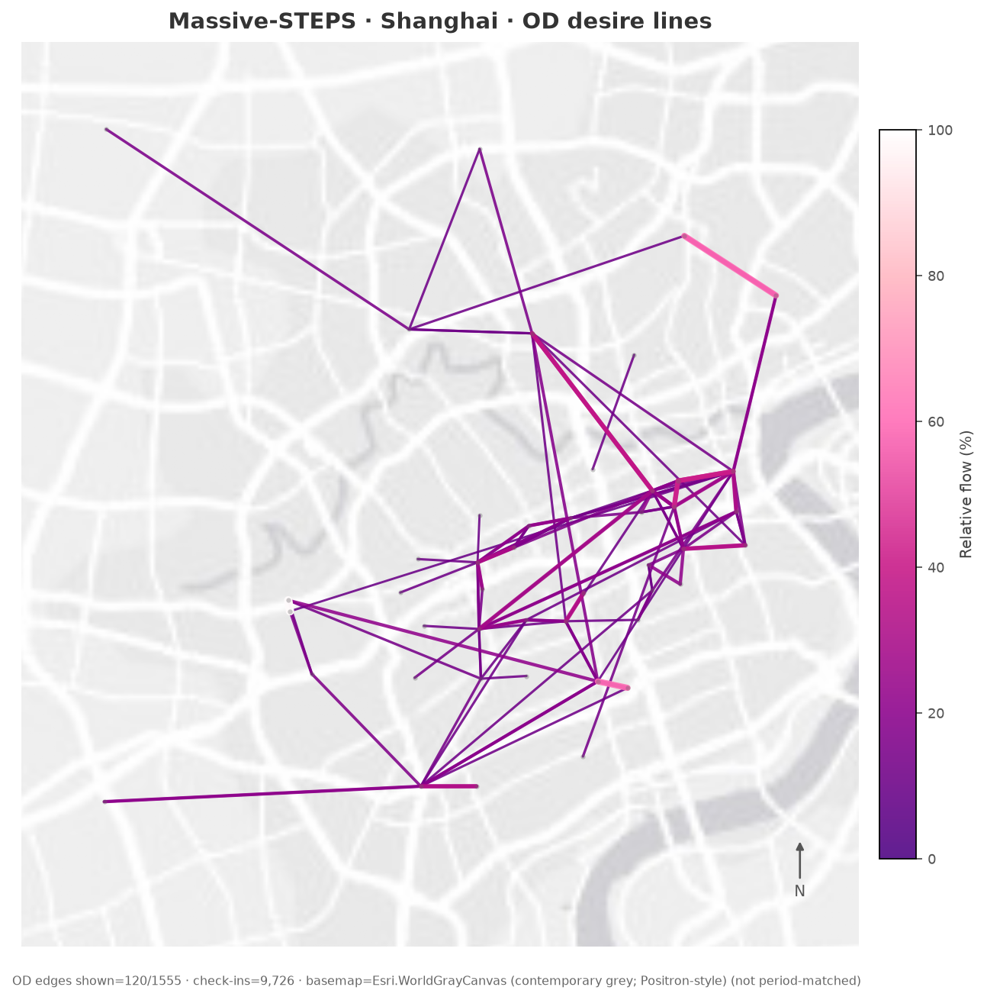

# Massive-STEPS：极简灰底图气泡 / 流向图

相对此前彩色街道路网底图（[`massive-steps-map-overlays/`](massive-steps-map-overlays/)），本目录按用户参考图审美重绘：**浅灰土地 / 白边海洋感的极简底图**，不做彩色 Esri 街道图。

**风格对齐：** 气泡图 = 亮红半透明比例圆；流向图 = 紫→粉→白相对流量着色 + 线宽，colorbar「Relative flow (%)」。参考图路径在本机未挂载，按描述复现。

**底图说明（重要）：** 底图为 **当代** 浅灰瓦片（`Esri.WorldGrayCanvas`，Carto Positron 同系极简灰；Positron 当前需 API key 故未用）。**并非** 2012–13 / 2017–18 数据期路网，**不声称历史准确性**。

**城市 / 数据：** Tokyo · Melbourne · Beijing · Shanghai；HF 全量 `*_checkins.csv`。分位数网格质心；同 `trail_id` 相邻 check-in 为 OD。气泡与流向分图，避免叠加杂乱。

## 编码

| 文件 | 含义 |
|------|------|
| `{city}_minimal_bubbles.png` | 灰底图 + 红色半透明比例圆（大小 ∝ 格子 check-in 数） |
| `{city}_minimal_flows.png` | 灰底图 + Top OD desire lines（色/宽 ∝ Relative flow %；北向箭头） |

## 图册

### Tokyo

### Melbourne

### Beijing

### Shanghai

## 文件

目录：[`massive-steps-minimal-maps/`](massive-steps-minimal-maps/) — 每城两张 PNG，另附 `*_grid_region_stats.csv` / `*_top_od_flows.csv`。
