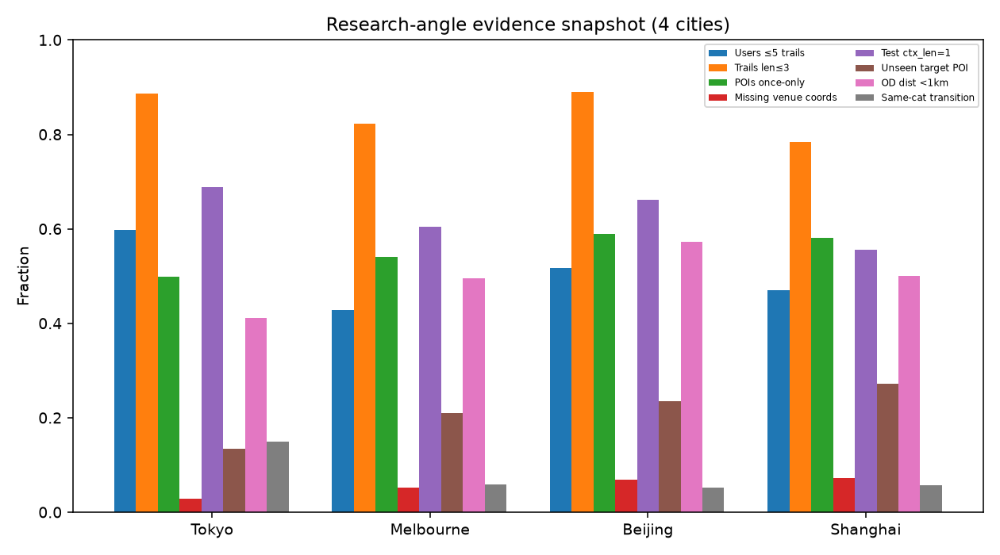
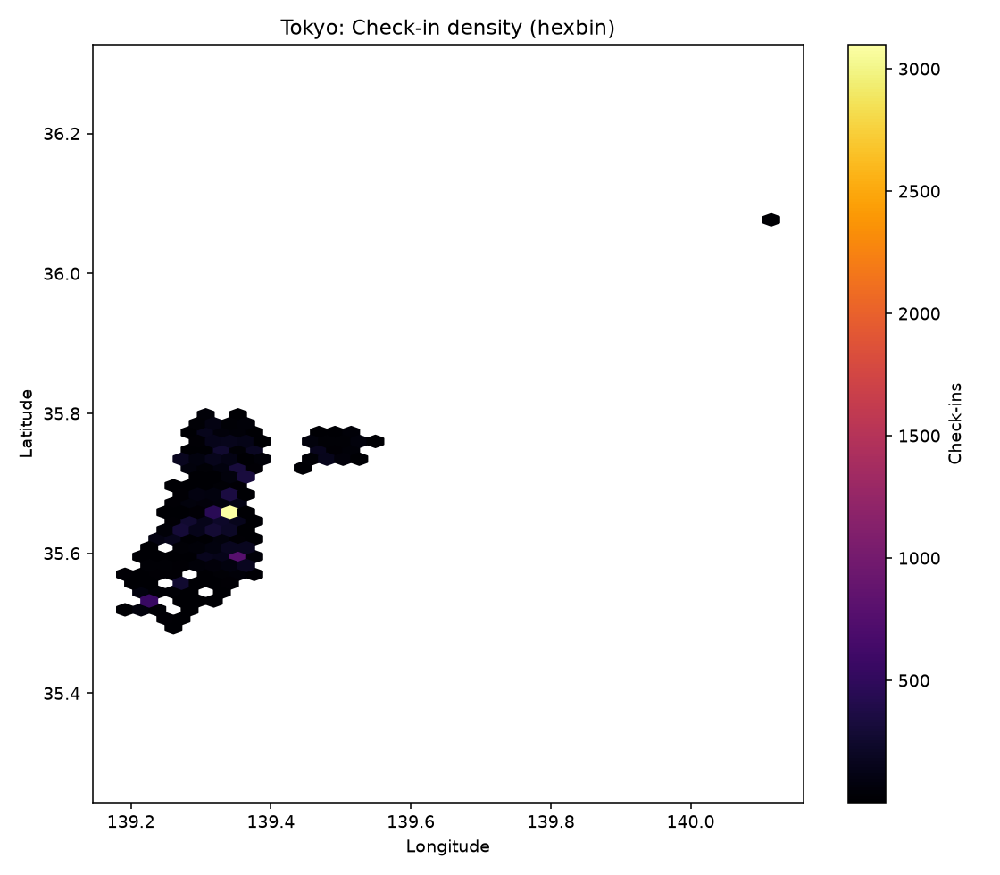
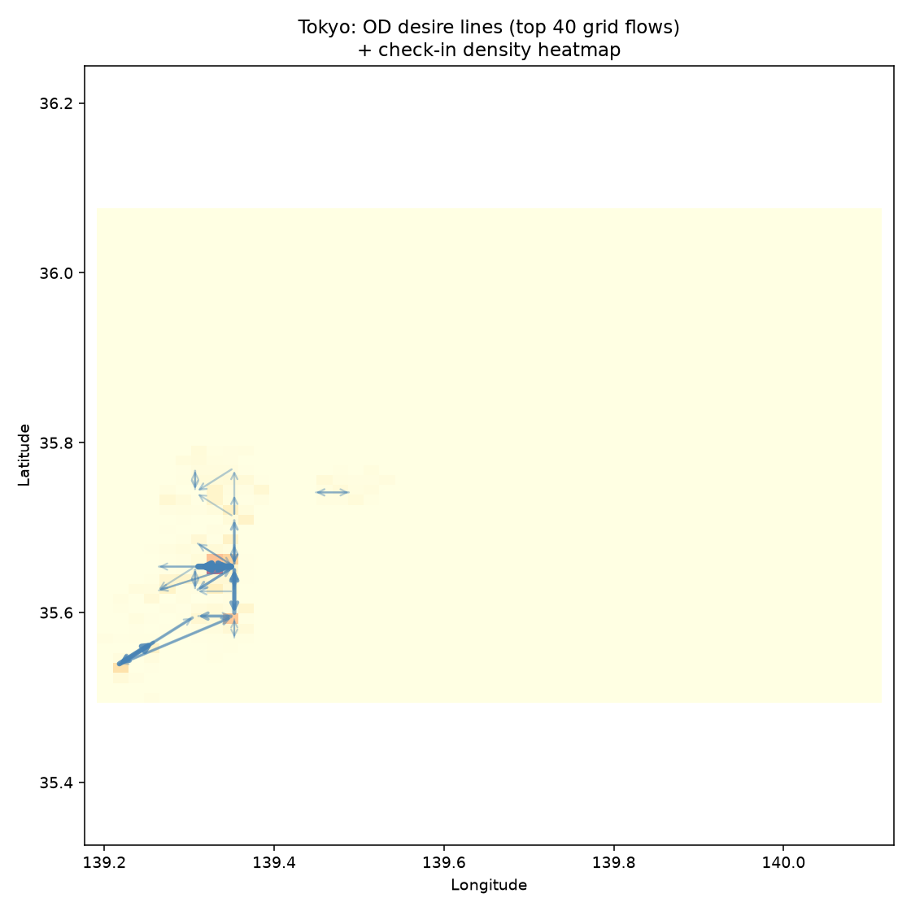
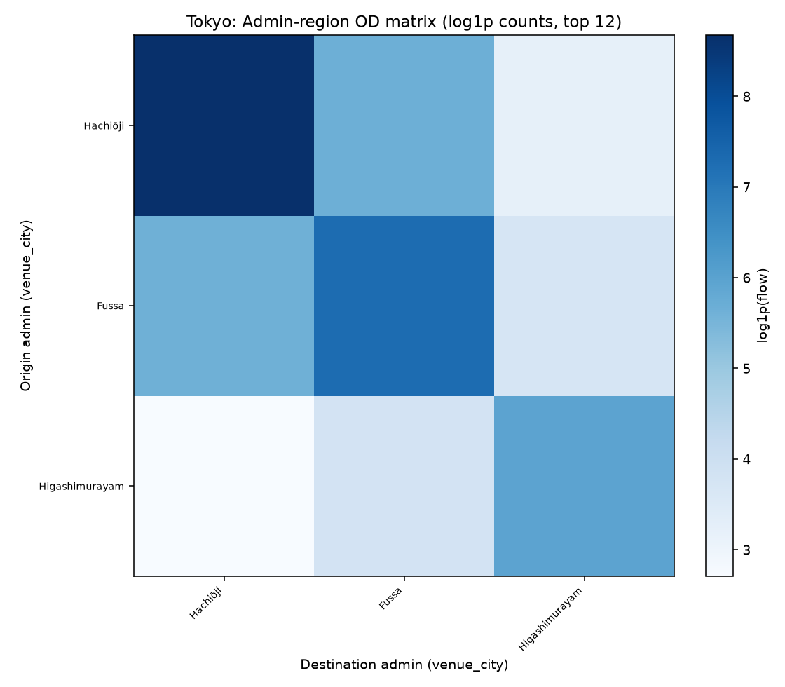
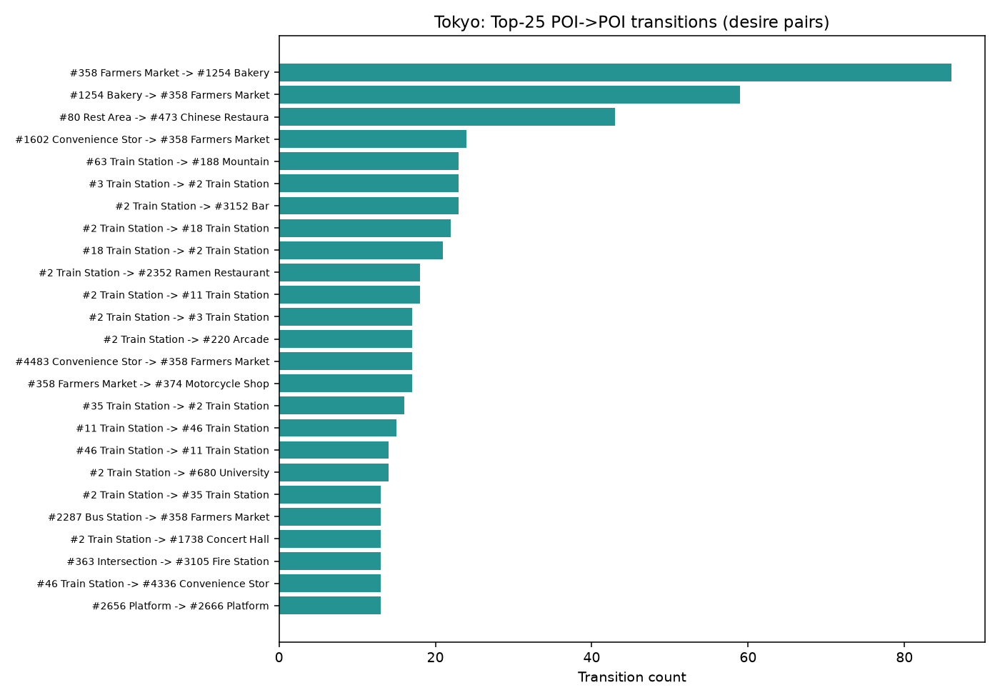
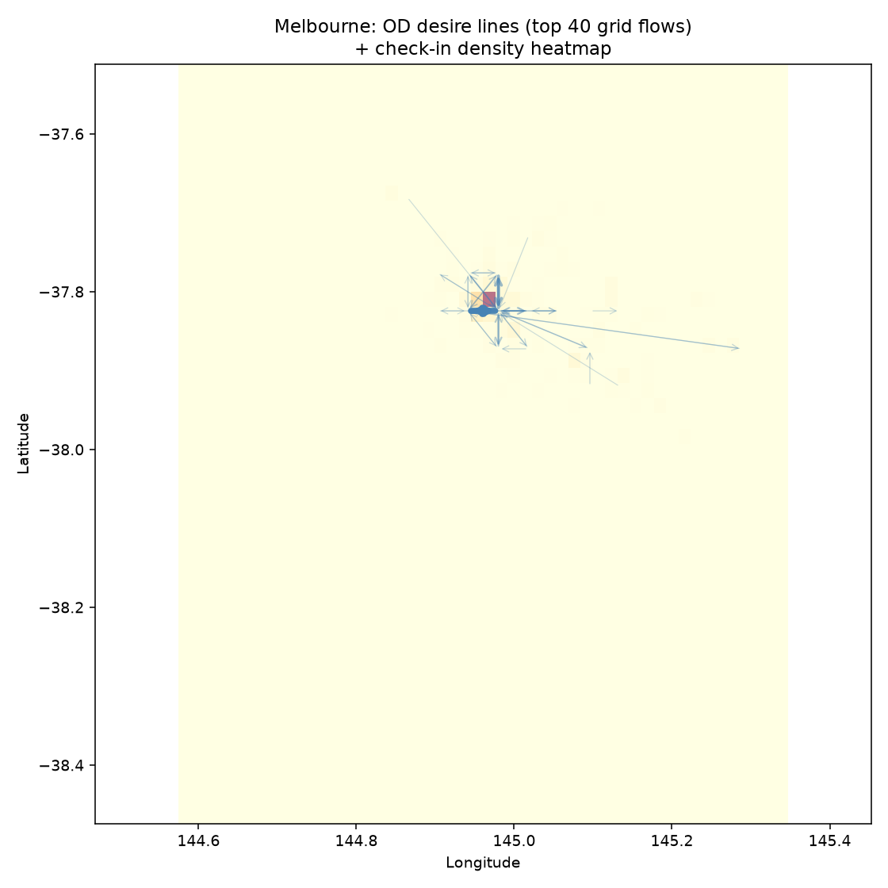
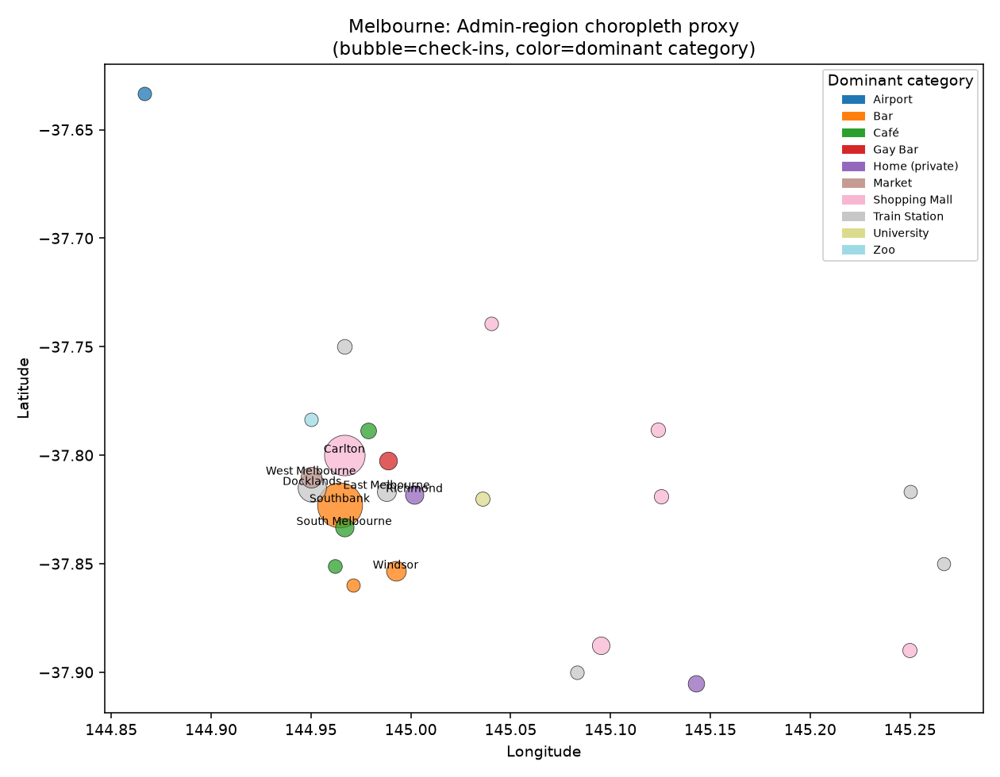
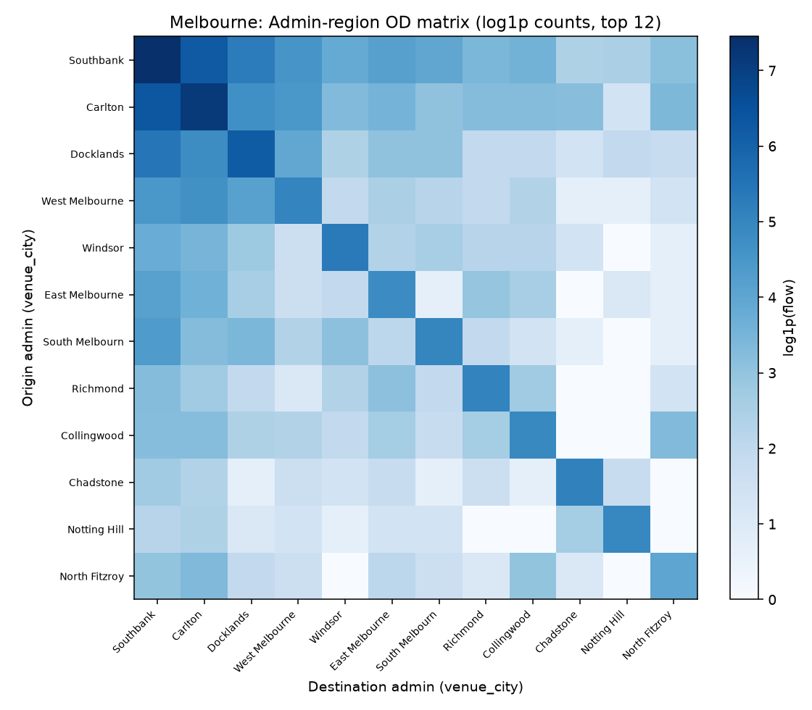

# Massive-STEPS：可做的研究方向、轻量基线与 OD 可视化

**定位：** 在已有数据画像报告（[`massive-steps-dataset-analysis.md`](massive-steps-dataset-analysis.md)）之上，聚焦**研究问题**（非数据如何构建）。用户信任 Massive-STEPS 的构建质量，本报告回答：数据支撑哪些现象与开放问题、简单基线能打到什么分数、如何用地图/OD 图呈现移动结构。

**评测城市（轻量）：** Tokyo · Melbourne · Beijing · Shanghai（HF 官方 `*_checkins_{train,test}.csv`）  
**指标：** next-POI 预测 **Acc@1 / Acc@5 / Acc@10**（与论文主表 Acc@1 对齐；本报告额外报 @5/@10）  
**证据标注：** **[measured]** 本机实测 · **[cited]** 论文/README

**产物目录：** [`massive-steps-research-figures/`](massive-steps-research-figures/) · 旁路 CSV 见文末

---

## 0. 术语：用户要的「那种图」叫什么？

中文里常被说成「OD 图 / 流向图 / 期望线」。标准叫法：

| 英文 | 中文常用名 | 含义 |
|------|------------|------|
| **OD matrix**（Origin–Destination matrix） | 起讫矩阵 / OD 矩阵 | 行=起点区域，列=终点区域，单元格=出行/转移次数 |
| **Desire lines** | 期望线 | 把 OD 量画成起点→终点的直线/曲线，线越粗流量越大（不考虑真实路网） |
| **Flow map** | 流量图 / 流向图 | 在地图上画方向流量；期望线是 flow map 的一种 |
| **Check-in density heatmap** | 签到密度热力图 | 空间上的活动强度（hexbin / KDE 等） |
| **Choropleth** | 分级设色图 | 按行政单元上色（本报告用 `venue_city` 作代理） |

本报告对每城产出：密度 hexbin、网格 desire lines、admin OD 矩阵、类别气泡 choropleth、Top POI→POI 转移条形图。

---

## 1. 研究角度（带实测证据）

下表为四城核心证据快照；完整数值见 [`massive-steps-research-evidence.csv`](massive-steps-research-evidence.csv)。

### 1.1 短轨迹 / 极短上下文 next-POI

**现象：** 绝大多数轨迹只有 2–3 次 check-in；预测时上下文常为 **1 步**。

| city | trail_len≤3 占比 [m] | test 中 ctx_len=1 占比 [m] | test ctx≤2 [m] |
|------|---------------------:|---------------------------:|---------------:|
| Tokyo | 0.886 | 0.688 | 0.876 |
| Melbourne | 0.823 | 0.604 | 0.819 |
| Beijing | 0.890 | 0.661 | 0.913 |
| Shanghai | 0.783 | 0.555 | 0.782 |

**开放问题**
- 「序列模型」优势是否主要来自 **非序列信号**（user 习惯、POI 流行度、一跳转移）？
- 如何为 **单步上下文** 设计更强的空间/语义先验，而不是堆更深 Transformer？
- 长轨迹稀有：是否应单独报 **长轨迹子集** 指标，避免被短轨迹淹没？

**基线旁证 [m]：** Tokyo 上 Markov1 在 ctx_len=1 时 Acc@1=0.127，ctx≥3 时反为 0.103——短上下文并不天然更难（转移表对热门边很有效）。

### 1.2 Cold-start / 用户活跃长尾

**现象：** 大量用户只有极少 trails；官方切分虽保证用户在 train 出现，但 **训练 trails 仍很少**。

| city | users≤5 trails [m] | Markov Acc@1 cold(≤3 train trails) / warm(>10) [m] |
|------|-------------------:|-----------------------------------------------------|
| Tokyo | 0.598 | 0.106 / 0.143 |
| Melbourne | 0.427 | 0.027 / 0.080 |
| Beijing | 0.518 | 0.105 / 0.310 |
| Shanghai | 0.470 | 0.011 / 0.091 |

Beijing 上 cold→warm 的 Markov Acc@1 从 ~0.11 升到 ~0.31，说明 **个性化历史量** 是主要难度轴之一。

**开放问题**
- 严格 **user-disjoint** 切分下，现有监督 SOTA 会掉多少？（当前设定允许同用户跨 train/test）
- Cold-start 用户是否应改用 **类别/区域/文本** 先验，而不是 POI id embedding？
- Meta-learning / 跨城迁移对低资源城（Beijing 56 users）是否必要？

### 1.3 POI 长尾与未见目标

**现象：** ~50–59% POI 仅出现 1 次；test 目标 POI 在 train 中未见的比例不低。

| city | POI once-only [m] | top10% POI 占 check-ins [m] | test unseen target [m] |
|------|------------------:|----------------------------:|-----------------------:|
| Tokyo | 0.499 | 0.613 | 0.135 |
| Melbourne | 0.541 | 0.501 | 0.210 |
| Beijing | 0.589 | 0.424 | 0.235 |
| Shanghai | 0.581 | 0.502 | 0.272 |

**开放问题**
- 开放词表 / 生成式推荐：如何推荐 **从未在 train 出现** 的 POI（靠 name、address、category、坐标）？
- 长尾评估：除 Acc@k 外，是否应报 **tail-POI Acc**、coverage、厂商公平性？
- LLM-Move 类「先空间截断候选再语义排序」是否就是长尾场景的正确归纳偏置？[cited 论文中 LLM-Move 常接近或超过部分监督模型]

### 1.4 缺失坐标与空间分辨率坍缩

**现象：** venue lat/lon 缺失时回退到 `venue_city_*` 行政中心 → 多点坍缩到同一 centroid。

| city | missing venue coord [m] | OD 边至少一端缺精确坐标 [m] | OD 中位距离 km [m] | OD <1 km 占比 [m] |
|------|------------------------:|----------------------------:|-------------------:|------------------:|
| Tokyo | 0.029 | 0.052 | 1.71 | 0.411 |
| Melbourne | 0.052 | 0.093 | 1.02 | 0.495 |
| Beijing | 0.068 | 0.127 | 0.76 | 0.573 |
| Shanghai | 0.073 | 0.136 | 1.00 | 0.501 |

（更大城如 Bandung/Palembang 缺失可达 ~23–30%，见前序报告。）

**开放问题**
- 空间 GNN / 距离特征是否被 **admin centroid 伪邻近** 污染？应强制 mask 或分层建模。
- 「Home / private」类缺失是否可当作 **语义隐私标签** 而非纯噪声？
- 密度图上的尖峰既可能是真热点，也可能是 **代理坐标堆叠**——解释地图时必须声明。

### 1.5 2013 vs 2018 时段极不平衡

| city | 2013 check-in 占比 [m] | 2018 占比 [m] | Top-20 类别分布 L1 漂移 [m] |
|------|-----------------------:|--------------:|---------------------------:|
| Tokyo | 0.000 | 1.000 | N/A（无 2013） |
| Melbourne | 0.836 | 0.164 | 0.251 |
| Beijing | 0.980 | 0.020 | 0.972（2018 样本极少，不稳定） |
| Shanghai | 0.869 | 0.131 | 0.352 |

**开放问题**
- 跨 5 年概念漂移：类别流行、开闭店（论文称部分城关闭率可观 [cited]）如何进入评测协议？
- Tokyo **无法做 2013↔2018 对照**；纵向结论不可一刀切。
- 是否应发布 **period-conditioned** 指标（只在 2018→2018 / 2013→2013）？

### 1.6 跨城迁移（cross-city）

**约束 [cited+前序]：** `venue_id` **城内 ordinal**，不可直接多城联合。

**实测类别可迁移性 [m]：** 类别名 Jaccard：Melbourne–Shanghai 0.645，Tokyo–Melbourne 0.476，Tokyo–Beijing 0.302。语义层有重叠，ID 层无重叠。

**开放问题**
- 以 **category + 文本 name/address + 相对空间** 做跨城 zero-shot / few-shot。
- 低资源城（Beijing/Shanghai）是否能从 Melbourne/Tokyo 的转移结构受益？
- 「地理多样性」是否带来 **负迁移**（交通主导 Tokyo vs 餐饮/商场主导 Shanghai）？

### 1.7 语义 vs 空间：哪条信号更强？

**实测 [m]**
- **Nearest（地理最近 POI）** Acc@1 极低：Tokyo 0.009，Melbourne 0.019，Beijing 0.070，Shanghai 0.022 → **纯距离几乎不够**。
- **Markov1（POI 一跳转移）** 明显更强：Tokyo 0.119，Beijing 0.217。
- **CatMarkov（类别转移→类内热门 POI）** 弱于 POI-Markov，但强于 MostPop（Tokyo 0.057 vs 0.034）。
- test 上 **同类别转移** 比例不高：Tokyo 0.149，其余城 ~0.05–0.06 → 下一站常换类别。
- **同 admin（venue_city）内转移** 极高：Tokyo/Beijing/Shanghai ~0.91–0.99，Melbourne 仅 0.439（admin 切得更碎）。

**开放问题**
- 需要 **语义选类 + 空间消歧** 的两阶段模型（LLM-Move 路线的结构化版本）。
- Desire lines 显示流量集中在少数网格：空间先验应用在 **区域/网格**，再在区域内做语义排序。
- 重复访问弱：test 目标出现在上下文中的比例仅 ~3–7% → 不是简单「再去刚去过的店」。

### 1.8 Weekday / weekend 时空分类

论文任务：轨迹**末次** check-in 是否落在周末 [cited]。

**轻量对照 [m]**（trail 级；70/30 随机切分）

| city | 周末 base rate | Majority Acc | 末 POI 类别规则 Acc |
|------|---------------:|-------------:|--------------------:|
| Tokyo | 0.444 | 0.556 | 0.565 |
| Melbourne | 0.324 | 0.676 | 0.661 |
| Beijing | 0.297 | 0.703 | 0.686 |
| Shanghai | 0.323 | 0.677 | 0.668 |

单靠末类别几乎 **打不赢 majority**（Melbourne/Beijing/Shanghai）；Tokyo 略超一点。论文中 BoW/TF-IDF + LR/RF 约 0.55–0.75 [cited]，在周末率偏低的城很大程度上吃的是 **类别不平衡**。

**开放问题**
- 真正难的是 **接近平衡的城**（Tokyo）与需要整段轨迹推理的样本。
- 应报告 **相对 majority 的 lift**，避免虚高 accuracy。
- 结合 hour-of-day + 类别序列是否比纯文本 LLM 更稳？

### 1.9 个性化泄漏 vs 真实泛化（切分协议）

**关键发现 [m]：** **UserMostPop**（按用户历史热门 POI，不足用全局热门补齐）在四城 Acc@1 全面最强简单基线：

| city | UserMostPop Acc@1 | Markov1 Acc@1 | MostPop Acc@1 | STHGCN Acc@1 [cited] | FPMC Acc@1 [cited] |
|------|------------------:|--------------:|--------------:|---------------------:|-------------------:|
| Tokyo | **0.186** | 0.119 | 0.034 | 0.250 | 0.176 |
| Melbourne | **0.106** | 0.065 | 0.011 | 0.168 | 0.062 |
| Beijing | **0.304** | 0.217 | 0.139 | 0.453 | 0.000 |
| Shanghai | **0.114** | 0.067 | 0.022 | 0.193 | 0.084 |

Tokyo 上 UserMostPop Acc@1 ≈ FPMC；说明在 **同用户跨 split** 协议下，很大一块「可预测性」是 **回头客习惯**。复杂模型需证明超越 UserMostPop，而不只是超越 MostPop。

**开放问题：** 并行报告 (a) 官方 split (b) user-disjoint (c) time-based split，三套协议下的排行榜是否稳定？

---

## 2. 轻量 next-POI 基线结果

**协议：** 官方 train trails 拟合 → test trails 预测末 POI；候选为全城 POI；报 Acc@1/5/10。  
**模型：** MostPop · UserMostPop · Markov1 · Nearest · CatMarkov（实现轻量，非仓库子模块）。

完整表：[`massive-steps-research-baselines.csv`](massive-steps-research-baselines.csv) · 与论文对照：[`massive-steps-research-baselines-vs-paper.csv`](massive-steps-research-baselines-vs-paper.csv) · 分层：[`massive-steps-research-baseline-strata.csv`](massive-steps-research-baseline-strata.csv)

### 2.1 读数要点

1. **全局 MostPop 很弱**（大词表 + 长尾）：Melbourne Acc@1 仅 0.011。  
2. **UserMostPop ≫ MostPop**：个性化历史是最强廉价信号。  
3. **Markov1** 稳定第二：一跳转移捕获车站换乘、商场连带等结构（见 POI desire pairs 图）。  
4. **Nearest 接近失败**：与「中位 OD 仅 ~1 km、但仍有大量同距离候选」一致——近不等于会去。  
5. **相对 STHGCN [cited]：** 四城均仍有明显 gap（Tokyo 0.186→0.250；Beijing 0.304→0.453），但 gap 小于「从 0 开始」的错觉；评测新方法时务必带上 UserMostPop/Markov。  
6. **Beijing 小样本**（test 115 trails）：分数方差大，适合做方法演示，不适合做唯一结论城。

### 2.2 Weekend 轻量基线

见 [`massive-steps-research-weekend-baselines.csv`](massive-steps-research-weekend-baselines.csv)。结论：先报 majority；再谈模型 lift。

---

## 3. 地图 / OD 可视化说明与图册

### 3.1 每城固定五件套

对 Tokyo / Melbourne / Beijing / Shanghai：

| 文件模式 | 类型 |
|----------|------|
| `{city}_checkin_density_hexbin.png` | 签到密度热力图 |
| `{city}_od_desire_lines.png` | 网格 OD **desire lines**（top-40）叠密度 |
| `{city}_admin_od_matrix.png` + `.csv` | 行政名 `venue_city` **OD 矩阵** |
| `{city}_admin_category_choropleth.png` | 行政气泡：大小=签到量，颜色=主导类别 |
| `{city}_top_poi_transitions.png` + `.csv` | Top POI→POI 转移（desire pairs） |

Melbourne 制图时剔除了极少数越界坐标（保留核心 bbox ≈ 99.97% 点），避免全国尺度拉伸。

### 3.2 示例（Tokyo）

**密度：** 活动高度集中；少数 hex 承载极高计数。

**Desire lines：** 主流量在核心簇内部短距往返，符合 OD 中位 ~1.7 km、<1 km 占 41%。

**Admin OD：** Tokyo 仅少数 `venue_city`，矩阵近对角（区内移动）。

**Top POI 转移：** 以 Train Station 等枢纽边为主（条形标签用 `venue_id + category`，避免 CJK 缺字）。

### 3.3 示例（Melbourne）

Melbourne admin 更碎（同 admin 转移仅 ~0.44），desire lines 呈 **CBD 核心 + 放射状长边**，适合做「中心–郊区」OD 研究。

### 3.4 Beijing / Shanghai 图（路径）

- Beijing：[`beijing_checkin_density_hexbin.png`](massive-steps-research-figures/beijing_checkin_density_hexbin.png) · [`beijing_od_desire_lines.png`](massive-steps-research-figures/beijing_od_desire_lines.png) · [`beijing_admin_od_matrix.png`](massive-steps-research-figures/beijing_admin_od_matrix.png) · [`beijing_admin_category_choropleth.png`](massive-steps-research-figures/beijing_admin_category_choropleth.png) · [`beijing_top_poi_transitions.png`](massive-steps-research-figures/beijing_top_poi_transitions.png)
- Shanghai：[`shanghai_checkin_density_hexbin.png`](massive-steps-research-figures/shanghai_checkin_density_hexbin.png) · [`shanghai_od_desire_lines.png`](massive-steps-research-figures/shanghai_od_desire_lines.png) · [`shanghai_admin_od_matrix.png`](massive-steps-research-figures/shanghai_admin_od_matrix.png) · [`shanghai_admin_category_choropleth.png`](massive-steps-research-figures/shanghai_admin_category_choropleth.png) · [`shanghai_top_poi_transitions.png`](massive-steps-research-figures/shanghai_top_poi_transitions.png)

### 3.5 可视化启发的研究方向

1. **网格/H3 上的 flow prediction**：先预测下一格子，再预测格内 POI（降候选）。  
2. **Hub discovery**：Top POI 转移图中的车站/商场 = 图中心性节点。  
3. **跨城 flow 结构对比**：Tokyo 区内枢纽换乘 vs Melbourne CBD 放射。  
4. **缺失坐标敏感度**：重绘「仅精确坐标」vs「含 admin 回退」两套 desire lines，量化伪邻近。

---

## 4. 推荐优先攻的问题清单（可直接开题）

1. **超越 UserMostPop 的个性化**：在官方 split 上把 UserMostPop 列为必报基线；分析增益来自何处。  
2. **单步上下文专用模型**：针对 ctx_len=1 的 60–70% test 样本。  
3. **未见 POI / 长尾生成式推荐**：利用 name/address/category；单独报 unseen-target 子集。  
4. **空间–语义两阶段**：网格/OD 候选截断 + 语义重排（对齐 LLM-Move 思想，但不依赖大模型）。  
5. **坐标缺失鲁棒训练**：显式缺失 token vs 错误 centroid。  
6. **时段漂移与开闭店**：2013/2018 条件评测；Tokyo 单期特殊性。  
7. **跨城 category/text 迁移**：ID 不可用时的迁移基准。  
8. **Weekend 分类的 lift 协议**：相对 majority；轨迹级推理样本挖掘。  
9. **切分协议敏感性**：user-disjoint / time-based 重评 SOTA。  
10. **OD 结构作为归纳偏置**：用 desire-line/OD 矩阵正则化 next-POI 图模型。

---

## 5. 方法备注（复现）

- 数据：Hugging Face `CRUISEResearchGroup/Massive-STEPS-{City}` 的 CSV 切分。  
- 工作目录（非交付）：`/tmp/massive-steps-workdir/`（clone + CSV + `scripts/research_pipeline.py`）。  
- Nearest / 密度图：缺失 venue 坐标时用 `venue_city_latitude/longitude`。  
- 未跑 GETNext/STHGCN 等重模型（子模块 + GPU）；论文 Acc@1 仅作对照 [cited]。

---

## 附录：本报告文件清单

| 路径 | 说明 |
|------|------|
| [`massive-steps-research-angles.md`](massive-steps-research-angles.md) | 本报告 |
| [`massive-steps-research-evidence.csv`](massive-steps-research-evidence.csv) | 四城研究向证据 |
| [`massive-steps-research-baselines.csv`](massive-steps-research-baselines.csv) | Acc@1/5/10 |
| [`massive-steps-research-baselines-vs-paper.csv`](massive-steps-research-baselines-vs-paper.csv) | 与 STHGCN/FPMC 对照 |
| [`massive-steps-research-baseline-strata.csv`](massive-steps-research-baseline-strata.csv) | cold/warm、ctx 分层 Markov |
| [`massive-steps-research-weekend-baselines.csv`](massive-steps-research-weekend-baselines.csv) | weekend majority / 类别规则 |
| [`massive-steps-research-figures/`](massive-steps-research-figures/) | 全部图与 OD CSV |

背景画像报告：[`massive-steps-dataset-analysis.md`](massive-steps-dataset-analysis.md)。
