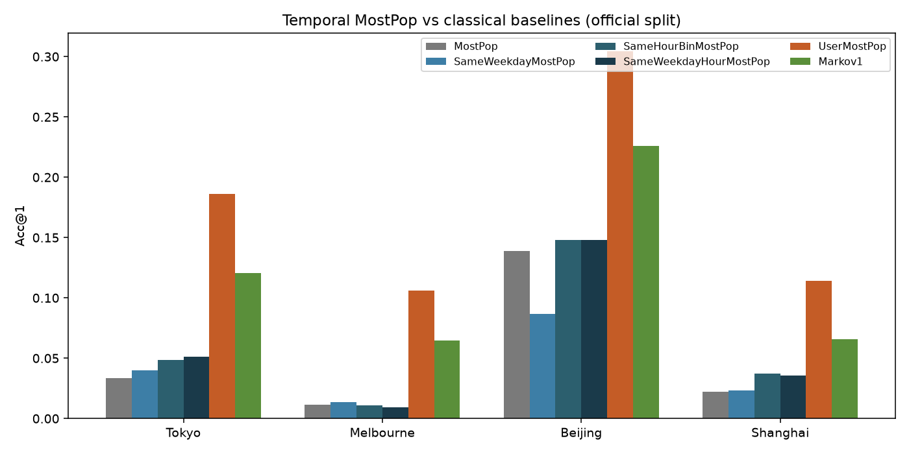
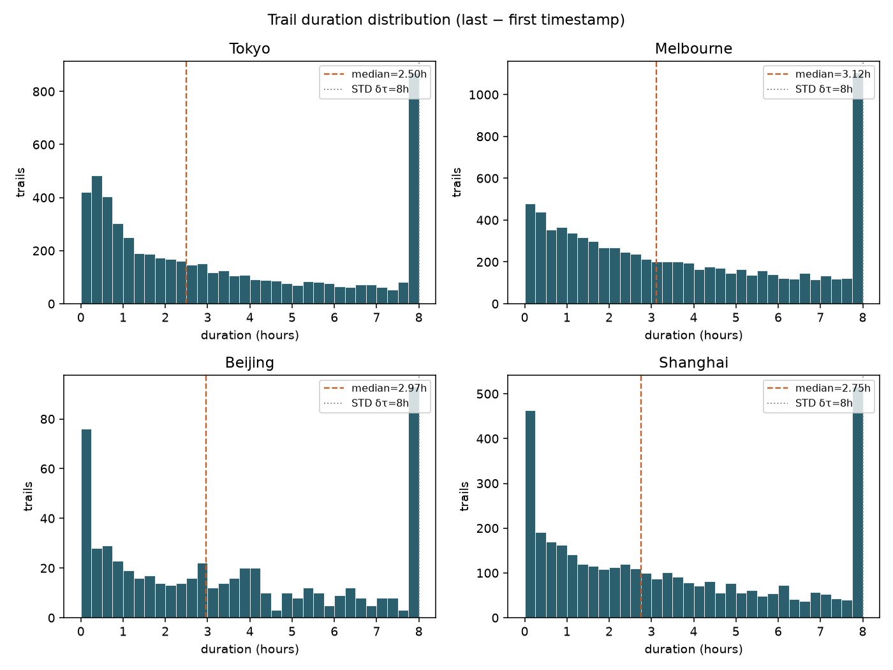

# Massive-STEPS：时间条件 MostPop 基线与轨迹时长分析

**目标：** 在廉价流行度基线族上加入 **weekday / hour-bin** 条件，并**实测**轨迹时间跨度（相对 STD δτ=8h 切段）。  
**评测城：** Tokyo · Melbourne · Beijing · Shanghai  
**指标：** next-POI **Acc@1 / Acc@5 / Acc@10**（全城 POI 候选；预测轨迹末 POI）  
**证据：** **[measured]** 本机 2026-10-28 · HF 官方 check-in CSV  
**产物目录：** [`massive-steps-temporal-baselines/`](massive-steps-temporal-baselines/)

前序：[`massive-steps-top-venue-topics.md`](massive-steps-top-venue-topics.md) · [`massive-steps-research-angles.md`](massive-steps-research-angles.md) · [`massive-steps-split-stability/`](massive-steps-split-stability/)

---

## 0. 协议与实现选择

**任务：** 给定 trail 上下文 \(c_1,\ldots,c_{L-1}\)，预测末站 \(c_L\) 的 `venue_id`。训练仅用该 split 的 train check-ins / trails。

**预测时刻：** 取 **target（末站）timestamp** 的 weekday / hour（短轨迹下与 context-last 几乎同日同时段；与「查询时刻已知」设定一致）。

**Hour bin（本报告选定）：** **4 小时箱**  
`hour_bin = hour // 4` → `[0–4), [4–8), [8–12), [12–16), [16–20), [20–24)`（共 6 箱）。未选 morning/afternoon/evening/night，因 4h 箱更细、实现对称，且与 weekday 联合时稀疏度仍可控。

**回退：** 条件桶内无 train 计数时，回退全局 MostPop，再按频次补齐至 k。

**切分：**
| 协议 | 构造 |
|------|------|
| **official** | HF `*_checkins_train.csv` fit · `*_test.csv` eval（与前序一致） |
| **user-disjoint** | 全量 CSV 上用户 80/20，`np.random.default_rng(42)` shuffle，前 20% 用户进 test；同用户全部 trails 同侧 |

---

## 1. 新基线定义

### 1.1 SameWeekdayMostPop

```
fit(train_checkins):
  for each check-in: bucket[weekday(ts)][venue] += 1
  global = MostPop(train)

predict(trail, k):
  ranked = bucket[weekday(target_ts)] by count desc
  append from global until length k
```

### 1.2 SameHourBinMostPop

同上，键为 `hour_bin = hour(target_ts) // 4`。

### 1.3 SameWeekdayHourMostPop（联合）

键为 `(weekday, hour_bin)`；空桶回退 MostPop。

对照基线：MostPop · UserMostPop · Markov1（定义同 [`massive-steps-top-venue-topics.md`](massive-steps-top-venue-topics.md) §0）。

---

## 2. Acc 结果 [measured]

完整表：[`temporal_baselines.csv`](massive-steps-temporal-baselines/temporal_baselines.csv) · 透视：[`acc1_official_pivot.csv`](massive-steps-temporal-baselines/acc1_official_pivot.csv) · [`acc1_user_disjoint_pivot.csv`](massive-steps-temporal-baselines/acc1_user_disjoint_pivot.csv) · 图：[`temporal_baselines_acc1.png`](massive-steps-temporal-baselines/temporal_baselines_acc1.png)



### 2.1 Official Acc@1

| city | MostPop | SameWeekday | SameHourBin | SameWeekdayHour | UserMostPop | Markov1 |
|------|--------:|------------:|------------:|----------------:|------------:|--------:|
| Tokyo | 0.034 | 0.040 | **0.048** | **0.051** | **0.186** | 0.120 |
| Melbourne | 0.011 | 0.013 | 0.011 | 0.010 | **0.106** | 0.065 |
| Beijing | 0.139 | 0.087 | 0.148 | 0.148 | **0.304** | 0.226 |
| Shanghai | 0.022 | 0.023 | **0.037** | 0.036 | **0.114** | 0.066 |

（小数四舍五入；精确值见 CSV。n_test：Tokyo 1097 · Mel 1573 · BJ 115 · SH 728。）

### 2.2 Official Acc@5 / Acc@10（新基线）

| city | model | Acc@5 | Acc@10 |
|------|-------|------:|-------:|
| Tokyo | SameWeekdayMostPop | 0.103 | 0.149 |
| Tokyo | SameHourBinMostPop | 0.131 | 0.183 |
| Tokyo | SameWeekdayHourMostPop | 0.125 | 0.180 |
| Melbourne | SameWeekdayMostPop | 0.039 | 0.063 |
| Melbourne | SameHourBinMostPop | 0.041 | 0.076 |
| Melbourne | SameWeekdayHourMostPop | 0.048 | 0.072 |
| Beijing | SameWeekdayMostPop | 0.174 | 0.191 |
| Beijing | SameHourBinMostPop | 0.200 | 0.270 |
| Beijing | SameWeekdayHourMostPop | 0.183 | 0.217 |
| Shanghai | SameWeekdayMostPop | 0.055 | 0.074 |
| Shanghai | SameHourBinMostPop | 0.065 | 0.092 |
| Shanghai | SameWeekdayHourMostPop | 0.066 | 0.088 |

### 2.3 User-disjoint Acc@1（摘要）

| city | MostPop≡UserMostPop | SameWeekday | SameHourBin | SameWeekdayHour | Markov1 | n_test |
|------|--------------------:|------------:|------------:|----------------:|--------:|-------:|
| Tokyo | 0.038 | 0.038 | **0.064** | 0.062 | **0.100** | 1018 |
| Melbourne | 0.006 | 0.006 | 0.010 | 0.008 | **0.018** | 1414 |
| Beijing | 0.210 | 0.150 | **0.260** | **0.260** | 0.250 | 100 |
| Shanghai | 0.014 | **0.017** | 0.008 | 0.011 | 0.009 | 783 |

Tokyo 的 user-disjoint 规模与前序 `split_meta` 对齐；Mel/BJ/SH 的 trail 计数随 RNG 用户集合而变（同 seed 构造，n_test_users 比例一致）。

### 2.4 读数

1. **时间条件相对全局 MostPop 有小幅增益**，但远小于 UserMostPop / Markov1：Tokyo Acc@1 MostPop 0.034 → SameWeekdayHour 0.051（+1.7pp），仍远低于 UserMostPop 0.186。  
2. **Hour-bin 通常 ≥ weekday**：日内时段比星期几更有区分度（Tokyo / Shanghai / Beijing）；Melbourne 上时间桶几乎无增益甚至略伤 Acc@1（稀疏 + 漂移）。  
3. **联合桶**不完全优于单因子：Tokyo 联合最好；Melbourne 联合最差（空桶回退增多）。  
4. **user-disjoint** 下个性化消失后，SameHourBin 在 Tokyo/Beijing 明显抬升 MostPop，Beijing 上甚至略超 Markov1（小样本 n=100，勿过度解读）。  
5. 结论：时间是**弱全局先验**，不能替代用户历史或一跳转移；适合作为特征/分层，而非主基线。

---

## 3. 轨迹时间跨度 [measured]

**定义：** 每条 trail 的 `duration = last_timestamp − first_timestamp`（小时）。  
**注意：** STD 用相邻 check-in 间隔 **δτ=8h** 切段——约束的是**单跳间隔**，不是总跨度。多跳串联后总时长常可 >8h；本数据中亦有少数 trail 的实测最大相邻间隔 >8h（预处理边界情况）。

逐 trail：[`trail_durations.csv`](massive-steps-temporal-baselines/trail_durations.csv) · 汇总：[`trail_duration_stats.csv`](massive-steps-temporal-baselines/trail_duration_stats.csv) · 直方图：[`trail_duration_histograms.png`](massive-steps-temporal-baselines/trail_duration_histograms.png) · 跨度 vs 长度：[`trail_span_vs_length.png`](massive-steps-temporal-baselines/trail_span_vs_length.png)




### 3.1 分布摘要（全量 CSV）

| city | n_trails | mean (h) | median (h) | p90 (h) | ≤1h | ≤4h | ≤8h | corr(span, len) |
|------|---------:|---------:|-----------:|--------:|----:|----:|----:|----------------:|
| Tokyo | 5482 | 8.39 | **2.50** | 10.07 | 0.297 | 0.638 | 0.856 | 0.16 |
| Melbourne | 7864 | 5.77 | **3.12** | 8.80 | 0.212 | 0.588 | 0.877 | 0.10 |
| Beijing | 573 | 5.35 | **2.97** | 9.55 | 0.272 | 0.613 | 0.852 | 0.27 |
| Shanghai | 3636 | 5.59 | **2.75** | 9.25 | 0.273 | 0.626 | 0.868 | 0.15 |

（mean 被极长尾拉高：Tokyo max ≈ 1862h；宜看 median / p90。）

### 3.2 读数

1. **中位跨度约 2.5–3.1h**，约 **59–64%** trails ≤4h；约 **85–88%** ≤8h。  
2. **p90 已贴近或略超 8h**——「一天内短活动」为主，但仍有一截跨多个时段的串联轨迹。  
3. **span–length 相关弱**（r≈0.10–0.27）：更长序列略更长时段，但短序列已可铺满数小时。  
4. 对模型：多数预测发生在**数小时窗口**内；强依赖「跨日节律」的表征收益有限，与 §2 时间 MostPop 弱增益一致。更有用的是 **hour-bin 内的局部流行度 / 转移**，而非粗 weekday。

---

## 4. 文件清单

| 路径 | 内容 |
|------|------|
| [`massive-steps-temporal-baselines.md`](massive-steps-temporal-baselines.md) | 本报告 |
| [`massive-steps-temporal-baselines/temporal_baselines.csv`](massive-steps-temporal-baselines/temporal_baselines.csv) | 四城 × official/user_disjoint × 6 模型 Acc@1/5/10 |
| [`massive-steps-temporal-baselines/acc1_official_pivot.csv`](massive-steps-temporal-baselines/acc1_official_pivot.csv) | Official Acc@1 透视 |
| [`massive-steps-temporal-baselines/acc1_user_disjoint_pivot.csv`](massive-steps-temporal-baselines/acc1_user_disjoint_pivot.csv) | User-disjoint Acc@1 透视 |
| [`massive-steps-temporal-baselines/temporal_baselines_acc1.png`](massive-steps-temporal-baselines/temporal_baselines_acc1.png) | Acc@1 柱状对比 |
| [`massive-steps-temporal-baselines/trail_duration_stats.csv`](massive-steps-temporal-baselines/trail_duration_stats.csv) | 跨度汇总统计 |
| [`massive-steps-temporal-baselines/trail_durations.csv`](massive-steps-temporal-baselines/trail_durations.csv) | 逐 trail 时长 |
| [`massive-steps-temporal-baselines/trail_duration_histograms.png`](massive-steps-temporal-baselines/trail_duration_histograms.png) | 时长直方图 |
| [`massive-steps-temporal-baselines/trail_span_vs_length.png`](massive-steps-temporal-baselines/trail_span_vs_length.png) | 跨度 vs 长度散点 |
