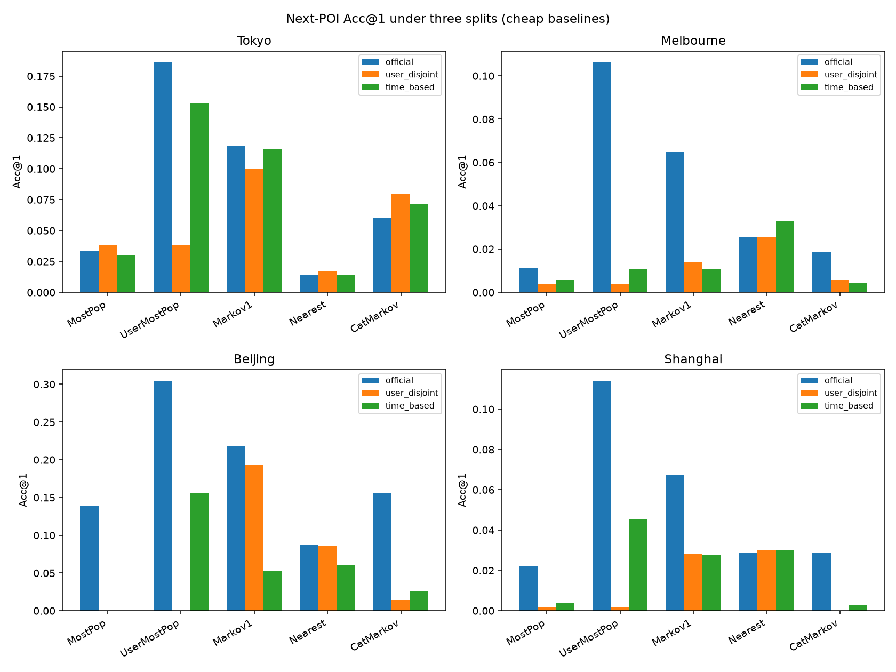

# Massive-STEPS：顶会级问题框定、基线精确定义与切分稳定性

**目标：** 在 [`massive-steps-research-angles.md`](massive-steps-research-angles.md) / [`massive-steps-dataset-analysis.md`](massive-steps-dataset-analysis.md) 之上，把廉价基线写到可复现伪代码、澄清 weekend 三项指标，并**实测**官方 / user-disjoint / time-based 三套切分下的排行榜稳定性；据此提出可投 KDD / WWW / SIGIR / SIGSPATIAL / NeurIPS-style 的具体课题。

**评测城：** Tokyo · Melbourne · Beijing · Shanghai  
**指标：** next-POI **Acc@1 / Acc@5 / Acc@10**（全城 POI 候选；预测轨迹末 POI）  
**证据：** **[measured]** 本机 2026-10-28 重跑 · **[cited]** 论文/README  
**切分结果目录：** [`massive-steps-split-stability/`](massive-steps-split-stability/)

---

## 0. 自洽基线定义（回答可独立阅读）

任务统一为：给定 trail 的上下文 check-in 序列 \(c_1,\ldots,c_{L-1}\)，预测末站 \(c_L\) 的 `venue_id`。训练仅用该 split 的 train check-ins / trails；候选集 = 该城全部出现过的 POI（坐标表来自全量 CSV，保证地理稳定）。缺失 `latitude/longitude` 时用 `venue_city_latitude/longitude`（与前序报告一致）。

### 0.1 MostPop

**特征：** 仅全局 POI 频次。

```
fit(train_checkins):
  freq[v] = count of venue_id v in train_checkins
  ranked = venues sorted by freq desc

predict(trail, k):
  return ranked[:k]
```

### 0.2 UserMostPop

**特征：** 用户历史 POI 频次；不足时回退 MostPop。

```
fit(train_checkins):
  user_freq[u][v] = count of (user_id=u, venue_id=v)
  global_ranked = MostPop ranking

predict(trail, k):
  ranked = user_freq[trail.user] sorted by count desc
  append from global_ranked until length k (skip duplicates)
  return ranked[:k]
```

在 **user-disjoint** 下，测试用户在 train 中无历史 → UserMostPop **退化成 MostPop**（本实验中 Acc 完全一致）。

### 0.3 Markov1（一阶 POI→POI）

**定义确认：** 用 train trails 统计一阶转移 \(P(v'|v)\)；预测时看**当前站**（上下文最后一站）的出边，按转移计数排序；不足 k 时用 MostPop 补齐。

**特征：** `venue_id` 转移计数；回退用全局频次。

```
fit(train_trails):
  for each trail with sequence v_1..v_L:          # context + target
    for i in 1..L-1:
      trans[v_i][v_{i+1}] += 1
  global_ranked = MostPop ranking

predict(trail, k):
  cur = trail.context[-1]
  ranked = destinations of trans[cur] sorted by count desc
  append from global_ranked (≠ cur) until length k
  return ranked[:k]
```

### 0.4 Nearest（地理最近 POI）

**定义确认：** 相对**当前 check-in 坐标**（上下文最后一站的有效 lat/lon），在全城 POI 中按 Haversine 距离排序，取最近的其他 POI（排除自身）。

**特征：** 有效坐标 `(eff_lat, eff_lon)`；POI 坐标表。

```
fit(all_pois):
  coords[v] = first non-null (eff_lat, eff_lon) for venue v

predict(trail, k):
  (lat, lon) = coords of trail.context[-1]   # with admin fallback
  candidates = all v ≠ cur, ranked by haversine((lat,lon), coords[v]) asc
  return candidates[:k]
```

> 与前序报告数值略有差（如 Tokyo Acc@1 0.014 vs 0.009）：本实现显式**排除当前 POI**，并用全城坐标表；语义与「地理最近邻」一致。

### 0.5 CatMarkov（类别转移 → 类内 MostPop）

**定义确认：** 先学类别一阶转移，取最可能下一类别；再在该类别内按 POI 频次（MostPop）排序；可继续扫次优类别直到凑满 k。

**特征：** `venue_category` 转移；类内 `venue_id` 频次。

```
fit(train_trails, train_checkins):
  for trail with categories g_1..g_L:
    for i in 1..L-1: cat_trans[g_i][g_{i+1}] += 1
  for each check-in: cat_poi_freq[category][venue] += 1

predict(trail, k):
  cur_g = trail.context_categories[-1]
  next_cats = cat_trans[cur_g] sorted by count desc  (fallback: [cur_g])
  ranked = []
  for g in next_cats:
    append venues in cat_poi_freq[g] by count desc
    stop when |ranked| >= k
  return ranked[:k]
```

### 0.6 三套切分协议

| 协议 | 构造 | 用户是否跨 split |
|------|------|------------------|
| **(a) official** | HF `*_checkins_train.csv` → fit；`*_test.csv` → eval | 是（重叠率 ~99–100%） |
| **(b) user-disjoint** | 用户 80/20 随机划分（seed=42）；用户全部 trails 进同一侧 | **否**（重叠=0） |
| **(c) time-based** | 按 trail **末 check-in 时间**排序；最早 80% train，最晚 20% test | 部分重叠（Tokyo ~90%，Mel/SH ~37%） |

元数据见 [`split_meta.csv`](massive-steps-split-stability/split_meta.csv)。

---

## 1. Q1 — Nearest / Markov1 / CatMarkov 如何实现？

见 **§0.3–0.5**。摘要：

| 模型 | 用到的字段 | 核心归纳 |
|------|------------|----------|
| Nearest | `latitude/longitude`（缺则 `venue_city_*`） | 空间最近邻，无转移/无用户 |
| Markov1 | `venue_id` 序列 | 一阶 POI 转移 + MostPop 回退 |
| CatMarkov | `venue_category` 序列 + 类内 `venue_id` 频次 | 语义选类 → 类内热门消歧 |

官方 split 上四城实测（与前序同量级）见 §3。

---

## 2. Q2 — Section 1.8：周末 base rate / Majority Acc / 末POI类别规则 Acc

论文任务：判断轨迹**末次** check-in 是否落在**周末**（周六/周日，`day_of_week ≥ 5`）。

| 术语 | 精确定义 |
|------|----------|
| **周末 base rate** | \(P(\text{末 check-in 在周末})\)，在**全城全部 trails**上统计 |
| **Majority Acc** | 永远预测**多数类**的准确率。四城周末率均 \<0.5 → 多数类=工作日 → Majority Acc \(= 1 - \text{base rate}\) |
| **末POI类别规则 Acc** | trail 级 70/30 随机切分：在 train 上对每个末站 `venue_category` 学「该类末站更常周末还是工作日」（类内均值 ≥0.5 → 周末）；test 上用末站类别查表预测；未见类别回退 majority |

**为何重要：** Melbourne/Beijing/Shanghai 上 Majority Acc 已 ~0.68–0.70；末类别规则**打不赢** majority。Tokyo 周末更接近平衡（base rate 0.444），majority 仅 0.556，类别规则略高一点（~0.565）——真正有信息增益的空间在平衡城 / 需整段轨迹推理的样本。论文 BoW/TF-IDF+LR/RF 的 0.55–0.75 [cited] 在偏斜城很大程度上吃的是类别不平衡，应报 **相对 majority 的 lift**。

重算表：[`weekend_baselines_recomputed.csv`](massive-steps-split-stability/weekend_baselines_recomputed.csv)

| city | 周末 base rate | Majority Acc | 末POI类别规则 Acc |
|------|---------------:|-------------:|------------------:|
| Tokyo | 0.444 | 0.556 | 0.565 |
| Melbourne | 0.324 | 0.676 | 0.657 |
| Beijing | 0.297 | 0.703 | 0.669 |
| Shanghai | 0.323 | 0.677 | 0.654 |

---

## 3. Q3 — 切分稳定性实测（Acc@1/5/10 + 是否翻榜）

完整数值：[`baselines_by_split.csv`](massive-steps-split-stability/baselines_by_split.csv) · 透视：[`acc1_pivot.csv`](massive-steps-split-stability/acc1_pivot.csv) · 翻榜：[`ranking_flips.csv`](massive-steps-split-stability/ranking_flips.csv) · 图：[`acc1_by_split.png`](massive-steps-split-stability/acc1_by_split.png)



### 3.1 Acc@1 摘要

| city | split | MostPop | UserMostPop | Markov1 | Nearest | CatMarkov |
|------|-------|--------:|------------:|--------:|--------:|----------:|
| Tokyo | official | 0.034 | **0.186** | 0.119 | 0.014 | 0.060 |
| Tokyo | user_disjoint | 0.038 | 0.038 | **0.100** | 0.017 | 0.080 |
| Tokyo | time_based | 0.030 | **0.153** | 0.116 | 0.014 | 0.071 |
| Melbourne | official | 0.011 | **0.106** | 0.065 | 0.025 | 0.018 |
| Melbourne | user_disjoint | 0.004 | 0.004 | 0.014 | **0.026** | 0.006 |
| Melbourne | time_based | 0.006 | 0.011 | 0.011 | **0.033** | 0.004 |
| Beijing | official | 0.139 | **0.304** | 0.217 | 0.087 | 0.157 |
| Beijing | user_disjoint | 0.000 | 0.000 | **0.193** | 0.086 | 0.014 |
| Beijing | time_based | 0.000 | **0.157** | 0.052 | 0.061 | 0.026 |
| Shanghai | official | 0.022 | **0.114** | 0.067 | 0.029 | 0.029 |
| Shanghai | user_disjoint | 0.002 | 0.002 | 0.028 | **0.030** | 0.000 |
| Shanghai | time_based | 0.004 | **0.045** | 0.028 | 0.030 | 0.003 |

Acc@5/@10 见 CSV（官方 split 上 UserMostPop 仍全面领先；user-disjoint 上 Markov1/Nearest 主导）。

### 3.2 排行榜是否翻转？

| city | official Top-1 | user-disjoint Top-1 | time-based Top-1 | 完整顺序是否跨协议一致？ |
|------|----------------|---------------------|------------------|--------------------------|
| Tokyo | UserMostPop | **Markov1** | UserMostPop | 否（仅 official≈time） |
| Melbourne | UserMostPop | **Nearest** | **Nearest** | 否（三套全不同） |
| Beijing | UserMostPop | **Markov1** | UserMostPop | 否 |
| Shanghai | UserMostPop | **Nearest** | UserMostPop | 否 |

**结论（强硬）：**

1. **官方协议下 UserMostPop 四城 Acc@1 全胜**——同用户跨 split 把「回头客习惯」算进可预测性。  
2. **user-disjoint 下 UserMostPop ≡ MostPop，Top-1 一律翻转**为 Markov1（Tokyo/Beijing）或 Nearest（Melbourne/Shanghai）。  
3. **time-based** 更接近真实部署；Melbourne 上 Nearest 反超个性化（2013→2018 漂移 + 用户重叠较低）；Tokyo 仍 UserMostPop 领先但 gap 缩小（0.186→0.153）。  
4. 任何声称 SOTA 的监督/LLM 方法，若不报 (b)(c)，结论在泛化语义上不可信。

---

## 4. 顶会级课题提案（10 题）

每题：**问题陈述 · 为何 Massive-STEPS 独特支撑 · 风险/新颖性 · 建议实验**。对齐 KDD/WWW/SIGIR（推荐与用户行为）、SIGSPATIAL（空间）、NeurIPS-style（泛化/评测协议/表示）。

### T1. 切分协议作为一等公民：Personalized Leakage vs. Cold-User / Temporal Generalization

**问题：** 在 (a)(b)(c) 三协议上联合排行榜；量化「官方 Acc 中有多少来自同用户泄漏」。  
**独特支撑：** 公开 trail 级切分 + 可重构 user/time 切分；四城已显示 **Top-1 全面翻转** [measured]。  
**风险/新颖性：** 评测论文风险低、贡献清晰；新颖性在于把 UserMostPop 设为**必报**并给出泄漏分解，而非再刷一个 GNN。  
**实验：** 重跑 FPMC/STHGCN/GETNext/LLM-Move 于三协议；报告 ΔAcc = Acc_official − Acc_user_disjoint；分层 cold/warm。

### T2. 单步上下文专用 Next-POI（Short-Context Specialists）

**问题：** test 中 ctx_len=1 占 55–69% [measured]；为单观测设计空间–语义先验，而非深序列 Transformer。  
**独特支撑：** 短轨迹是数据集常态（trail_len≤3 占 78–89%），不是边角子集。  
**风险/新颖性：** 若增益只在长轨迹出现，需诚实报分层；新颖性=「承认序列很短」的模型族。  
**实验：** 基线 Markov1/Nearest/CatMarkov vs 单步条件模型（类别×网格、贝叶斯转移）；按 ctx_len∈{1,2,≥3} 分层 Acc。

### T3. Open-Vocabulary / Unseen-POI 推荐

**问题：** test 目标 POI 在 train 未见比例 13–27% [measured]；用 name/address/category/坐标推荐开放词表 POI。  
**独特支撑：** FSQ 语义字段齐全；`venue_id` 城内 ordinal 逼出非 ID 方法；与 LLM-Move 路线可对照 [cited]。  
**风险/新颖性：** 生成式召回易刷语义相似但坐标错；需空间约束指标。  
**实验：** unseen-target 子集单独报 Acc/距离误差；对比 ID embedding vs text encoder vs LLM-Move；禁看目标 ID。

### T4. 空间–语义两阶段（Grid/OD Propose → Category/Text Rerank）

**问题：** Nearest Acc@1 极低但 user-disjoint 上可夺冠；同类别转移仅 ~5–15%；需「先区域后语义」结构化两阶段。  
**独特支撑：** 已有 desire-line / admin OD / 类别气泡图证据；LLM-Move 是无结构版本 [cited]。  
**风险/新颖性：** 两阶段不是新故事，但用 **可解释 OD 先验** 替代黑盒负采样有 SIGSPATIAL 卖点。  
**实验：** H3/网格召回@M + CatMarkov/文本重排；消融「仅空间 / 仅语义 / 两阶段」；对照 desire-line 枢纽边。

### T5. 坐标缺失作为一等公民（Missing-at-Admin-Centroid）

**问题：** 缺失坐标回退行政中心造成伪邻近；缺失率 3–7%（本四城）至 20%+（部分城）[measured/cited]。  
**独特支撑：** 显式提供 venue 与 admin 两套坐标，可做可控污染实验。  
**风险/新颖性：** 易被当成数据清洗；升格为「隐私诱导缺失」的鲁棒学习更有趣。  
**实验：** 三设置——仅精确坐标 / 含 fallback / 显式 missing token；测 Nearest 与空间 GNN 的 Acc 与 OD 距离误差；报告伪邻近边比例。

### T6. 2013↔2018 概念漂移与开闭店

**问题：** Melbourne/Shanghai 跨期类别 L1 漂移大；Beijing 2018 极少；Tokyo **无 2013** [measured]。时间切分已使 Melbourne 上 Nearest>UserMostPop。  
**独特支撑：** 双 STD 时期标签在 `trail_id` 前缀；可 period-conditioned 指标。  
**风险/新颖性：** Tokyo 无法纵向对照是威胁；应用「城×时期」设计而非一刀切。  
**实验：** 2013→2018 / 2018→2018 迁移；POI 消失检测（末期未见）；time-based 上重评 SOTA。

### T7. 跨城 Zero-Shot：Category + Text + Relative Space

**问题：** `venue_id` 不可跨城；类别 Jaccard 城间 0.30–0.65 [measured]——语义可迁移、ID 不可。  
**独特支撑：** 15 城地理与文化多样性；低资源城（Beijing 56 users）是自然 sink。  
**风险/新颖性：** 负迁移真实存在（交通主导 Tokyo vs 餐饮主导 Shanghai）；需 leave-one-city-out 协议。  
**实验：** 源城学 CatMarkov/文本编码器 → 目标城 zero-shot；对比 within-city cold-start；报城对迁移矩阵。

### T8. Weekend/Weekday：相对 Majority 的 Lift 与轨迹级推理

**问题：** 偏斜城上 majority 已很强；何种样本需要整段轨迹（而非末类别）？  
**独特支撑：** 官方 ST classification 任务 + 丰富中间 check-in。  
**风险/新颖性：** 纯刷 Acc 易被拒；**lift / balanced Acc / 难例子挖掘** 才是贡献。  
**实验：** 定义 hard set = 末类别规则与真值不一致；比较 hour+类别序列模型 vs LLM；必报 majority lift。

### T9. Hub-Aware 图模型：以 Desire-Line 中心性为归纳偏置

**问题：** Top POI 转移高度集中在车站/商场；能否用 OD 枢纽正则化 next-POI？  
**独特支撑：** 可复现的 POI 转移图与网格 desire lines（见 research-figures）。  
**风险/新颖性：** 与 GETNext 图构造重叠风险——差异应在 **flow 强度先验** 与跨城 hub 类型学。  
**实验：** 边权=转移计数的 GNN vs 均匀图；hub masking 消融；Tokyo 枢纽 vs Melbourne CBD 放射对比。

### T10. 廉价基线天花板与「何时需要深度模型」决策规则

**问题：** 给出数据可计算特征（用户历史量、ctx 长度、未见目标率、周末率）→ 预测何种基线最优，以及深度模型的最小有意义增益。  
**独特支撑：** 本报告已提供跨协议基线地板；15 城可扩展。  
**风险/新颖性：** meta-benchmark / evaluation 向，适合 NeurIPS datasets&benchmarks 或 SIGIR 短文；需避免只负向结论。  
**实验：** 多城多协议跑五基线 + 1–2 深度模型；学习「推荐用哪条基线」的分类器；发布决策树式协议卡。

### （可选延伸）T11. 长尾公平性与 Coverage

在 T3 之上加 tail-POI Acc、厂商/类别 coverage、exposure 不平等；Massive-STEPS 的 POI once-only ~50–59% 是自然长尾床。

### （可选延伸）T12. 隐私标签化的缺失坐标

把「Home/Private」类缺失当成语义隐私信号而非 MCAR 噪声（接 T5），做半监督或对抗去标识评测——需人工/启发式标签，风险较高。

---

## 5. 对用户四问的短答

1. **实现：** Nearest=当前站地理最近其他 POI；Markov1=train 一阶 POI 转移；CatMarkov=类别转移后再类内 MostPop——伪代码见 §0。  
2. **1.8：** base rate=P(末站周末)；Majority Acc=永远猜多数类；末POI类别规则=用末站类别查表猜周末/工作日（§2）。  
3. **1.9：** 三协议已跑；**官方 UserMostPop 全胜，user-disjoint 全面翻榜（Markov1/Nearest），time-based 部分翻榜**——详表 §3 与 `massive-steps-split-stability/`。  
4. **课题：** T1–T10（+T11/T12）见 §4；优先 T1（切分泄漏）、T3（unseen POI）、T4（空间–语义两阶段）、T7（跨城）。

---

## 附录：文件清单

| 路径 | 说明 |
|------|------|
| [`massive-steps-top-venue-topics.md`](massive-steps-top-venue-topics.md) | 本报告 |
| [`massive-steps-split-stability/baselines_by_split.csv`](massive-steps-split-stability/baselines_by_split.csv) | 四城×三协议×五模型 Acc@1/5/10 |
| [`massive-steps-split-stability/acc1_pivot.csv`](massive-steps-split-stability/acc1_pivot.csv) | Acc@1 透视 |
| [`massive-steps-split-stability/rankings_by_split.csv`](massive-steps-split-stability/rankings_by_split.csv) | 各协议名次 |
| [`massive-steps-split-stability/ranking_flips.csv`](massive-steps-split-stability/ranking_flips.csv) | 翻榜摘要 |
| [`massive-steps-split-stability/split_meta.csv`](massive-steps-split-stability/split_meta.csv) | 切分规模与用户重叠 |
| [`massive-steps-split-stability/weekend_baselines_recomputed.csv`](massive-steps-split-stability/weekend_baselines_recomputed.csv) | 周末三项指标重算 |
| [`massive-steps-split-stability/acc1_by_split.png`](massive-steps-split-stability/acc1_by_split.png) | Acc@1 柱状对比图 |

前序：[`massive-steps-research-angles.md`](massive-steps-research-angles.md) · [`massive-steps-dataset-analysis.md`](massive-steps-dataset-analysis.md)
