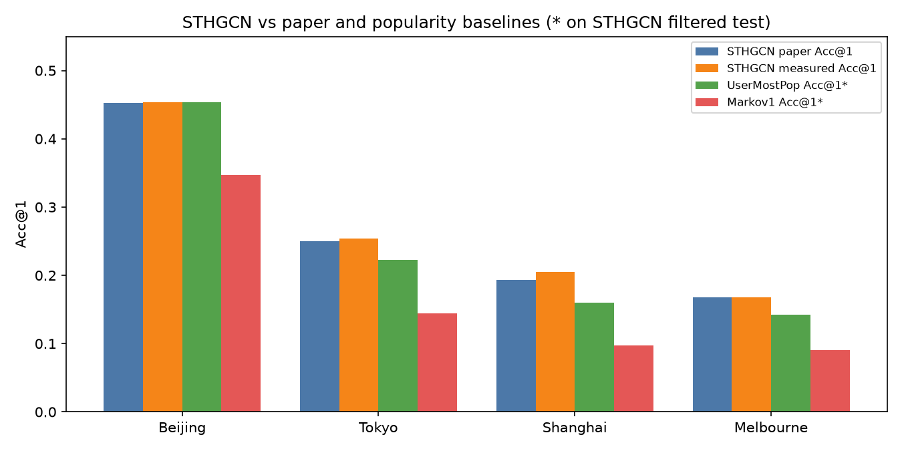
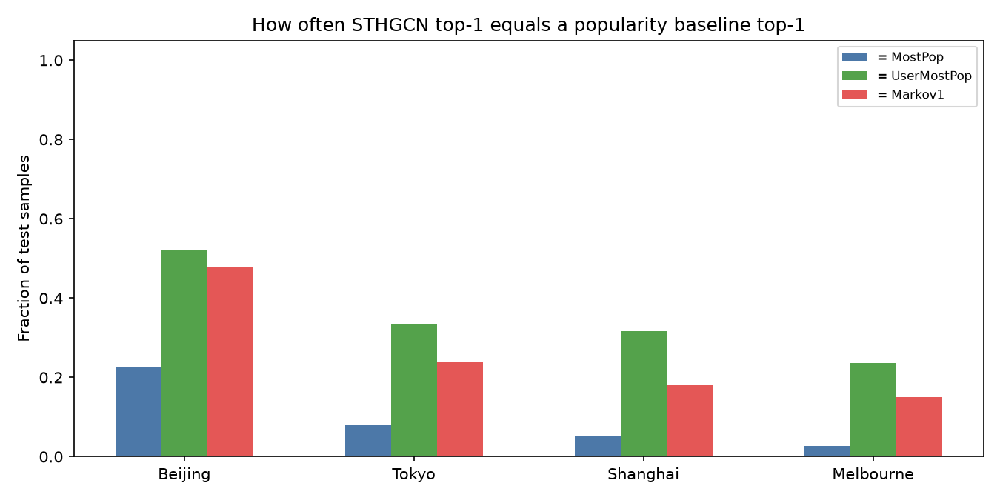
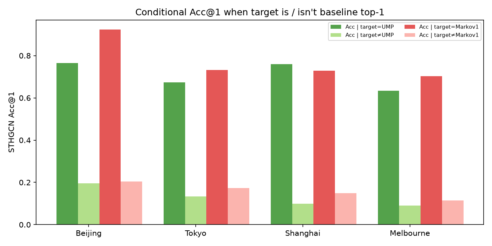

# STHGCN on Massive-STEPS — Acc vs paper & popularity bias

**Source:** [Massive-STEPS](https://github.com/cruiseresearchgroup/Massive-STEPS) · [STHGCN fork](https://github.com/w11wo/Spatio-Temporal-Hypergraph-Model) · [arXiv:2505.11239](https://arxiv.org/abs/2505.11239)  
**Cities (CPU-feasible):** Tokyo · Beijing · Shanghai · Melbourne  
**Data:** full Hugging Face official splits (`train`/`validation`/`test`; `covers_full_csv=True`)  
**Device:** CPU (`gpu: -1`); paper `std_conf/{city}.yml` (seed `54607333`, 20 epochs)  
**Artifacts:** [`sthgcn-bias/`](sthgcn-bias/)

---

## 1. Setup

| item | value |
|------|-------|
| HF repos | `CRUISEResearchGroup/Massive-STEPS-{Tokyo,Beijing,Shanghai,Melbourne}` |
| Code | Massive-STEPS submodule `Spatio-Temporal-Hypergraph-Model@758c50b` |
| Config | `conf/std_conf/{city}.yml` with `gpu: -1` only |
| Metric | Recall@k ≡ Acc@k (full POI candidate set after LabelEncode on train) |
| Eval set | STHGCN preprocessed `test_sample.csv` (official test trails, last check-in only, unseen user/POI removed) |

Provenance: [`sthgcn-bias/hf_download_provenance.csv`](sthgcn-bias/hf_download_provenance.csv).

**Note on spatial features.** The Massive-STEPS STHGCN adapter maps `venue_city_latitude/longitude` → model lat/lon (city centroid), so pairwise distances are near-zero. Temporal / collaborative hypergraph signal carries the model.

**Pandas patch.** Newer pandas broke `haversine` row apply (`x[0]` → KeyError); fixed with `.iloc` for this CPU rerun (same math).

---

## 2. Acc vs paper

| city | n_test (STHGCN) | paper Acc@1 | **measured Acc@1** | Δ | Acc@5 | Acc@10 |
|------|----------------:|------------:|-------------------:|--:|------:|-------:|
| Beijing | 75 | 0.453 | **0.453** | +0.000 | 0.653 | 0.747 |
| Tokyo | 907 | 0.250 | **0.254** | +0.004 | 0.445 | 0.506 |
| Shanghai | 493 | 0.193 | **0.205** | +0.012 | 0.331 | 0.381 |
| Melbourne | 1151 | 0.168 | **0.168** | −0.000 | 0.311 | 0.370 |

CSV: [`sthgcn-bias/acc_and_bias_table.csv`](sthgcn-bias/acc_and_bias_table.csv) · per-city metrics JSON under [`sthgcn-bias/`](sthgcn-bias/).



**图注：** Measured STHGCN Acc@1 matches the paper table within ~1pp on all four cities (Shanghai +1.2pp largest gap). On the **same** STHGCN-filtered test, UserMostPop is competitive with STHGCN (Beijing: **tied** at 0.453); Markov1 is weaker but non-trivial; global MostPop is weak outside Beijing.

---

## 3. Bias vs MostPop / UserMostPop / Markov1

Baselines fit on official **train** check-ins (raw `venue_id`); scored on the same STHGCN test rows (LabelEncode inverse). Markov1 conditions on the **second-to-last** venue in the trail (target = last).

### 3.1 How often is STHGCN top-1 a popularity baseline?

| city | = MostPop | = UserMostPop | = Markov1 | = any of three |
|------|----------:|--------------:|----------:|---------------:|
| Beijing | 0.227 | **0.520** | 0.480 | 0.733 |
| Tokyo | 0.079 | **0.333** | 0.238 | 0.492 |
| Shanghai | 0.051 | **0.316** | 0.181 | 0.442 |
| Melbourne | 0.026 | **0.235** | 0.151 | 0.349 |



**读数：** STHGCN top-1 coincides with **UserMostPop** most often (23–52%), then Markov1 (15–48%), rarely global MostPop outside Beijing. On Beijing, **¾** of predictions equal at least one of the three cheap baselines.

### 3.2 Conditional Acc@1 when the target is / isn’t that baseline

| city | Acc \| target=UMP | Acc \| target≠UMP | Acc \| target=Markov1 | Acc \| target≠Markov1 |
|------|------------------:|------------------:|----------------------:|----------------------:|
| Beijing | **0.765** | 0.195 | **0.923** | 0.204 |
| Tokyo | **0.673** | 0.133 | **0.733** | 0.173 |
| Shanghai | **0.759** | 0.099 | **0.729** | 0.148 |
| Melbourne | **0.634** | 0.090 | **0.702** | 0.115 |



**读数：** When the true next POI **is** the user’s historical mode (UMP) or the 1-step Markov mode, STHGCN Acc@1 is 0.63–0.92. When it is **not**, Acc collapses to ~0.09–0.20. The model’s headline Acc is therefore heavily driven by recovering **repeat / transition-popular** destinations rather than long-tail novelty.

### 3.3 Baseline Acc on the STHGCN test (for context)

| city | MostPop | UserMostPop | Markov1 | STHGCN |
|------|--------:|------------:|--------:|-------:|
| Beijing | 0.213 | **0.453** | 0.347 | **0.453** |
| Tokyo | 0.041 | 0.223 | 0.144 | **0.254** |
| Shanghai | 0.032 | 0.160 | 0.097 | **0.205** |
| Melbourne | 0.016 | 0.142 | 0.090 | **0.168** |

Lift over UMP (Acc_STHGCN − Acc_UMP): Beijing **0.000**, Tokyo **+0.031**, Shanghai **+0.045**, Melbourne **+0.025**.

Per-sample dumps: `sthgcn-bias/{city}_per_sample_bias.csv`.

---

## 4. Interpretation

1. **Reproduction holds on CPU.** Four-city Acc@1 tracks the Massive-STEPS paper table; Beijing/Melbourne essentially exact.
2. **Popularity / loyalty bias is large.** One-third to one-half of STHGCN top-1s are identical to UserMostPop; conditional Acc shows the model is strong mainly when the target *is* UMP or Markov1.
3. **Reported STHGCN gains vs classical neural baselines do not imply gains vs UserMostPop.** On Beijing, STHGCN ≡ UMP Acc@1 on the filtered test; on other cities the absolute lift is only 2.5–4.5pp.
4. **Eval protocol caveat.** STHGCN drops unseen users/POIs and keeps only the last check-in per trail → n_test is smaller than the full official test trail count used for some simple baselines in earlier Massive_POI reports. Bias numbers above are aligned to the **STHGCN test**, not the full HF test CSV.

---

## 5. More bias probes (designed, not all run here)

Priority probes for follow-up (same official split + dump of STHGCN top-k):

1. **Rank of UMP / Markov1 in STHGCN’s score list** — mean reciprocal rank of the baseline POI; “how far is the popular choice from top-1 when they disagree?”
2. **Disagreement set analysis** — Acc / category / distance on samples where `STHGCN_top1 ≠ UMP_top1`; is the residual lift geographically or categorically structured?
3. **Cold vs warm users** — stratify by `#train check-ins` or whether UMP is defined from ≥k visits; does STHGCN help cold users or only re-rank warm loyalty?
4. **Context length** — Acc and UMP-overlap vs `ctx_len` (trail length − 1). Short trails (majority) may collapse to UMP-like behavior.
5. **Time-conditioned UMP (UMP_DN / UMP_WW)** — overlap of STHGCN with day/night and work/weekend user modes (from MS-10/11); does the GNN rediscover time bins?
6. **Top-k set overlap** — Jaccard(STHGCN@k, UMP@k) / Markov@k for k∈{5,10}; Acc@k conditional on target∈UMP@k.
7. **Novelty / long-tail** — Acc on targets in bottom-quartile train frequency; fraction of top-1 predictions that are globally rare.
8. **Calibration / confidence** — softmax margin or entropy of STHGCN scores when pred=UMP vs when pred≠UMP (overconfidence on loyalty?).
9. **Ablation dump** — with `do_traj2traj=False` / no ST encoder (existing ablation configs), does UMP-overlap rise? Isolates which component encodes popularity.
10. **Cross-city transfer of bias** — train on city A, test B (if vocab allows via category-only); does bias pattern transfer with culture/scale?

Suggested next run order: (1)+(2)+(3) on the existing `test_preds.pt` dumps (no retrain); then (5) using already-computed UMP_DN tables; then (9) if GPU available.

---

## 6. Repro commands

```bash
# data
hf download CRUISEResearchGroup/Massive-STEPS-$City --repo-type dataset --local-dir data_hf/$City
# link into Spatio-Temporal-Hypergraph-Model/data/$city/*_checkins_*.csv
# set gpu: -1 in conf/std_conf/$city.yml
python run.py -f std_conf/$city.yml   # dumps log/.../test_preds.pt + test_metrics.json
# bias
python sthgcn_bias_analysis.py        # → docs/sthgcn-bias/
```

Analysis script (working copy): store `internal/sthgcn-bias-analysis-script.py`.
